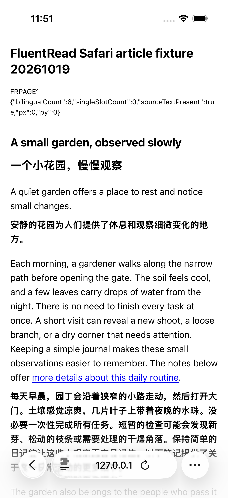
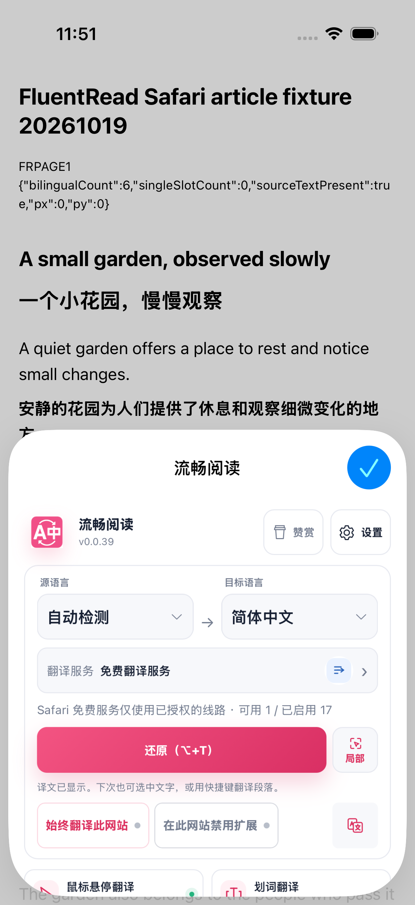
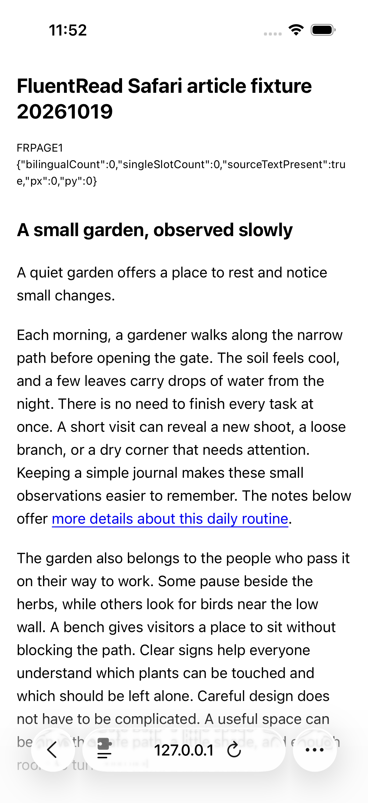

# 当前 Safari 安装包：文章翻译与恢复（2026-10-21）

当前专用 iOS 模拟器中的安装包已完成一次固定英文文章的翻译与恢复。译文节点为 0→6→0，原图中能看到双语正文、可用的还原按钮，以及恢复后的英文正文；本轮只接受已观察到的页面区域。

## 范围与实际结果

- 使用 c54 冻结源码构建并经 U3 安装的同一包，完整 App 490 文件／Web 472 文件与构建一致。05fba 仅修测试，不声称包来自干净的 05fba 构建。
- 从 Safari 正常页面菜单打开扩展 Popup，免费翻译服务显示可用 1／启用 17。点击翻译一次，等待实际还原控件可用，再关闭 Popup 查看正文；重新打开 Popup，点击还原一次并关闭，查看英文正文。
- 本次锁定“已有可用线路”分支，额外权限选择为 0，没有选择供应商或重置权限。可用线路数不能识别实际供应商，不能证明微软授权或权限保留。
- 12 AX／9 UI／3 张原图。DOM 双语节点 0→6→0、单语节点 0、固定原文子串存在，三阶段滚动均为 0。未进行整页滚动，不能证明全部正文翻译完成或恢复后像素完全相同。
- 官方为 0PASS／1SKIP／0FAIL，32.988215 秒。这是脚本预先定义的“收集完成后交由原图审查”结果；未将 SKIP 改写为 PASS。Root 外层退出 0，21 命令／42 流均正常关闭、回收且所属进程组消失，本地服务关闭；15 台模拟器最终 Shutdown，其他 14 台完整记录未变，3 次焦点采样相同。

Root 与独立审查均已逐张查看全部三张未经编辑原图，并核对 36 个 JSON、绑定、安装包与资源收尾。自动采集记录中的 paint UNKNOWN 保留；可见区结论来自另行查看原图，不由节点计数推导。

## 保留边界

未拦截提供商请求或证明缓存未命中；不验收供应商身份、全文完成／完全恢复、配置／权限保留、完整标签集合、文档 timeOrigin／无重载、实体设备或全部移动端能力。本轮已有可用线路，因此没有执行微软“允许1天”分支。Popup 底部内容超出截图可见区域，本轮不据此声称全部控件同时可见。

完整机器摘要见 [verification.json](./verification.json)。未借鉴或修改参考项目。
