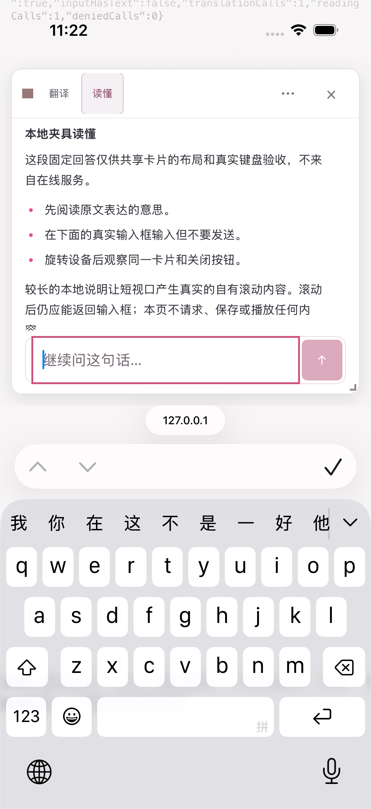
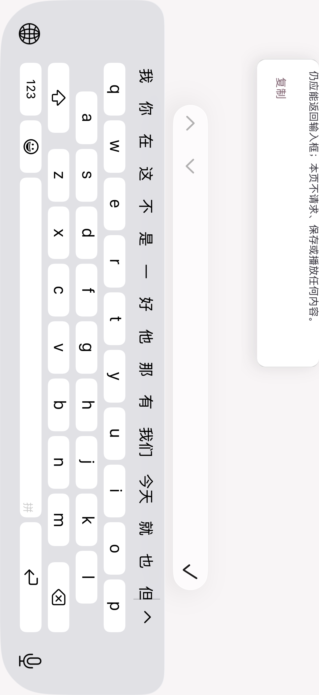
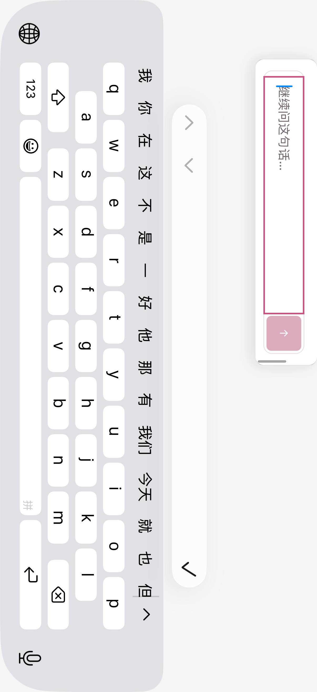
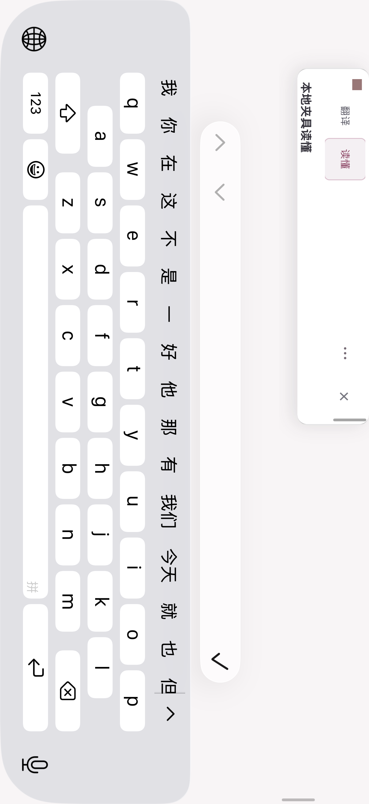

# 阅读追问：原生键盘、横屏与短视口验收（2026-10-21）

当前共享划词卡片在 iOS 模拟器中通过了原生点击聚焦、系统键盘、横屏、卡片内部正反滚动及关闭验收。横屏键盘将可用卡片高度压到 78px 时，输入框和关闭按钮通过滚动分别可达；不能将这次结果描述为两者同时常驻。

## 验收范围

本次页面编译当前任务源码中的原始 Vue 组件和样式，只将翻译、阅读回答、配置及浏览器接口替换为固定本地回答与内存拒绝端口。点击本地入口用程序化 Range 建立选择，再进入真实卡片并用原生点击聚焦真实输入框。这证明当前共享组件在系统键盘下的行为，**不证明安装扩展的正常长按选词链**，没有在线服务、输入文字、发送、权限或配置操作。

夹具实际构建包含 200 个输入，完整 1130 个 src 文件与当前原生构建的源码映射一致。安装包对应 c54 冻结源码，05fba 只修正两份测试；不声称来自干净的 05fba 构建。

## 实际结果

- 官方结果 1PASS／0SKIP／0FAIL，18.387108 秒；外层退出 0。12 个 AX 快照、8 个原动作和一次竖屏清理，4 张原图。
- 竖屏输入框可见并唤起实际系统键盘；横屏后仍保持聚焦，实际可用高度 78px，卡片可见高 78px／内容高 392px。
- 卡片 scrollTop 为 252→314→0。两次卡片手势前后，底页 scrollX=0、scrollY=557；没有将旋转前后的浏览器自动滚动算作手势隔离证明。
- 滚到底部看见输入框，反向滚回顶部看见关闭按钮。一次原关闭点击后卡片为 0、系统键盘为 0；最后恢复竖屏。
- 21 条命令／42 个输出流均正常结束、回收，所属进程组消失；专用模拟器最终 Shutdown，其他 14 个设备记录未变。3 个焦点采样均为 ChatGPT；这是采样，非连续监测。

Root 与独立审查均已逐张查看下列四张未编辑原图，并核对全部 24 个 JSON、绑定与资源关闭记录。

## 仍需验证

正常安装扩展的触摸选区链、中文输入法实际组词与发送、在线供应商、配置／权限保留、真实隐藏恢复、长后台驱逐及实体设备均未由本轮接受。横屏 78px 的结果仅说明整张卡片可滚动并能关闭，不代表所有控件同时可见。

原始机器记录由 verification.json 保存；没有借鉴或修改参考项目。
