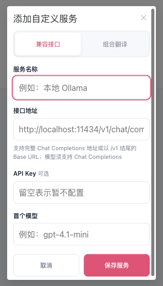
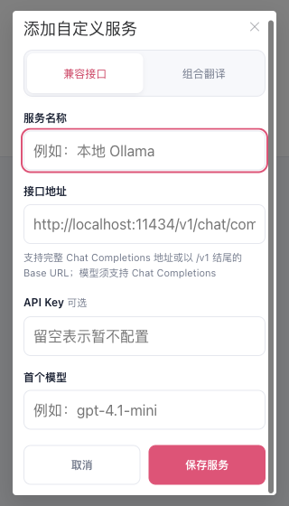
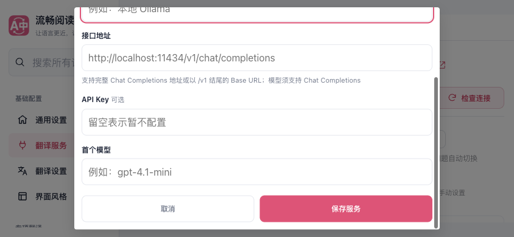
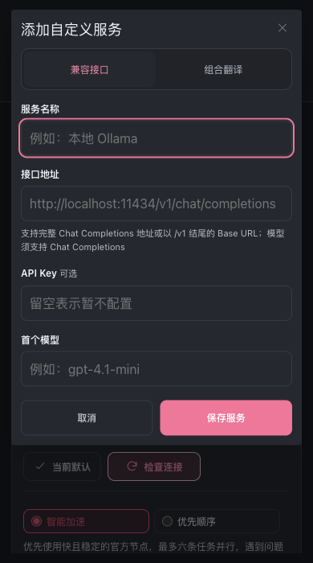
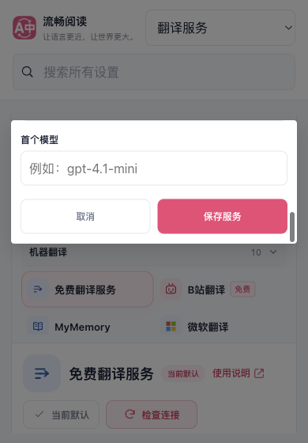
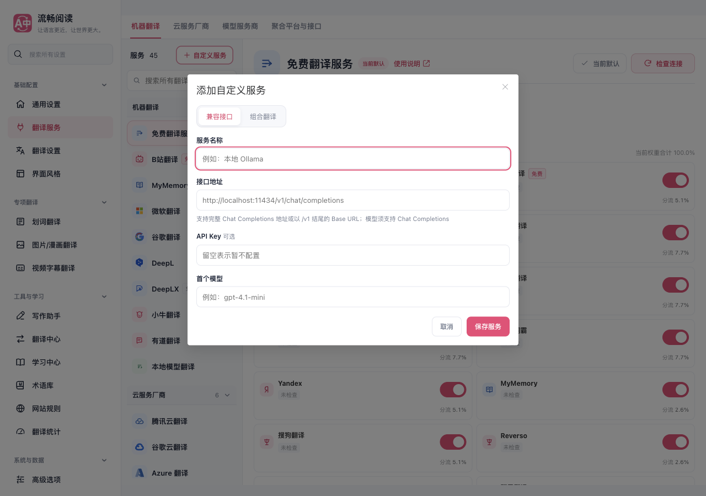
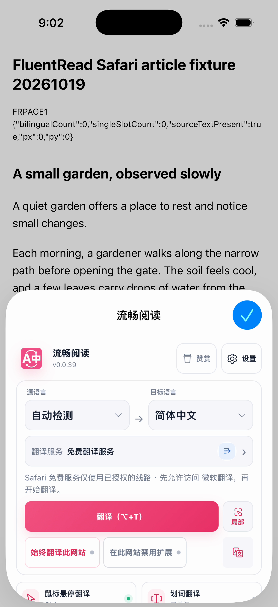
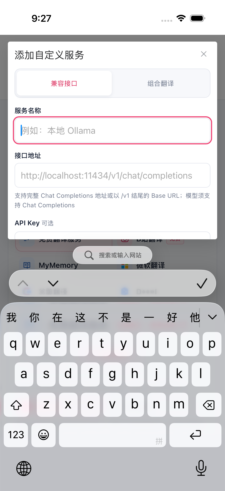
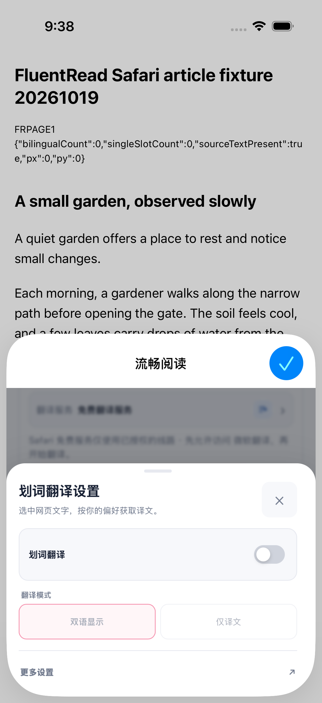

# 添加自定义服务：手机视口与触屏验收

2026-10-21。添加自定义服务窗口在窄屏或粗指针环境中按当前可见视口定位、限高，并在窗口内部滚动。输入框、组合设置及底部操作可分别滚动到达；输入字号至少 16px，控件目标至少 44×44px。细指针桌面保留 600px 宽、13px 字号和 38px 高输入框。

视口监听仅在当前窗口归属有效且打开时保留；关闭、面板失活、KeepAlive 停用或卸载后释放监听与排队帧，迟到回调不再更新旧窗口。服务提交、密钥存储与类型切换逻辑沿用原有流程。

当前 N5／U6 包已在专用 iPhone 16 Pro／iOS 26.2 模拟器完成服务弹窗的真实键盘、滚动、取消与完整截图审查（case64），以及 Popup 上滑后的划词设置抽屉入口与完整截图审查（case65），两轮各 **1 PASS／0 SKIP／0 FAIL**。这两条路径的实际结果见文末；先前的受控布局、旧包和失败诊断均保留各自范围。

## 生产 Options 页面

使用 Chrome MV3 production 包，在独立临时 Edge profile 中从正常设置入口打开窗口。首轮完整 UI5 完成 7 组、保存 18 张原图，已全部逐张人工核对；前四轮未完成的驱动调试记录保留，不计入通过结果。

| 受控布局 | 实际结果 |
| --- | --- |
| 320×560、390×700、深色 390×700 | 对话框无横向溢出，四个输入框及页脚分别可达 |
| 粗指针 844×390 | 对话框宽 600px、高 366px，内部滚动；组合设置单列换行 |
| 可见高度 180px | 对话框高 156px，输入与页脚分别滚动可达 |
| 高度 180px、向下偏移 140px | 对话框位于 y=152..308；组合超时输入可达 |
| 细指针桌面 1280×900 | 保留 600px 对话框及原紧凑输入尺寸 |

六组手机布局记录的输入／选择框／按钮／summary 均至少 44×44px，输入及选择框字号至少 16px；记录中对话框和文档均无横向溢出，底页 scrollX／scrollY 均为 0。短视口采用分别可达设计，不能据此声称所有字段、标题及页脚同时常驻可见。平移视口的组合输入截图中页脚部分剪切；这里附的是另一次滚动后完整可见的页脚原图。

320px 接口草稿取消重开后清空；320px、844px 与平移短视口的组合草稿取消重开后，成员及高级设置恢复初始状态。最后在桌面布局通过公共保存按钮保存一次无密钥的保留域名服务，回读端点、模型与空密钥正确，默认翻译服务未变。观察到 0 个 pageerror、0 次 HTTP(S) 请求；未调用供应商。

所有 7 组都在原有 VisualViewport 对象上注入受控尺寸与偏移，粗指针由浏览器模拟；点击使用鼠标，滚动可达性通过窗口自身 scrollTop 检查。这不是系统软键盘、真实触摸手势、Safari／iOS 或真机验收。首启只设置临时 profile 的中文与语言引导完成标志，不验收首次引导。焦点记录仅限启动放置前后两点；清理证据是 guarded session.close 完成及 profile 删除，不是连续焦点监测或进程组现场查空。

## 回归与构建

- 4 个定向测试文件 **159/159 通过**，覆盖服务编辑与设置面板生命周期、可见视口工具及 UI 架构；`vue-tsc --noEmit`、测试归属审计通过。测试中的 hidden 指面板失活，不冒充真实 document 隐藏。
- Chrome、Firefox、Safari Web 三种 production 构建均 exit 0。
- 新输出 `native-unsigned-build-2` 的本地打包、macOS、iOS Simulator 与 iPhoneOS arm64 Release 未签名编译均 exit 0。实际收据与独审核对 8 命令／16 流关闭，构建输入 16 项与 2673 文件源码映射前后相等，三平台包含本轮 472 文件 Web 快照。它未安装、未启动，不证明原生窗口或真机表现；旧 native1／U3 运行证据仍属于旧 c54 包。

本次未借鉴参考仓库，未合并 PR。机读指标、原图哈希与本地证据摘要见 [verification.json](./verification.json)。

## 代表原图

320px 输入位置与页脚位置：

粗指针横屏页脚：

深色输入位置：

平移短视口中单独滚动到页脚：

桌面紧凑布局：

## 入口 44px 复验（UI6）

后续补齐窗口外“自定义服务”入口：在不超过 700px 或粗指针环境中最小 44×44px，长标签允许换行；细指针桌面保留原 34px 高度，服务业务与配置逻辑不变。新一轮 production UI6 完成同样 7 组并保存、逐张审阅 19 张原图。12 次公开打开前的记录中，10 次手机／粗指针入口均为 **104×44px**，2 次桌面入口均为 **104×34px**；这些是重复打开观察，不是 12 个不同按钮。

对话框输入／页脚分别可达、取消重开及无密钥公共保存继续通过，观察到 0 个 pageerror、0 次 HTTP(S) 请求。全部视口与触屏边界仍为前述受控夹具，未验证真实系统键盘或 iOS。上文 native2 编译早于入口修复，保留其历史身份；本节不声明后续新包构建或原生运行通过。

## 入口修复后的新包（native3）

包含入口 44px 修复的 Chrome、Firefox、Safari Web production 构建分别通过；本次仅改入口 CSS 和浏览器测量，原窗口生命周期源码与已通过的 159 项测试保持不变。新的 Safari 打包及 macOS、iOS Simulator、iPhoneOS arm64 三个 Release 未签名编译通过，8 命令／16 流关闭回收，17 项输入与 2673 文件源码映射前后一致，472 份 Web 资源与三份完整 App 逐文件核对。该节只验收构建，专用模拟器更新和原生界面另列实际结果。native2／U4 没有进行安装。

## 专用 iOS 模拟器更新（U5）

本地 unsigned native3 已实际更新到本任务专用 iPhone 16 Pro／iOS 26.2 模拟器。一次安装后，模拟器开机和关机状态下的完整 App（490 文件）及 Web（472 文件）映射均与新构建一致；12 条命令／24 个输出流结束并回收，其他 14 台模拟器记录不变，最终 15 台均关闭。独立复核实际重哈希新安装的全部 App 与 Web 文件，通过。源码映射已另行绑定到提交 `e4a9047465f302a3cd2d5e7b8fa6f13e53629b02`，这不是在该干净提交上重新编译的声明。

此轮只核对安装后的二进制身份，没有启动应用或操作界面。配置与站点权限是否保留仍未知；自定义服务窗口的原生键盘、输入法和实际触摸体验继续单独验收。

## 原生分类观察与窄屏基础样式（case54／UI7）

旧 N3／U5 包在 iOS 的正常 Popup→划词→更多设置路径中完成只读观察。对应“设置分类”标签的唯一 `.other` 原生节点为 **203×35pt**，未通过 44pt 门槛，因此没有点击分类；正式结果保留为 **0 PASS／1 SKIP／0 FAIL**。这只证明已知节点的缓存几何，不证明它是完整 DOM select 外框，也不证明缩放或媒体条件是原因；此轮没有截图、弹窗或键盘验收。21 条命令／42 个输出流及夹具均关闭回收，独立复核通过。

源码另有明确缺口：窄屏分类的基础样式仍为 38px／12px，只有粗指针条件才覆盖为 46px／16px。本次仅把窄屏分类补齐为 border-box、46px 高、16px 字号，保留桌面显示规则与原生 select 交互。没有据此声称已修复上述原生映射差异。

最新 production UI7 先在 **390×700、细指针、非粗指针** 页面中测得分类框 **190×46px、16px**，再完成原有七组弹窗布局；13 次分类观察中 9 次可见且高 46px／字号 16px，4 次宽屏隐藏。原有输入／页脚分别可达、取消重开、一次无密钥公共保存继续通过，0 个 pageerror、0 次 HTTP(S) 请求。20 张原图已由 Root 与独立复核者逐张查看；短视口与触屏仍为受控夹具，真实 iOS 分类／弹窗／键盘须新包复验。Chrome、Firefox、Safari Web production 新构建均通过；此次 CSS 修改没有重新执行先前 159 项生命周期测试。

## 分类修复后的新包（native5）

新样式对应的本地 Safari 打包及 macOS、iOS Simulator、iPhoneOS arm64 Release 未签名编译全部通过，8 条命令／16 个输出流结束回收。17 项输入及 2673 文件源码映射前后一致，472 份 Web 资源及完整 App 已由 Root 与独立复核者逐文件核对。本轮为实际工作树快照构建，基线提交 `e4a9047` 仅作上下文；安装、原生 UI 与真机另验。此前 native4 在 Apple 转换工具处报输入路径访问／manifest 解析错误，保留失败记录，未进入原生编译，也未安装。

## 分类修复包的专用模拟器更新（U6）

native5 已通过一次安装更新到专用 iPhone 16 Pro／iOS 26.2 模拟器。12 条命令／24 个输出流正常结束回收，安装后的完整 App 490 文件／Web 472 文件与构建一致，Root 在外层执行结束后再次重哈希核对，独立复核也重新读取全部安装文件并重算逐文件与整体摘要；15 台模拟器最终均关闭，其他 14 台完整记录不变。该轮未启动应用或操作权限、配置；配置和权限保留仍未知，原生分类／弹窗／键盘另验。

## 更新后的原生入口检查（case55）

N5／U6 新包的旧 Popup→划词路径在一次手势后，已知关闭状态的划词按钮未在限定 5 秒内通过可点击就绪检查，测试在进入设置前停止：**0 PASS／1 SKIP／0 FAIL**，4 次 AX 观察／4 次操作／0 张截图。没有分类、服务窗口或键盘结果，也不据此推断产品原因。21 条命令／42 个输出流与夹具结束回收，安装身份仍与 U6 相符，15 台模拟器最终关闭、其他 14 台记录不变。后续改走 Popup 顶部公开“打开完整设置”，独立验收服务 UI；本条停止记录保留。

## 公开设置入口与分类菜单（case56）

从 Popup 顶部公开“打开完整设置”正常进入设置页，按钮原生节点为 **60×46pt**；随后对唯一已知“设置分类”节点点击一次，观察到原生 **“翻译服务”按钮 250×42pt**。分类节点仍为 **203×35pt**，不能声明原生触摸尺寸合格，也不能把它当作完整 DOM 外框尺寸。菜单覆盖时没有公开 TabDocument，未推断其 owner，也没有点击服务选项。

本轮为有界观察，正式结果保持预设的 **0 PASS／1 SKIP／0 FAIL**；6 次 AX 观察／5 次操作／0 张截图，不经过旧划词入口或滚动手势。21 条命令／42 个输出流与夹具结束回收，安装身份与 U6 一致，其他模拟器记录不变。没有服务窗口、键盘、配置或新建 tab 的验收结论。

## 服务窗口路径的后续原生检查（case57–59）

三轮仍使用同一 N5／U6 安装包，只调整验收驱动，没有修改产品。每轮正式结果均为 **0 PASS／1 SKIP／0 FAIL**，不能将外层命令 exit 0 视为弹窗或键盘通过。

| 运行 | 实际到达范围 | 停止及限制 |
| --- | --- | --- |
| case57：4 AX／3 操作 | Popup 已打开；完整设置按钮缓存为 60×46pt、启用且位于内容内 | 点击前的复合即时检查未通过，具体谓词未导出；没有点击设置按钮 |
| case58：6 AX／6 操作 | 完整设置、设置分类、原生“翻译服务”选项各点击一次；完整设置按钮的 14 项即时检查均通过 | 5 秒内未见精确“翻译服务配置”锚点；未保存选项点击后的有效场景，不能据此断言菜单仍打开或服务页加载失败 |
| case59：3 AX／3 操作 | Popup 已打开；完整设置按钮有界就绪等待记录 `LIVE_HITTABLE_FALSE` | 5 秒截止前未通过检查，没有点击设置按钮；本轮未到达新增的服务页观察逻辑 |

三轮均为 0 张截图，未进入新增服务窗口、名称输入、真实键盘、模型滚动或取消阶段，也没有输入、保存、配置写入或权限操作。每轮 21 条命令／42 个输出流与夹具结束回收，五对保存的 App／Web 映射与 U6 相符，15 台模拟器最终均关闭，其他 14 台完整记录不变；三点焦点记录保持同一应用。独立复核结果及具体证据哈希见机读记录。

旧 Popup 划词入口在 case55 中停止的原因也保持未知。“已关闭”来自划词模式文案，入口本身只受总开关禁用；手势前已通过启用检查。现有原生 AX／文章夹具不能读取工具栏 Popup 的 DOM 视口和滚动尺寸，因此仍未确认底部裁切的具体原因，没有应用推测性的产品修复。

case60 再次正常点击完整设置、分类和“翻译服务”选项各一次。有效的新场景中，原设置页归属保持，唯一包含固定“切换配置服务”文字的目录按钮为 **348×44pt**，完整位于根界面内；测试对“恰好三层 Web 且实时标题匹配”的复合条件未通过，具体子条件未导出。这里已有服务页公开入口，不能描述为服务页加载失败。

本轮 **0 PASS／1 SKIP／0 FAIL**，7 次 AX／6 次操作／0 张截图；未点击目录、添加、名称或取消，未进入弹窗或键盘。完整设置按钮的 `isHittable` 与原即时检查均为 true，因此本轮没有验证“原生属性为 false 时标准点击仍可用”。资源、保存的安装映射和其他模拟器保留检查正常；后续仅修正验收脚本的页面层级假设。

case61 则实际进入了 `isHittable=false` 分支：其余 13 项即时检查通过，但一次 `XCUIElement.tap()` 调用中，XCTest 内部三次尝试均计算出 `{-1,-1}` 命中点并失败。正式结果为 **0 PASS／0 SKIP／1 FAIL**，原生命令 exit 65，外层 exit 1；没有进入设置页，也没有执行新服务页层级判断。

失败附件含系统录屏及辅助功能快照，驱动未请求截图。已从 8.3867 秒录屏抽取五个原样画面逐张查看：末帧的公开“设置”按钮完整可见，初始位置底部功能卡片被裁切。这些画面不能覆盖全部执行时间，也不能据此判定手动触点无效。全部 21 条命令结束回收，仅原生命令非零；安装身份、其他模拟器记录及收尾检查正常，配置与权限保留仍未知。后续对当前精确按钮中心单击，以实际页面跳转复验。

## 新包的原生服务弹窗、键盘与取消（case63）

同一 N5／U6 包本轮完成 **1 PASS／0 SKIP／0 FAIL**，49.7857 秒。公开设置按钮采用当前精确按钮中心的一次触点点击；随后正常打开分类、翻译服务、目录和新增窗口，对名称聚焦一次，观察到真实原生键盘 **402×233pt**。一次弹窗内上滑后，首个模型 **350×44pt** 与取消 **171×44pt** 分别完整可达；取消一次后，窗口标题和键盘均消失，仍回到原设置页及服务目录。

本轮 13 次 AX／11 次操作／1 张原图；原图仅为新窗口空名称输入框的精确裁剪，不能替代完整弹窗或键盘的视觉审查。没有输入、保存、配置写入、权限选择或驱动供应商请求。完整设置及目录按钮的 `isHittable` 本轮均为 true，因此没有验证该属性为 false 时触点点击的行为。原生分类 35pt／菜单项 42pt 的 AX 尺寸限制继续保留，也不宣称所有触摸目标、布局或真机均已通过。

21 条命令／42 个输出流与夹具正常结束回收，五对保存的安装映射保持 U6，15 台模拟器最终关闭、其他 14 台完整记录不变。真实键盘、模型可达与取消返回的功能结果现已覆盖这一专用模拟器路径；配置与权限保留仍未知。

## 原 Popup 滚动后的实际位置（case62）

沿原来的一次中心上滑，划词入口从 **y=835pt 移至 y=697pt**，大小仍为 **175×49pt**，新场景中的完整可见交集也是 175×49pt。归属、标题及完整内容链保持，按钮启用，不能再把旧就绪等待失败描述为“上滑后仍裁切”或“滚动无效”；具体 DOM 滚动容器仍未读取。

接下来的一次标准元素点击仍因 XCTest 内部三次 `{-1,-1}` 命中点失败，未进入抽屉：正式 **0 PASS／0 SKIP／1 FAIL**，15.1893 秒，原生命令 65、外层 1。其余 20 条命令正常，全部结束回收，保存的 U6 映射及模拟器记录保持。本轮三点焦点同为 Macs Fan Control，未沿用前轮应用名称；没有配置或权限操作。驱动未截图，本条仅使用有效 AX 和官方执行记录，未作失败录屏的视觉结论。

## 真实键盘下的完整弹窗截图（case64）

同一 N5／U6 包再次完成服务目录→新增→名称聚焦→一次窗口内上滑→取消，正式 **1 PASS／0 SKIP／0 FAIL**，42.9059 秒，15 次 AX／11 次操作／3 张原图。Root 与独立复核者查看了全部三张图；其中两张是未经裁剪或合成的完整原生应用截图，另一张仅为名称输入框裁剪。没有输入、保存、配置或权限操作。

第一张完整图显示新空白窗口、名称及端点，原生键盘已出现；第二张显示滚动后的模型、取消和保存，均完整位于窗口内且在键盘上方，没有观察到横向溢出或操作被键盘遮挡。第二个位置的标题与名称已随整窗滚动离开画面，这是两个位置分别可达的验收，不是全字段、标题与页脚同时可见。取消后标题与键盘消失，原设置页及服务目录恢复，由实际执行检查支持，未另拍取消后的截图。

本轮完整设置及目录的原生 `isHittable` 均为 true；35pt 分类／42pt 菜单项的 AX 尺寸限制仍保留。21 条命令／42 个输出流及夹具结束回收，保存的五对 App／Web 映射与 U6 相符，最终 15 台模拟器关闭、其他 14 台完整记录不变。配置与权限保留、横屏、缩放、全部布局组合及真机另验。

## Popup 滚动后的划词抽屉（case65）

沿原来的一次上滑，划词入口同样由 y=835pt 移至 y=697pt，175×49pt 完整位于 Popup 内容内。原生 `isHittable` 本轮仍为 false，其余 13 项即时身份、位置、启用及新鲜度检查通过；以当前精确按钮中心为主点击方式，只点击一次，即实际进入划词设置抽屉。没有先尝试标准元素点击，也没有后备点击或重试。

正式 **1 PASS／0 SKIP／0 FAIL**，14.8806 秒，6 次 AX／5 次操作／1 张完整原生应用截图。Root 与独立复核者查看了原图：标题、关闭、开关、两种翻译模式及“更多设置”均完整可见，没有观察到横向溢出或抽屉操作裁切；模式按钮随关闭状态禁用。本轮未切换功能或模式，未点击更多设置，没有键盘、配置、权限或供应商验收。

此结果证明该专用模拟器路径可达，不改写 case62 的标准元素点击失败，也不证明原生 `isHittable`、DOM 滚动容器或其他设备的行为。21 条命令／42 个输出流及夹具正常结束回收，保存的 U6 映射与其他模拟器记录保持。真实手机与其他布局仍须分别验收。

本次报告补充未修改产品源码。VitePress、Storybook 构建及文档完整性检查通过，完整性检查为 87 页／4895 链接／851 锚点／172 图片；内部报告按现有规则不发布到公共文档站。首次完整性检查因新输出缺少 Storybook 而失败，补齐后重跑通过；JSON、原图逐字一致性、引用哈希及 `git diff --check` 均已核对。
