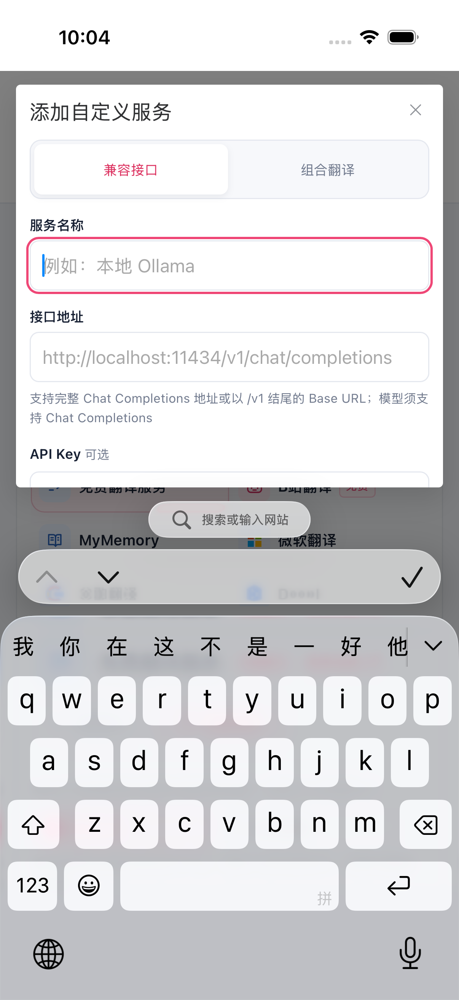
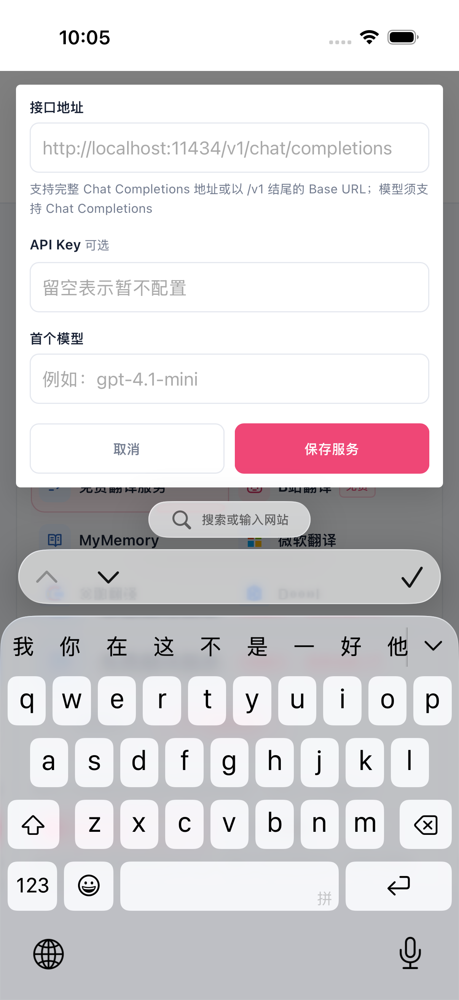
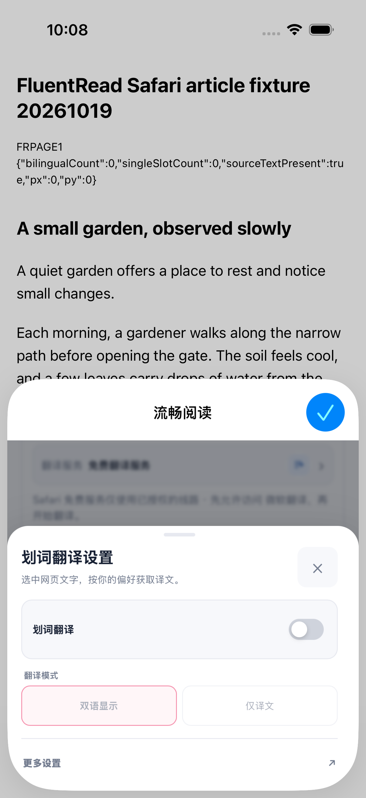

# 手机与 Safari 最后一轮复核

2026-10-21，本轮按用户要求收敛为已有主要流程的最后复核、关键遗漏修复和交付，不增加新设备或新测试驱动。此前的实现、不同包身份及失败记录继续保留，不能用本轮局部通过覆盖。

## 最后补齐的问题

代码与操作逻辑审查发现：Popup 根组件已支持往返缓存恢复，但源语言／目标语言选择器在 `pagehide` 后仍永久禁用。现在仅在配对的 `persisted pagehide → persisted pageshow` 后开启新选择会话；普通退出和卸载继续终止，隐藏前的选择结果、菜单事件和浮层回调不能写入恢复后的会话。

新增四项实际 Vue 模板回归覆盖源语言、目标语言、普通退出及卸载。连同 Popup、服务编辑、设置和视口的相关回归，本轮八个文件 **391 项通过**。这是受控生命周期验证，未执行新修复在 Safari 原生往返缓存中的现场复验。

## 实际界面复核

专用 iPhone 16 Pro／iOS 26.2 模拟器使用既有 N5／U6 安装包，其冻结产品快照对应 `0ea3b708e372321e3cdd3da7497584398e4d266e`。**该安装包不包含上述最后补齐的语言选择恢复修复**。新修复另经类型检查、定向回归和 Chrome／Firefox／Safari Web 生产构建验证，不能将两层证据混同。

| 流程 | 本轮实际结果 | 证据范围 |
| --- | --- | --- |
| case66 新增自定义服务 | 1 PASS，42.028 秒；名称聚焦出现真实键盘，一次窗内上滑到达模型和取消；取消恢复原服务页 | 两张完整原图和一张名称裁剪图全部由主代理及独立代理查看；未输入或保存配置 |
| case67 Popup 划词设置 | 1 PASS，14.961 秒；一次上滑后点击当前卡片中心一次，进入实际设置抽屉 | 完整原图由两人查看；关闭、开关、模式和更多设置可见；未切换开关或模式 |

这四张原图在观察位置未见横向溢出或操作遮挡。case67 使用当前按钮的精确中心坐标；原生 `isHittable=false` 仍保留，不覆盖此前 case61／62 标准元素点击失败，也不声称所有原生触摸尺寸均合格。表单控件分布在两个滚动位置，不声称同时可见。

两轮驱动均已退出并回收所属进程；专用模拟器回到关闭状态，另外十四个设备记录保持原样。前、中、后焦点采样一致，未声称连续焦点监控。原始报告引用、截图哈希和本轮验证见 [verification.json](./verification.json)。

## 最终集成复核

推送时发现与最新 `main`（`f87b9d2c131b703e54cfb675f32893e48d2b217c`）冲突，已保留双方说明和独立测试。合并后六个相关文件 **502 项通过**，与前述 391 项有重叠，不累加成独立用例总数。

集成审查还补齐了当前页字体入口与显示模式按钮在手机上共存的宽度：触屏和 Android 的双按钮容器至少 94px，两个 46px 按钮不再相互压缩，桌面保持原尺寸。使用最终生产 CSS 的静态 DOM 片段，在隔离无头 Edge 中验证触屏、Android fine pointer 和桌面三组几何尺寸、边界及不重叠，三张原图已查看。它是未加载扩展的布局实验，不是完整 Popup 运行时或新一轮原生验收。

## 交付边界

既有服务选择横竖屏与搜索键盘、触摸选词、字幕菜单短视口、划词设置回程和翻译恢复证据继续按各自包与夹具身份记录，见 [服务窗口报告](../mobile-custom-provider-dialog-20261021/acceptance.md) 和 [Safari 集成记录](../mobile-safari-integration-20261016/services-short-viewport-followup.md)。本轮没有重新执行这些完整矩阵。

本轮后保留的未验收项：物理设备和签名安装、正常安装选区阅读的 IME／发送、长后台及进程驱逐、更新后的配置／权限保留、YouTube 在线播放与 AVKit 系统全屏字幕、Android Edge 当前安装版本及 userscript 管理器执行。它们不作为此次最后复核的通过结论，也不继续扩大本轮执行范围。

改动保存在既有独立分支和 PR #1009，不自动合并；未借鉴或修改参考仓库。
