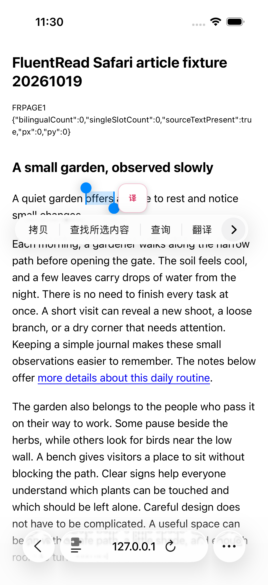
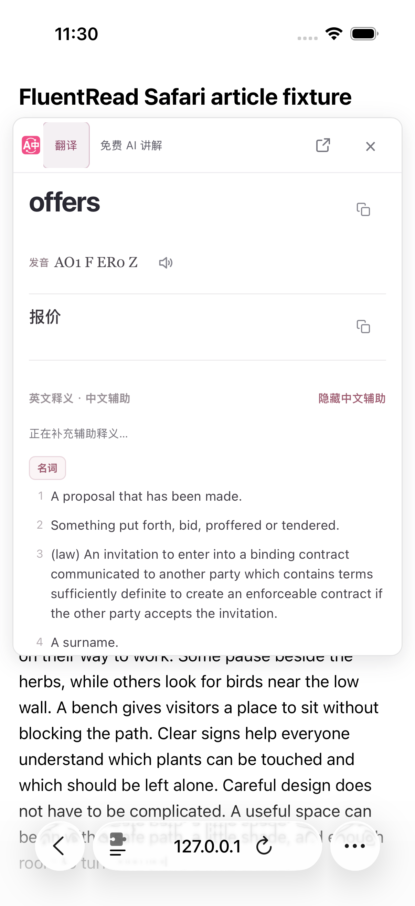
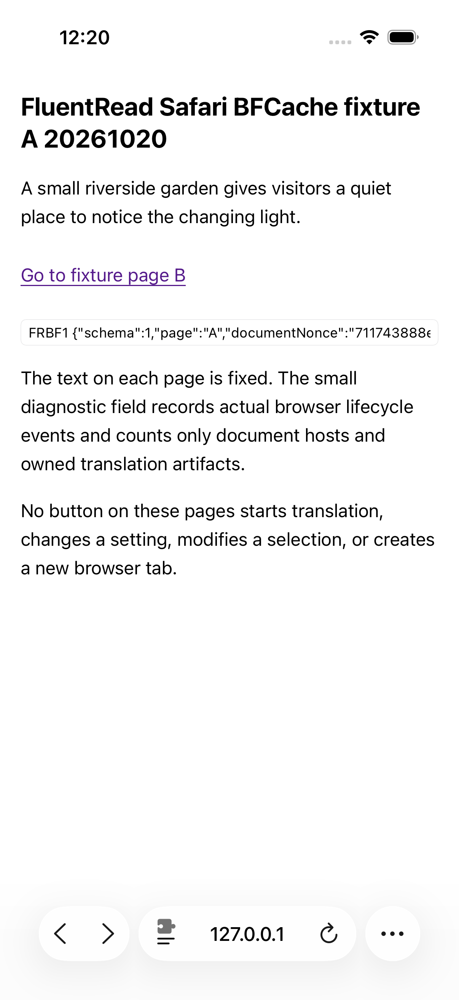
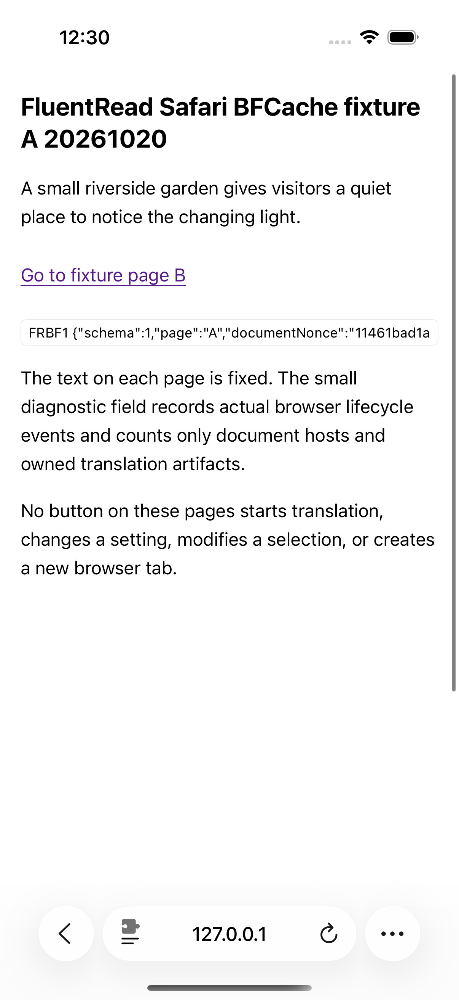
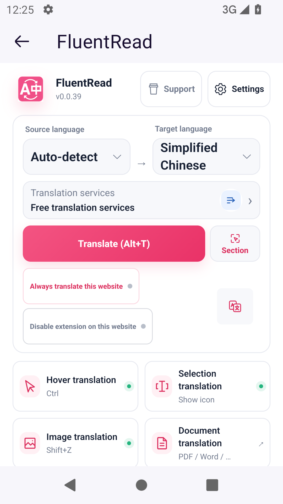
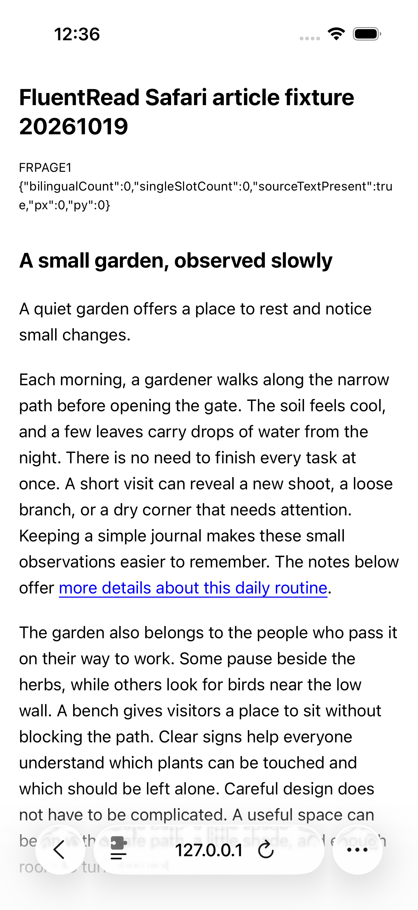

# 安装版触摸选词与后台返回补验

当前84a214351安装包在专用iOS Simulator26.2上完成了原生长按选词、开卡、关闭和页面返回补验；专用Android模拟器的Firefox完成30秒后台往返及服务抽屉操作。本次只补充验收文档和原始截图，产品源码与此前的[短卡、阅读输入和软键盘修复](../selection-card-short-viewport-20261020/acceptance.md)一致。

## 实际结果

| 场景 | 结果与范围 |
| --- | --- |
| iOS原生选词、开卡、关闭 | 长按固定英文段落一次，点击现有图标打开实际安装扩展卡片，再点击44×44关闭按钮；两次后续读回均无卡片或图标重开，原文及宿主滚动保持。正式1PASS／0SKIP／0FAIL，3张原图。 |
| Safari BFCache返回 | 真实链接A→B，再点原生返回；同一文档，实际可信pageshow.persisted=true、pageshow计数1→2，原文、滚动和单个扩展宿主保持。正式1／0／0，3张原图；范围仅固定本地A/B。 |
| Safari后台30秒 | Home一次、被动等待30.010秒、返回Safari一次；同一文档和单个扩展宿主，原文及滚动保持。正式1／0／0，2张原图。 |
| Android Firefox后台30秒 | 实际临时加载当前483文件生产包；Home后等待30.010秒，再返回同一Popup文档。服务抽屉实际打开、关闭各一次，返回键关闭Popup后，原阅读页面的文档标识、滚动73、空选区及译文节点计数保持。场景和外层资源检查均通过，4张原图。 |
| 恢复临时测试设置 | 将验收时开启的ICON模式关闭一次，读回DISABLED，再关闭抽屉、点击原生完成并返回原文。正式1／0／0，1张原图；原先观测到的关闭模式已恢复。 |

选词夹具和驱动未程序化设置选区、注入组件或拦截翻译响应。开卡会走产品请求路径，但未记录上游请求次数、供应商身份或缓存命中；中文主内容已出现，辅助释义仍加载，因此本轮开关卡通过不代表翻译质量或全部服务完成。

Android使用专用AVD已有的Firefox配置，确实执行了临时扩展加载；它不代表全新profile或真机。服务入口与关闭目标的当前44px触控尺寸、视口内位置和五点命中通过，抽屉开关由保存的DOM、原生节点及实际输入证明，四张截图中没有抽屉展开图。阅读页保持结论仅限表中所列字段。

## 原始截图

原生长按后的选区与图标、实际安装卡片，以及关闭后回到原文：

Safari分别在BFCache返回和30秒后台返回后保留原页面：

Android Firefox的后台前后Popup，以及iOS恢复设置并关闭Popup后的原文：

## 证据与未覆盖项

Root和独立审阅者实际查看了上述各轮全部13张原图；此处选取8张，按原字节复制。[verification.json](./verification.json)保存报告、官方结果、关键读回、独立审查和原图摘要。各iOS轮次21条命令均成功关闭、回收，完整安装包映射保持，其他14台设备记录未变，15台最终关机；Android的所属进程、端口和转发清理闭合。iOS焦点证据是三个点样本，Android守卫的焦点事件为空，不能合称全程前台监控。

旧SKIP、读取超时和共享键盘夹具case20的外层焦点失败均保留原结果；后续通过不改写旧轮次或推定旧失败原因。case20仍只证明共享源码夹具的真实软键盘、旋转、内部滚动和关闭，安装版原生选词后的阅读追问键盘仍待验收。30秒往返也不证明长后台、进程驱逐或Android BFCache。配置、权限持久性及隐藏设置的字节保持仍未知。

物理设备、受登录／机器人检查限制的YouTube及原生AVKit路径仍未完成；[网页翻译与恢复](../safari-article-translation-restoration-20261020/acceptance.md)保留其独立范围。移动端与Safari完整目标继续进行，PR #1009未合并。本次未借鉴或修改参考项目。
