# 移动端与 Safari 验收记录（2026-10-15）

本项从 `fa431a845`（PR #993 已合并）独立实现，分支 `codex/mobile-safari-product-20261015`。Issue #969 的正文嵌入稳定性由独立任务负责；本项不改全文候选、调度或站点适配算法。Issue #992 的原反馈为 iOS YouTube 系统全屏无字幕、竖屏字幕居中，未给出浏览器与安装渠道，因此不把桌面夹具结果当作报告者环境已修复。

截图中的遮罩缺口、背景误触、关闭按钮边缘被滚动条遮挡、返回列表位置错误及 Android 页脚裁切已修复，两端模拟器实测保存在 `215e40fba`。后续组合回归又发现 Safari 清空系统选区后，网页替换整个正文会恢复仍带旧内容的划词 host；`8d85e62c7` 在恢复前调用组件已有来源校验，关闭失效卡、取消请求并拒绝迟到回写，原文有效时保留同一实例和请求。

材料整合轮次 `073cf5db2` 包含主分支 `633baacd32` 的专业文档、翻译质量、网页稳定性和材料学习工作区更新。保留材料的来源关联、隐私与保存代次约束，以及本分支的移动选区、键盘、原生字幕和 Safari 权限策略。265 项划词消费者检查及 343 项语言/字幕学习关联检查通过；来源恢复 runtime 定向四维覆盖率为 100%，代码未因整合改变。该轮四目标 Web 构建、verifier、类型及审计通过；原始源码摘要、每轮生产包与 Apple 编译记录分别保存在 `verification.json`。

最新界面整合提交为 `657376c7f`，另包含主分支 `11732fa31` 的首次使用与自助诊断；随后 `acae06466` 修复了 userscript 构建体积。整合时保留完整遮罩、内部抽屉定位、Android 容器与滚动余量，并补齐新诊断入口的 46px 触摸区域。诊断“重试”接入 Safari 同一次点击的授权流程；服务权限读取失败继续显示明确的权限提示，不混为供应商故障。13 个相关测试文件共 590 项通过，挂载模块单独四维覆盖率 100%，类型检查通过。这些是本地定向检查，生产界面与各平台构建按该轮身份另存。

该整合产物的生产 Chromium 专项完成 9 项、29 张截图复核：完整遮罩、320/390px 深浅色、长列表末项和返回、关闭四边、可见视口键盘夹具、新引导确认及诊断浮层均通过；新引导 8 个控件至少 46px，诊断入口和关闭均为 46×46px。正式通过记录为 `production-popup-integrated-117/attempt2/`，零控制台错误、零焦点违规，自有进程和 profile 已清理。首轮额外标题翻译请求与清理期间焦点事件仍保留为失败；重试修正空页面标题，并在身份复核后先用官方 Browser.close 退出，再由原关闭守护确认。未修改共享浏览器 helper、关闭焦点监测或把模拟 Android 标记当作设备运行证据。

`117` 轮 Safari Web 产物为 467 文件，摘要 `2370a210fd9d816fcbfe569a9470406866342b0b2f7da9343a045beeab22de7c`，构建与校验通过。新的原生 wrapper 生成命令被自动审批拒绝；附既有人类任务授权记录复审后仍要求当前明确确认，命令均未执行，因此该轮 macOS／iOS Simulator／iPhoneOS 编译与安装没有通过结论。此前 `633` 的三目标编译和实际安装继续只代表旧产物。

整合还触发 userscript 体积校验：原产物 2,097,258 字节，超过既有 2,095,100 字节上限；独立 `117` 主线构建为 2,090,732 字节并通过。修复仅在 userscript 构建中无损编码已有 14 种皮肤与 10 种字体的静态数据，在原位置同步恢复，完整保留值、枚举顺序和既有 API；共享业务源码、体积预算、固定资源地址、依赖与许可证均未修改，Greasy Fork 仍保留可读数据。正式修复产物为 2,093,894 字节，原 verifier 通过。完整配置消费者 228 项通过（含 35 项新场景），插件单独四维覆盖率 100%；加上上述 590 项，当前整合共 818 项不同的定向检查通过。根与临时检出的早期压缩字节差异没有被归因为路径影响；最终修复产物在两处摘要相同，历史失败与调查均保留。

实际平台证据按版本分开：当前原生字幕模块在 iOS 26.2 Simulator 的真实 AVKit 中完成 FluentRead 勾选、动态双语、关闭后继续播放无残留、重选及退出恢复。另用正式 `228/d3` 扩展在真实 YouTube 完成相同操作，独立检查确认关闭后退出、再次进入仍保持关闭。前一轮 XCTest 因退出后网站标题切换为中文而失败，原失败保留；后一轮退出重入检查通过。系统菜单出现软件键盘的原因仍未建立。之前 Android/iOS Popup 截图对应各自原始产物，不挪作后续整合包的安装验收。

## 实现与边界

| 路径 | 变更 | 需要证明的行为 |
| --- | --- | --- |
| 网页翻译 | 触屏悬浮球完整 44px 命中区；VisualViewport、安全区与恢复定位；拖动时保留布局并按主体偏移跟手；pointer 与兼容 click 去重、辅助技术 click-only 入口 | 翻译、恢复、重译、加载取消、迟到结果、拖动和刷新 |
| 页内快捷面板 | 按实际可见边界夹边并重新协商 iframe 尺寸；关闭释放视口观察 | 软键盘偏移、横屏、深色、关闭与重建 |
| Popup 与服务抽屉 | 全页遮罩拦截背景，内部抽屉按可见视口定位；Android 固定容器限宽限高、46px 点击区；滚动条留位，切换面板只恢复所属容器位置 | 遮罩连续、背景不可误触、末项可达、返回源行、关闭四边、键盘收起与页脚滚动 |
| 网页进度 | 可见视口与安全区内定位、限制尺寸、内部滚动；触屏操作 44px | 加载、错误、重试、隐藏、后台恢复和卸载；保持现有会话限定回调 |
| 划词 | 触摸稳定等待、系统句柄调整、长按菜单和 pointercancel；44px 入口与操作；正文原生滚动；安全区与可见视口缓存 | 图标按下不丢选区、关闭不重新出现、软键盘、切换、来源失效、刷新与卸载 |
| 划词恢复 | 分别保存 Selection 文本与 Range 指纹 | 跨段文本序列化不同不误关闭；原文实际改变才清理 |
| 视频内联字幕 | YouTube/X 复用实际视频画幅几何，小播放器按可见控件留底距；移动双语合并显示；四边安全区 | 竖屏底部、横屏、控件显隐、模式切换、后台恢复 |
| 系统原生全屏 | 复用原时间轴与已缓存译文预备原生 TextTrack，由系统菜单选择；缓存更新保持用户模式，退出与清理只保守恢复仍由 FluentRead 让位的原轨；明确系统样式与挂起限制 | 系统选择、关闭、重选与退出恢复必须按实际 AVKit 产物独立验收 |
| Safari 交付 | WXT 0.20.18 Safari MV2、Safari 26 门槛；显式 UTF-8 非持久后台页；最终产物与完整资源校验；Apple 单/双平台包装与中英安装指引 | 生成和编译可复现；语言配置可保存；不签名发布、不把包装当运行验收 |

没有新增独立翻译实现。触摸和字幕均继续通过已有配置、服务与生命周期接入。未复制或借鉴外部参考项目代码。

## 官方依据与现有能力核实

- [Mozilla 的 FluentRead 商店页](https://addons.mozilla.org/en-US/firefox/addon/%E6%B5%81%E7%95%85%E9%98%85%E8%AF%BB/) 在本次核查时明确标示可用于 Firefox Android。这不等于本次开发包已完成 Android 设备验证。
- [Microsoft 移动策略](https://learn.microsoft.com/en-us/deployedge/microsoft-edge-mobile-policies)说明 Android 扩展可受管理策略限制；具体目录和安装按钮仍需当前浏览器确认。 微软当前 [API 支持表](https://learn.microsoft.com/en-us/microsoft-edge/extensions/developer-guide/api-support)列出 Android 的 action、runtime、Offscreen、存储与 DNR；这不证明流畅阅读已进入移动目录。官方浏览器获取已定位 Google Play，当前隔离环境没有可用 Play Store／账号，尚未找到可验证的官方免账号 APK 路径；没有使用第三方镜像或宣称实际 Edge 安装通过。
- Safari Userscripts 的核心网页/划词入口和 Via 既有说明继续保留；userscript 不提供扩展的视频字幕运行时，新原生全屏提示不进入其固定语言资源。
- [Apple Safari 扩展说明](https://developer.apple.com/safari/extensions/)及[包装工具文档](https://developer.apple.com/documentation/safariservices/packaging-a-web-extension-for-safari)用于未签名包装流程。
- [MDN 官方兼容数据](https://github.com/mdn/browser-compat-data/blob/main/webextensions/api/declarativeNetRequest.json)记录现有请求隔离所需的 `initiatorDomains`/`requestMethods` 从 Safari 26 开始支持。本项保留限制条件，不对旧 Safari 放宽来源范围。
- [WebKit 的内联视频说明](https://webkit.org/blog/6784/new-video-policies-for-ios/)区分网页内播放与系统全屏；网页 DOM 字幕不能直接覆盖系统播放器。原生轨桥接不保证平台样式或后台持续翻译。

## 验证状态

本地验证限定改动与直接影响范围。首轮 GitHub CI 因 `package.json` 新增 Safari 命令，被既有 planner 归为共享测试配置变更，自动执行全部 730 个测试文件；这不是本地专项范围。CI 的改动模块覆盖率均为 100%，但三个原本未改的测试文件失败：Linux 不存在 `/private/tmp`、Vue renderer 引用未声明入口，以及单个 PDF 导入用例超过默认 5 秒。已在 `cd55bc55c` 作最小测试修复，95 项定向检查通过；[Ubuntu 复验](https://github.com/FluentRead/FluentRead/actions/runs/38700538192)完整通过：730 文件、24,092 项通过及 4 项既有跳过，改动模块四维覆盖率 100%，类型和构建步骤也通过。后续 UTF-8 与原生指引提交 `82fa8085f` 的[独立 CI](https://github.com/FluentRead/FluentRead/actions/runs/38709422336)也已通过；它不包含本轮后续的权限与触摸修复。权限、46px 触摸目标与 Safari 原生选区菜单清理提交 `915672c7c` 的[质量检查](https://github.com/FluentRead/FluentRead/actions/runs/38722958827)和[文档检查](https://github.com/FluentRead/FluentRead/actions/runs/38722958865)随后均通过；随后控制栏副本修复提交 `48e195d54` 的[质量检查](https://github.com/FluentRead/FluentRead/actions/runs/38729484457)和[文档检查](https://github.com/FluentRead/FluentRead/actions/runs/38729484201)也通过。这些检查对应上述提交，不包含本报告后续的原生选择策略、键盘和完整布局修复。PDF 的本地超时未复现，仅增加该用例的 15 秒有界预算，保留全部进度与取消断言。

布局及前三轮主线整合提交 `d08054108` 的[质量 CI](https://github.com/FluentRead/FluentRead/actions/runs/38757793503)也已通过：738 个文件、24,621 项通过及 5 项跳过，改动模块覆盖率四维 100%，类型和构建阶段均通过。它不包含随后 `8d85e62c7` 的来源复核修复和 `073cf5db2` 的材料整合；后者的定向验证单独记录。

| 验证 | 结果与范围 |
| --- | --- |
| 类型检查 | `pnpm compile` 通过 |
| 初轮集成专项 | 10 文件、1,436 项通过，含 1,028 条文件头规则；其余覆盖模块边界、验证归属、真实 Vue 行为、浮层尺寸协商、字幕运行时与划词生命周期 |
| 平台/文案合约 | Safari manifest/包装/容器专项 42 项通过，浏览器能力 13 项通过；userscript 构建配置与固定语言资源投影专项通过 |
| 严格覆盖率 | VisualViewport、新原生轨桥接及既有 popup/core/字幕缓存/人工字幕 6 个受影响模块四维均 100%（分别限定模块执行） |
| Vue 行为归属 | 悬浮球与全文进度组件迁出冻结债务，真实 SFC setup/模板消费者分别 10 和 5 项通过 |
| 网页触摸与浮层 | `floating-progress/report.json`：14 项通过，含加载、取消迟到结果、44px 目标、拖动、刷新、深色 popup、可见视口夹具及卸载 |
| 划词 | `selection-final/report.json`：8 项通过，含真实生产 UI、可信 CDP 触摸/DOM Range、320px 深色、键盘偏移夹具、后台和刷新清理 |
| 网页结果状态 | `progress-status/report.json`：12 项通过，含失败重试、取消、恢复、隐藏、390px 深色失败面板；三个操作目标宽高均不小于 44px |
| 视频 | 生产原生轨资源事件、内联/横屏、菜单与恢复 10 项通过；所有 13 个可见按钮不小于 44×44，时间标签独立成行，最终证据为 `video-complete/report.json` |
| 构建 | Chrome、Firefox、Safari MV2、userscript 均通过，userscript verifier 通过；具体资源身份见 `verification.json` |
| 文档与审计 | `pnpm docs:build`、`pnpm test:audit` 和 `git diff --check` 通过；审计发现 730 个已归类文件不代表已执行全量 |

上述 Edge 浏览器专项使用 production 扩展、自有临时 profile、第二屏正常后台窗口、焦点监测与 owned-close 清理；翻译响应及页面受控。当时 UTF-8 修复轮次的 Chrome、Firefox、userscript 完整资源摘要与该轮既有产物一致，不是后续整合包的相同声明。CDP 触摸输入、DOM Range、VisualViewport/生命周期夹具不替代原生长按、系统键盘或移动真机。真实 Simulator Safari 的单独证据见下文。

本地原始证据根目录：`research/mobile-safari-20261015/`（工作区层级）。失败轮次保留在各自目录，最终通过轮次另存，不覆盖失败证据。与本报告并列的 [verification.json](./verification.json) 记录源码摘要、构建身份和证据索引；`validation/` 保存类型检查、专项、覆盖率与构建日志。

已执行的代码与逻辑复核修复包括：触摸兼容 click 重复执行、拖动布局坐标、跨段 Range 恢复误判、原生轨错误后的 claimed 状态、空字幕轨、轨道资源任务异步清空、人工字幕时间轴批量查询成本，以及后台字幕时钟重启。截图复核还修复了触摸按钮被高优先级样式压缩，以及时间标签被截断的问题。

## Apple 工具检查与未完成项

本机 Xcode 26.2、macOS/Safari 26.6.2。首次检查只有 macOS/iPhoneOS/iPhoneSimulator 26.2 SDK，没有可用 iOS runtime 或连接的 Apple 设备；三个完整 iOS 构建尝试因此失败，原始日志继续保留。

用户要求继续后，使用 Apple 官方命令获取 iOS 26.2（23C52）arm64 runtime，导出包为 8,380,941,319 字节。本机 `-downloadPlatform ... -exportPath` 同时完成了 runtime 安装和注册，不能称为仅下载；确认可用后没有重复执行 import。

- macOS 通用 arm64/x86_64 完整编译通过。
- runtime 就绪后，iOS Simulator generic scheme 的完整 App/Extension 编译通过，包含此前失败的 assets/storyboard 阶段。
- iPhoneOS arm64 的完整 App/Extension 编译同样通过。它没有开发者签名，不能直接作为真机安装包。
- 最初三平台编译后的 460 个 Web 资源均逐文件匹配修复前的生产构建。正式 UTF-8 修复增加后台 HTML，变为 461 个文件；每轮包装和编译均重新对照对应源产物，最终身份见 `verification.json`。原生可执行文件与 Info.plist 单独记录，不混入 Web 资源摘要。
- 所有构建关闭开发者签名及自动 provisioning；macOS/Simulator 的链接器 ad-hoc 标记不是开发者证书。未配置账号、开发团队、TestFlight 或 App Store 发布。
- 创建了名称唯一的任务 iPhone 16 Pro 模拟器，通过 `simctl` 和 XCTest 完成 App 安装、Safari 扩展启用及单站点授权。仅对 `127.0.0.1` 允许一天，私密浏览权限保持关闭；宿主 Simulator.app 未启动，焦点监控没有测试应用激活事件。三条翻译路径的结果须分别查看后续正式产物记录。

补充的独立 macOS WebKit 研究保留了两种结果：原始 manifest 在该宿主生成的后台页使用 GB18030，导致 UTF-8 脚本执行失败；原脚本经系统 JavaScriptCore 纯解析通过。只将后台入口换成显式 UTF-8 页的研究变体，保持 124 个生产 JS 文件字节不变，通过真实 TextTrack、cue 恢复、划词挂载与卸载检查。它不是原始 Safari App 验收；隐藏宿主没有执行前台横竖屏重排，不能把几何读数当作对应 UI 通过。诊断见工作区证据 `webkit-isolated/investigation.md`。

随后在真实 iOS 26.2 Simulator Safari 进行了同一 App 的冷启动 A/B：A 保留自动 scripts 后台页，重启后点击语言确认仍出现保存失败；B 只替换 manifest 后台入口并增加 UTF-8 HTML，其余原生文件及 124 份 JS 完全相同，相同操作进入翻译主菜单。两轮均观察 15 秒，详见 `ios-ui-harness/cold-ab-comparison.json`。该对照支持“显式页面与编码声明”组合修复，未把两者拆成独立变量，也不代表已经验证翻译。正式修复使用锁定 WXT 的 publicAssets 和 manifestGenerated hooks，不修改背景业务逻辑；正式重构建的资源身份单独记录。

原生容器提供中英启用步骤、深色模式和手动系统路径。iOS-only 模板额外登记缺失的 Script.js 资源，macOS-only 和双平台布局也经过包装与编译检查。模拟器上原设置快捷按钮仅打开系统设置根页，故模拟器与无开发团队构建只呈现手动步骤；真实开发团队下的 iOS 26.2+ 公开 API 路径仍需真机验证，不能把团队标识推断为该模拟器现象的已证实根因。

正式 reviewed App 的 461 个 Web 文件在源构建、包装、三目标编译和实际 Simulator 安装中一致，完整摘要 `67b0af77f5e99f0c665643765c7f3e2399e4c93ab05097767b475e020cda853a`。原生容器独立审查修复了 WKScriptMessageHandler 强引用环；使用弱转发器并注销注册，三目标 Swift 编译通过，未作动态释放仪器验证。实际安装后的中英文及深色引导截图已审查，路径完整、无裁切，模拟器不显示无效快捷按钮。对应截图为本机 iOS 26.2 Simulator，区别于上方桌面窄视口夹具。

正式 Safari 冷启动保留了中文界面、简体中文目标及默认免费服务。三段公开英文正文均由未改写的生产业务生成一份中文译文，保留原文且没有嵌套译文。完整闭环未通过：译文出现后，Safari 仍依次显示 `dict.youdao.com`、`ifanyi.iciba.com`、`webapi.laratranslate.com`、`lingvanex.com`、`index-translate.bilibili.com` 权限提示。前四个域仅允许一天，第五个保留未授权；没有选择所有网站。提示遮住主面板操作，因此恢复、重译、刷新、触摸和视频验收尚未继续。七轮原生 guard 均未发现宿主激活或新 Simulator.app。精确结果为 `ios-ui-harness/formal-production-acceptance.json`，失败的 XCTest 轮次保留，不能改写成产品操作通过。译文与授权提示不证明某个具体上游供应商成功，也不证明每次都发出新的网络请求。

## Safari 免费服务授权修复

上述权限队列另行修复，旧失败记录继续保留。[WebKit 的请求错误处理](https://github.com/WebKit/WebKit/blob/main/Source/WebKit/UIProcess/Extensions/Cocoa/WebExtensionContextCocoa.mm)在扩展 Fetch/XHR 因 CORS 失败后异步请求站点权限；该提示帮助将来的请求，不能挽救已失败的请求。免费池原本按普通网络失败换线，同时存在段落并行和备用请求，因此成功后仍可能看见已排队的系统提示，不能靠完成后取消请求撤回这些提示。

新的 Safari 产品策略只调度已授权完整域集合的免费线路。临时授权集合不写回用户配置，不改变原顺序、权重策略及普通/文档混合池的合批条件；固定、自定义服务保持原路径。零授权在进入免费池前明确返回，不发 provider 请求、不计健康失败；设置的单线路及全部检查也遵守此边界。后台快照按实际授权计算可用权重，保留未授权线路的历史健康记录。原本在本地完成的空批次仍本地返回。

真实 `getAll`/`contains` 诊断区分了既有允许域和其他域，但不证明所有未授权域都无法使用开放 CORS；仅授权策略是产品选择。原生手势 A/B 又发现，未写可选域的 MV2 清单中 `permissions.request` 返回 true 而 `contains` 仍为 false；仅增加 `optional_permissions: ['https://edge.microsoft.com/*']` 后，系统弹出真实授权框。拒绝得到 false/false，重开后允许一天得到 true/true，未授予所有网站。详见 `permissions-diagnostic/result.json` 和 `request-gesture-probe/ab-result.json`。没有据此猜测 Safari 内部的唯一根因。

正式清单从单一 JSON 目录生成 17 个服务的 21 个精确可选域，包含初始化和备用端点；包装检查拒绝缺项、重复、额外宽域和错误的 MV3 字段。Popup 在真实点击的同步阶段申请一个服务，随后复核完整授权；拒绝、部分授权、页面切换、关闭或迟到结果不启动旧翻译，恢复原文不触发授权。设置复用现有列表显示待授权和逐项操作。七语文案及 userscript 固定词典投影专项 288 项通过。

权限读取受原截止时间、取消信号和两秒上限约束。真实 broker 测试证明，即使浏览器查询永不结算，取消或超时后并发槽仍可释放，迟到结果不会启动 provider；已有 HTTP 持槽规则不变。权限、编排及清单专项共 277 项通过，三个直接受影响模块四维覆盖率 100%；真实 Vue 消费者覆盖拒绝、部分授权、迟到、恢复、未授权检查和权重读取竞态。类型检查、四目标生产构建及 verifier 通过，新的 462 文件 Safari 资源摘要为 `efe1dff6ab2a22a0ed4814262455aae756eb550be47e97437aec0cfe42f1ccd1`，三目标原生 App 编译及资源一致性检查通过。

在新的专用 iPhone 16 Pro / iOS 26.2 模拟器上，正式 `efe1dff…` App 已通过首次授权与网页闭环：零服务授权等待 15 秒没有请求提示；点击后只请求 Microsoft 的精确域，拒绝后正文保持原状；重试并允许一天后自动完成三段公开英文的中文翻译，无额外翻译点击，也没有其他供应商授权提示。恢复后译文归零，再译每段一份，真实 Reload 创建新页面生命周期，原文保留、无嵌套或重复译文。语言、免费服务和已允许域仍保留。`ios-ui-harness/formal-permissions-acceptance.json` 与逐步 DOM 报告单独记录这些结果，不覆盖旧版本失败。

同一正式 App 的真实长按暴露了新的定位问题：44×45 点的划词图标与 Safari 原生菜单重叠，按其实际可访问名称点击仍打开系统“查询”，没有打开翻译卡片。该失败截图保留。修复将触摸入口放到选区端点行的侧边，边缘空间不足时换侧，再按可见视口夹边；桌面偏移保持不变。选区生命周期与 core 专项 315 项通过，最终 `c24aab…` App 的同一原生长按复验已通过：入口下边缘 330 点与原生菜单上边缘 335 点分离，实际按具名入口打开“划词翻译结果”卡，显示原文 inspect 和中文“检查”，没有打开原生查询或额外域授权。卡片关闭、复制和播放等目标为 44×45 点。它证明该实际场景已修复，不能推及所有系统菜单姿态。

原生检查还发现 Popup 主操作和快捷抽屉部分按钮小于 44 点。触摸样式补齐主画布、关闭、模式和更多设置的点击区域，开关使用 44×44 点击框并保留 40×24 紧凑胶囊。已有 Popup 契约 31 项与独立 320/390px、fine/coarse 的主画布及真实 teleport 抽屉预览 8 项通过，包含点击胶囊外扩展区域后实际开关状态变化。预览将新 CSS 应用到隔离生产页面，并非新正式 Safari 产物验收。

最终源码审查另外修复授权后的权重刷新竞态：取消仍在等待的旧查询，立即为新授权读取快照，旧响应迟到不再回写。真实设置 SFC 的 25 项通过；本轮实际 SFC 消费者合计 220 项。Safari 包装还在创建目录前对称拒绝输入/输出相互嵌套，临时目录预检覆盖归一化、双向嵌套与允许的相邻目录，包装专项更新为 45 项通过。

包含所有修复的正式产物已重新构建：Safari 462 文件摘要 `c24aab5e0f58dffff29e6cbf576b24123b05a919f9b0d751262b9f7e9fb269d3`，macOS、iOS Simulator 和 iPhoneOS 三目标完整编译通过并逐文件匹配；Chrome、Firefox、userscript、verifier 与测试归类审计均通过。原生指引源码仍为 `f84de75…`。最终 Chrome 生产产物在隔离 Edge 上再验 11 项通过，直接使用内嵌 CSS，无样式注入：8 项主画布/真实抽屉几何与点击，以及翻译—恢复—重译 `[1,0,1]`；权限请求、控制台异常和未处理后台错误均为零。它使用受控 Microsoft 响应与 CDP 指针媒体模拟，不能当作原生移动或在线服务验收。所有旧产物报告保留各自身份。

最初的软键盘与旋转探针没有测量扩展浮层，横屏截图又处于黑区过渡，因此该轮只证明原生事件。最终 `c24aab…` 的补充检查观察到开放词典和中文辅助完成、加载状态结束；待卡片坐标连续稳定后取得完整横屏截图，原文、译文和关闭按钮在屏内，返回竖屏后实际关闭成功。键盘同时显示时的扩展浮层几何仍未验收。 稳态竖屏截图还显示原生编辑菜单覆盖卡片中部，并侵入复制译文按钮下部；入口能打开和中心可点击不等于整个按钮可用。该项作为新的实际 UI 缺陷单独修复：只在 Safari 触摸入口正常开卡后，对仍然匹配的原生选区调用标准 removeAllRanges，保留克隆 Range、文本和独立的快照持有标记；不复用会影响反向目标语言的手动翻译标志。异步空选区不误关卡，新选区/关闭/卸载释放标记，原文失效仍走现有来源检查。最新真实 SFC 生命周期 256 项、类型检查通过，最新 `e3f9c0…` App 实际更新后，原生长按开卡的系统菜单条目归零，复制译文出现“已复制译文”反馈；关闭后另选 boundaries 显示新词“边界”，没有复用 inspect。新词的词典数据偏向电影条目，截图保留；该步骤只证明新请求身份与 UI 链路，没有将词典释义质量判为通过。真实 Safari Popup 的稳定半屏检查还发现系统将 44px 点击框缩成约 43 点，展开后恢复 44 点；后续触摸规则增加为 46px，为这个已观察到的原生缩放留余量，40×24 开关胶囊和桌面样式不变。`e3f9c0…` 实测半屏主翻译 203×46 点、局部 45×46 点，展开分别为 210×46 和 46×46 点；本轮配置及可用 1 / 启用 17 的授权状态保留。不承诺任意用户缩放都至少 44 点。首次设备启动的一轮 PID 监测错误导致 guard 中止，失败已保存；后续核心网页操作的焦点监测正常，未启动宿主 Simulator.app。

源目录只覆盖当前直接请求域；后续服务端跨域跳转及预检后的授权撤销仍需各自验证。

包含 46px 与菜单清理的该轮正式 Safari 构建为 `e3f9c03a4d08d6325b0761924ff32dc48d7fdbda13759d376096275c541ea544`，三个原生目标完整编译及 462 资源逐文件校验通过；四目标 Web 构建、verifier 与审计通过。中间 `d040da…` 版本只完成构建和独立 CSS46 Chrome 界面 8 项验证，未安装到模拟器；不能把它计作原生通过。该轮 Popup CSS 与上述 8 项验证一致；后续键盘和 Android 宽度修复另记产物与验证。菜单修改后的最终 Chrome 生产包另通过划词 8 项实际浏览器专项：入口模板点击后原生 Selection 仍保留，卡片、窄屏深色、横屏与明确标注的 viewport/生命周期夹具通过，说明 Safari 清选分支没有改变 Chrome 路径；它不替代原生 iOS 菜单消失的证明。

## iOS AVKit 真实平台检查

在同一专用 iOS 26.2 模拟器的 Safari 上，独立 loopback 页面通过真实用户点击调用未替换的 `webkitEnterFullscreen()`。标准 Reference VTT 在原生全屏画面中可见，且系统字幕菜单提供关闭、自动及英语参考轨。随后加载由当前生产 `nativeFullscreen.ts` 精确转译的模块，使用受控原时间轴和缓存译文，真实 AVKit 全屏画面显示英文原文与中文译文两行；已直接查看完整系统截图。这没有覆写 WebKit API、伪造 fullscreen 事件或使用新的供应商请求。

这项检查证明模块桥接的真实原生渲染，不等于正式扩展在 YouTube 的整条采集/翻译链路已通过。原生接管后，页面 DOM 的 cue 状态不能单独替代或否定系统截图；系统菜单还真实提供 FluentRead 轨；选择“关闭”后原生视频无字幕，观察 5 秒未被模块重新打开。菜单勾选状态曾与实际渲染不一致，故没有用勾选或 DOM 状态冒充渲染证明。仅原文模式也已在真实原生画面显示；没有缓存译文时，Reference 保留且没有空 FluentRead 轨；禁用/销毁后实际退出回到内联，并恢复 Reference。换视频、完整 YouTube 链路、后台冻结与物理设备仍按各自操作验收。证据为 `avkit-loopback/runtime-acceptance.json`。原生控件自动隐藏造成的一轮前置测试失败保留，重试只复用已观察到的控件，没有改业务来满足测试。

## 实际 YouTube 生产路径与后续修复

正式 `e3f9c0…` App 在实际 `m.youtube.com/watch?v=R0JKCYZ8hng` 上，只给该站允许一天。公开 [TED-Ed 候选视频](https://www.youtube.com/watch?v=R0JKCYZ8hng)匿名加载并静音播放，实际选择人工“英语”轨后，页面下缘显示英文原文与中文 FluentRead 字幕。进入真实 AVKit 后，顶层原生 Close/PlayPause/Overflow 控件及系统菜单中的 FluentRead 轨已核对；播放时英中字幕随时间变化，已查看系统截图。这是实际生产链路，区别于上一节的模块夹具。默认配置优先目标语言人工字幕，未取得逐 cue 上游来源证据，因此没有把这次显示归因为某个机器翻译服务。

独立检查仍有未通过项：实际字幕入口点击后未取得自定义菜单；候选播完自动切到下一视频/广告时曾出现两个相邻可点击入口，以及随后自行消失的额外权限横幅。未知域没有批准、没有归因。单独 DOM 深复制 fixture 确实复现控制栏复制了带标签但无事件监听的入口，随后绑定原节点形成双入口。修复只在当前绑定实例所持控制栏清除同实例副本，保留原节点监听；不扫描全页面或误删其他实例/同 ID 页面节点。修复前两种场景失败，修复后 46 项专项、152 项关联测试通过，binding 模块四维覆盖率 100%。该 fixture 并未证明广告现场就是同一根因。后续隔离生产 Chrome MV3 的 5 项检查也通过：控制栏真实 `cloneNode(true)` 后由现有观察器自动清除无监听副本，保留原活按钮并能开菜单；空宿主、移动宿主以及禁用后的节点清理通过，没有直接调用私有同步函数。它仍是受控站点夹具。新 Safari 产物 `730bdbb38f0f98d220df4b3b7f59b850399812d7772e7833889c5b91c737b24f` 的四目标 Web 构建及三目标原生编译通过；与 `e3f9c0…` 的 462 资源中只有 `content-scripts/content.js` 改变，其余 461 文件逐字节一致。该包已安装，其实际原生关闭对照结果见下文；自定义入口菜单仍未完成验收。

真实 YouTube 的系统菜单还存在“关闭”勾选与渲染不一致：`e3f9c0…` 一次点击已选的“关闭”后观察 5 秒仍有双语，故该次关闭不通过；不能用模块夹具成功覆盖该结果。后续 `730bdb…` 的原生配对进一步排除“只点了已选项”的解释：明确选择 FluentRead 后重开菜单，截图确认该项被勾选；再选“关闭”并播放 3 秒，视频继续前进，系统画面仍停留在旧的英中 cue，而后台网页已有下一句。该轮 Off 同样不通过。退出到内联后恢复当前英中字幕；退出后未证实暂停，测试随后终止自己的 Safari 以避免自动播放。完整结果、截图和失败输入前置轮次见 `ios-ui-harness/production-youtube-acceptance.json`。

据此调整原生轨道选择策略：只准备轨道，进入系统全屏不强制打开 FluentRead，也不关闭源轨；由系统菜单选择。字幕缓存更新保持用户选择，离开时只有 FluentRead 仍被选中且没有其他源轨显示，才恢复先前显示的源轨；已选“关闭”不被恢复逻辑重新打开。七语提示与使用说明明确选择方式和退出全屏的回退路径。新策略的 23 项专项、四维 100% 覆盖、164 项关联及类型检查已通过；独立审查未发现阻断问题。`c5d007…` 中间产物的四目标 Web、三目标原生构建及生产 Chrome 视频专项 10 项通过，浏览器中明确以标准 TextTrack.mode 写入模拟系统选择，不能当作 AVKit 操作；本机不支持该套件的非零 safe-area 模拟接口，只验证了回退几何。该中间包未安装到模拟器。后续 `1cfa94…` 实装在实际 YouTube 中已进入原生全屏并观察到初始画面没有字幕；明确选择 FluentRead、关闭和重选仍未完成，输入前置失败与候选播完的记录保留，不能据此宣称旧 cue 残留已修复。站点点击过暂停也不代表原生进入后持续暂停；后续已观察到视频继续至结尾。

## 服务抽屉的真实软键盘问题

`730bdb…` 正式 App 的服务抽屉在实际搜索框输入 micro 后，列表变短，整个抽屉退到系统键盘后。返回、关闭、搜索和清除控件均落入键盘覆盖区；辅助功能仍报告 hittable，但真实点击清除没有清空输入，因此该轮失败。原始截图、控件帧和失败操作保存在 `ios-ui-harness/popup-keyboard-acceptance.json` 及 `popup-service-keyboard-evidence/`，没有选择新服务或申请新授权。

修复只让当前打开的实际 teleport 遮罩跟随 VisualViewport 坐标与高度，并复用现有内部滚动；工具栏 Popup 的根宽高仍由内容决定。关闭、页面离开、缓存停用和卸载会撤销监听与待执行帧。触屏服务按钮使用 46px 命中区，搜索框使用 16px 字号；桌面尺寸保留。真实 PopupApp 与 PopupServices 消费者联动覆盖输入、过滤、可见视口变化、清除、返回和关闭，115 项专项、20 项验证归属检查、类型检查及独立审查通过。统一新 Web 产物 `1cfa94…` 含 463 个 Safari 资源，四目标构建、verifier 及三个 Apple 目标完整编译通过。生产 Chrome 的 320/390px × 浅/深色 4 项和打开中收键盘恢复 1 项的控件几何与操作断言通过，16 张截图曾作初步审查；后续用户指出遮罩断层，已撤回该轮的完整视觉通过结论。它是明确的 VisualViewport/CDP 夹具。

随后正式 `1cfa94…` App 在专用模拟器上更新，481 个 App 文件逐字节匹配，已安装的 463 个 Web 资源摘要独立核对一致。真实键盘复验通过：输入 micro 后搜索框与清除位于 y279–325 点，返回与关闭位于 y222–268 点，均在键盘附件栏上方；各操作高度 46 点。实际清除生效，返回时键盘消失，关闭回主面板后中文、默认免费服务和可用 1 / 启用 17 的授权状态保留，最后系统 sheet 关闭。根代理查看了搜索与清除两张完整截图。该结果验证服务搜索抽屉；划词卡片与键盘同时显示、横屏键盘和物理设备仍分别待验收。

## Android Firefox 实际运行检查

专用 Android 12 / API 31 arm64 模拟器安装了 Mozilla 官方 Firefox 158 APK，并核验包标识、版本、架构和签名。通过 Firefox 官方远程调试流程临时加载当前生产 Firefox MV2 扩展；474 个文件在运行前后保持一致，摘要及算法见 `android-runtime/firefox-production-run.json`。它不是 AMO 签名分发或真机安装验证。模拟器使用独立 AVD、独立 ADB 服务端口及明确设备序列号，没有操作用户设备、默认 ADB 服务或日常浏览器。

实际扩展菜单和首次语言引导可用。确认英文界面后，主面板点击 Translate，公开测试页保留英文并出现中文译文；重新打开面板仍保持语言设置并显示 Restore，点击后中文消失、原文保留。没有替换网络响应或使用 DOM 翻译夹具，未记录具体成功供应商，因此只证明本次默认免费池真实返回。根代理已查看实际主面板及翻译结果截图。正式调试 runner 退出后关闭任务 Firefox、移除临时扩展与调试转发；宿主焦点监测没有违规。

该轮同时发现 360dp 竖屏的主面板仍按 380px 布局，右侧设置、功能卡片与清除缓存被裁切。翻译和恢复成功不能覆盖这个 UI 失败；原始 `firefox-23-popup-main.png` 与 `firefox-runtime-summary.json` 保留，布局修复另行验证。划词、系统键盘、字幕、旋转、后台恢复和物理 Android 设备不在本轮通过范围。

修复放在 Popup 唯一组装入口：仅当 Firefox 的公开 [`runtime.getPlatformInfo()`](https://developer.mozilla.org/en-US/docs/Mozilla/Add-ons/WebExtensions/API/runtime/getPlatformInfo) 返回 Android 时，为固定容器启用视口限宽；轻量首次引导与主菜单共享这一设置。平台查询不阻塞挂载，关闭、卸载或加载失败清理自有标记，迟到响应不再写入。桌面保留中文 320px、英文 380px 的固有尺寸。227 个直接相关用例、挂载模块四维 100% 覆盖、类型检查及独立审查通过；四目标 Web 构建与 verifier、审计通过。新生产 Chrome 在隔离 Edge 的三项复验通过，五张截图已审查：桌面宽度保持、窄页面仍保留固有宽度，以及服务抽屉的搜索、清除、返回、关闭与重开。它使用明确的可见视口夹具，未当作 Android 键盘验收。随后新 Firefox 生产包在同一专用 Android 模拟器复验，英文主面板的设置、右侧功能卡和清除缓存完整位于屏幕内，原有英文设置与翻译统计保留；根代理已查看主面板和真实键盘搜索截图。该轮同时发现部分按钮仍使用较小的桌面点击区：返回和关闭约 28dp，不能把 iOS 的 46 点通过结果推到 Android。触摸尺寸作为后续修复另记，不将宽度通过等同于完整移动 UI 通过。

## 网页重建后的划词来源复核

真实 runtime 与真实 SFC 的组合回归首次为 3 通过、1 失败：Safari 图标入口已消费系统 Selection 后，仅移除 host 会正确恢复同一实例；但替换 body 后旧卡仍显示。新接线在已有 host 祖先观察器的恢复分支内先调用 Vue 公开实例的来源复核，不增加全页观察器或轮询。组件沿用 `restoreSelectionSource` 和 `hideAll`，有效来源不重发请求或改变反向目标语言；失效来源取消请求、清理快照，迟到结果不回写。pagehide 与卸载也不会复活卡片。

修复后的 4 个组合用例全部通过，相关三文件 290 项通过；单独的 runtime 严格覆盖率为语句/行 100、函数 8、分支 70，四维 100%。第一次覆盖率遗漏公开端口调用的分支，补充当前 owner 在重新接入前复核的端口契约后通过，原失败日志保留。正式 Chrome 产物的 11 项生命周期检查通过，5 张截图逐张复核，含正文替换时取消、迟到响应、有限恢复、禁用重启、失败重试和 390px 深色键盘操作。该浏览器测试使用受控 Microsoft 响应，不能代替 Safari 的系统 Selection 行为。证据为 `validation/selection-runtime-source-combination/` 与 `selection-source-revalidation-production/`；材料整合后的版本另存。

正式 `073/633` App 随后更新到专用 iOS Simulator，483 个 App 文件与 465 个 Web 资源逐字节匹配，Web 摘要为 `b2acf907c6042a1b82e656523166485bca48775b216f28c0d85567cfc4b62399`。真实长按 inspect 并点击入口后，系统 Selection 已清空，卡片显示“检查”；自有页面通过服务端命令移除 host 后恢复同一对象与卡片，再替换整个 body 后旧卡消失。两次 DOM 变更之间 selectionchange 计数始终为 2，没有卡外点击或人工 Selection 事件。再长按新正文 boundaries 能显示“边界”。独立 case 100 运行 31.530 秒、1 项通过，根代理查看了四个关键状态完整截图。该轮验证真实 Safari 的来源生命周期，未制造在线供应商迟到响应竞态。记录为 `ios-ui-harness/source-revalidation-633-acceptance.json`。

同一源码的 Firefox 476 文件产物也在专用 Android 模拟器验证原生长按和句柄调整。permission 卡显示 ECDICT 本地词典“准许”，实际复制按钮出现勾选与 Translation copied 提示，关闭后没有残留，再选 service 显示“服务”。卡片和按钮布局已查看完整截图，未独立粘贴核对剪贴板。系统原生菜单保持开启时的一次正常时长点击仍未完成：本轮成功开卡发生在原生 Back 之后，近零时长 adb tap 曾缺 click，100ms 触摸随后产生可信 click 并开卡，不能据此把事件处理器判为缺陷。原生菜单和句柄仍与入口边缘部分重叠，后续需单独复核直接开卡体验。产物前后摘要一致，任务进程与端口已清理，记录为 `android-runtime/firefox-attempt5-selection-summary.json`。

## 当前原生字幕策略的实际系统验证

`avkit-loopback-system-choice-20261015/runtime-acceptance-current.json` 记录当前 `nativeFullscreen.ts` 的精确转译与实际 AVKit 测试。它只接入已有编号时间轴和缓存英中译文，不调用翻译供应商，不覆盖 YouTube 的调用入口。XCTest case 97 运行 91.062 秒、1 项通过：系统菜单实际勾选 FluentRead，画面编号从 2 更新至 3；点击“关闭”后继续播放 5 秒且菜单勾选关闭，观察区间视频时间从 11.70 秒推进至 19.72 秒，画面无字幕；再选 FluentRead 显示编号 5，退出后 Reference VTT 恢复，destroy 后自有轨被移除。

根代理查看了动态双语、实际勾选、关闭无字幕及重选六张完整截图。菜单截图 04/06 同时出现软件键盘，原因未建立，原图与说明保留；该轮不声称完整原生菜单/键盘界面验收。旧 `730b` YouTube 关闭后残留的失败仍保留，真实 YouTube 新策略结果另记。

正式 `228/d3` 扩展随后使用公开 [TED 长视频](https://www.youtube.com/watch?v=iG9CE55wbtY)执行真实 YouTube 配对。case 98 先确认系统 FluentRead 勾选，英中字幕随视频前进；改选“关闭”后继续播放至少 5 秒，画面无字幕且系统勾选关闭；重选 FluentRead 后出现下一句英中字幕。最后实际退出已返回网页，但站点视频标题从英文改为中文，原有英文前缀断言失败，因此保留整轮 XCTest 的 1 项失败，不改写为通过。

独立 case 99 运行 74.834 秒、1 项通过、0 失败：开始画面确认同一视频内联双语；选择关闭并退出后网页双语恢复，再进系统全屏时仍由系统勾选关闭，视频从 1:13 前进到 1:18 且没有字幕，最后退出至 1:20 的网页双语。根代理查看了退出、重新进入的实际勾选和继续播放三张完整截图。这支持当前策略在该候选和该安装产物上的关闭、重选及退出重入行为；不覆盖另一源轨选择（实际菜单没有其他源轨）、供应商归因、内存回收或物理设备。case 98/99 的系统菜单截图也出现软件键盘，原图保留，完整菜单/键盘交互仍需定位。记录为 `ios-ui-harness/production-youtube-228-native-acceptance.json`。

## 遮罩与滚动的后续样式修复

用户提供的服务抽屉截图暴露了先前审查遗漏：整个 ElOverlay 被缩成可见区域，页面其他位置没有遮暗，也不再拦截背景按钮。新的生产浏览器回归在修复前稳定失败：页面 320×844px，而遮罩仅覆盖 x8–312、y40–280；在 (160,450) 实际命中背景“开源项目”链接。控件仍能点击不能证明模态层正确。失败报告 `production-popup-mask/before/report.json` 保留，不通过裁剪图片或绘制假键盘掩盖。

修复保留整页遮罩，仅让内部抽屉按 VisualViewport 定位与限高。新生产浏览器检查确认该点由遮罩命中，背景隔离恢复；长服务列表实际滚动到最后的 Ollama 项。Android 实际 Firefox 的 popup 同时确认 `any-pointer: coarse=false`、`any-pointer: fine=true`，因此通过已确认的 Android 根标记补齐 46px 点击区，保留原 coarse 媒体规则。`1e95fc…` Safari 包四目标 Web 与三目标原生构建通过；新 Android 包在真实键盘下的返回、关闭、清除均为 46×46px，清除、返回、关闭操作完成，IME 上方没有发现背景控件露出。

进一步检查未放宽通过条件：长列表返回概览会沿用旧的底部滚动位置，关闭按钮右缘也出现命中失败；Android 主画布 560px 超过实际 512px 高度，一次滑动后页脚仍未完整露出。这些结果分别保留在 `production-popup-mask/after/report.json` 与 `android-runtime/firefox-attempt3-mask-summary.json`。逐像素命中检查进一步确认：关闭按钮右缘 6px 被系统 overlay 滚动条占用，而 `scrollbar-gutter: stable` 未扣除布局宽度。

最终布局修复为滚动条显式留出 16px 空间，Android 固定容器按可见页面高度限制主画布，并让服务面板在当前会话、焦点和所属容器都有效时恢复局部滚动位置。进入选择页回顶，返回时让源行露出；不滚动宿主网页、不夺取已转移的焦点。40 个服务 SFC 专项与类型检查通过，独立审查无新增阻断。生产 Chrome 最终六项复验全部通过，21 张完整截图逐张复核：320/390px × 浅/深色下整页遮罩拦截背景，列表末项可滚达，返回后默认服务可见，关闭按钮中心及四边均可点，收起模拟键盘保留查询，再次打开正常；桌面 320/380px 固有尺寸保留。报告为 `production-popup-layout-final/report.json`，明确不把模拟 VisualViewport 当作原生键盘。

布局修复轮次的 Safari 资源摘要 `0d624626ee4fa1efe35a3b8c11fa6b5db80fc3ce815fdf95a26ffaeeed827033`，463 文件在三个原生目标中逐字节一致，四目标 Web、verifier、审计均通过。该轮 Android 包已实测主画布及根均为 512px，实际滑动后页脚完整可见，两个主要页脚按钮高 46px、下缘 507px，消除了先前的外层截断。该轮 Android 七组实际检查通过，包括主画布、页脚、46px 控件、服务末项返回、关闭按钮四边、真实键盘和完整遮罩；另有公开页翻译后短暂 Home→Firefox 往返保留双语、再恢复原文通过，不代表系统内存回收。任务 Firefox、调试端口和 AVD 均已关闭。该轮 iOS App 的 481 文件和 463 Web 资源逐字匹配，真实 micro 输入、清除、返回收键盘、关闭及配置保留通过，四个关键控件均为 46 点，完整画面遮罩持续覆盖 Popup；该轮未进行原生背景点击或末项滚动，明确不算这些通过。两端原始失败均保留，结果分别见 `android-runtime/firefox-attempt4-layout-summary.json` 和 `ios-ui-harness/popup-keyboard-acceptance.json`。

## 剩余验收

- Safari macOS 与物理 iPhone/iPad 的安装、站点授权、更新保留配置、禁用/卸载。Simulator 的已验项目见各版本报告。
- 实际 YouTube 的另一源轨选择、完整原生菜单/键盘交互、视频旋转、换视频与后台冻结恢复，以及物理设备 AVKit。已通过的 `228/d3` 候选关闭/重选/退出重入不扩大为这些项目的通过。
- Android Edge/Firefox 真机安装更新、系统选词句柄、键盘、安全区、内存回收与网页/划词/字幕三条路径。
- Safari Userscripts 实际管理器与设备、更广的真实供应商覆盖、真实音频播放、VoiceOver/TalkBack。

在这些证据缺失时，Safari 原生交付保持开发预览；不会宣称移动与 Safari 整体目标已经完成。

## 集成契约

共享几何端口为 `src/platform/dom/visualViewport.ts`，业务自行持有生命周期与显示状态。移动适配自身未新增公共配置字段和消息协议；已整合上游功能的接口变化保留其原有约定。

可能与其他并行任务冲突的共享文件：`package.json`、`wxt.config.ts`、`tests/test-matrix.json`、`tests/architecture/vue-verification-owners.json`、严格覆盖率清单、七种 i18n 消息、userscript 文案投影、文档导航与快速开始；另有全文进度组件和对应测试的最小移动定位接入，以及 Popup 组装入口对 Firefox Android 容器宽度的适配。合并时应保留各任务的新增条目，不整文件覆盖。CI 兼容性修复另涉及 `tests/ownedBrowserClose.test.ts`、`tests/vocabularyVideoSourceUi.test.ts`、`tests/documentTranslationBinary.test.ts`；前两个仅修测试环境适配，后一个仅调整单用例有界预算。

## 界面审查截图

以下图片均来自生产扩展；背景网页与翻译响应为受控夹具。键盘截图中的可见视口为显式模拟，没有原生键盘验收含义。

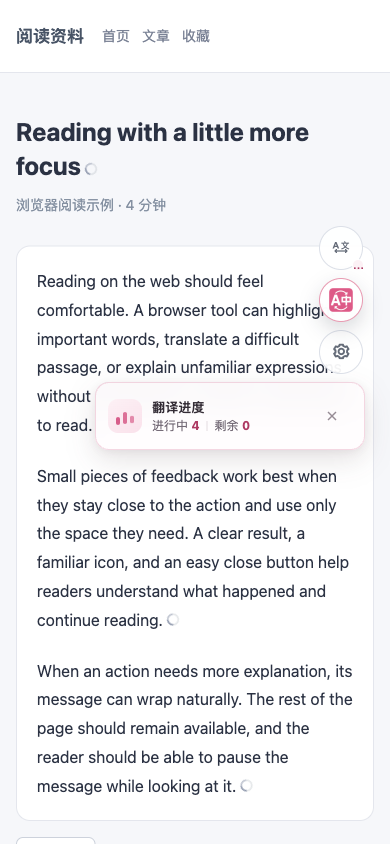

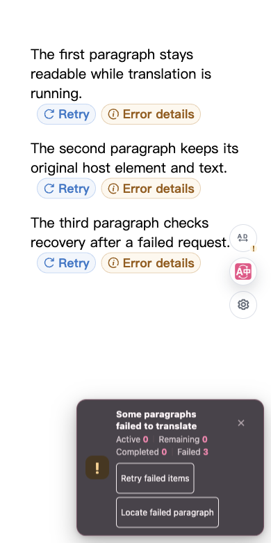

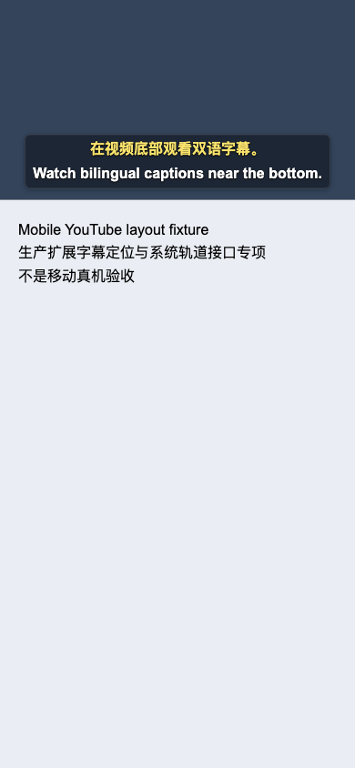

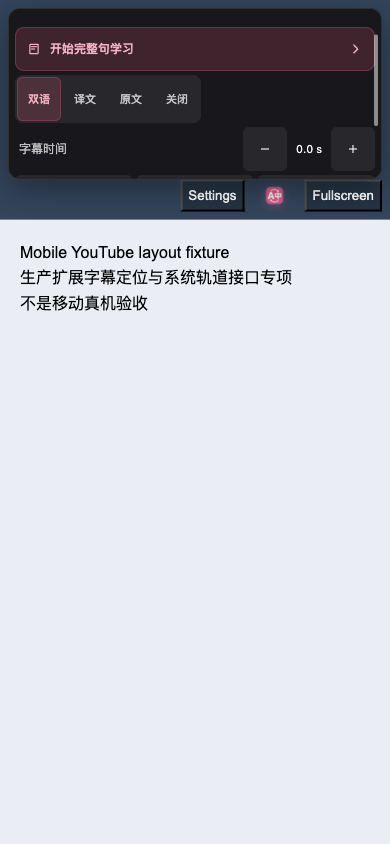

以下为正式 reviewed App 的真实 iOS Simulator 安装指引；系统语言通过 App 启动参数指定，深色检查后恢复任务设备原有浅色外观。

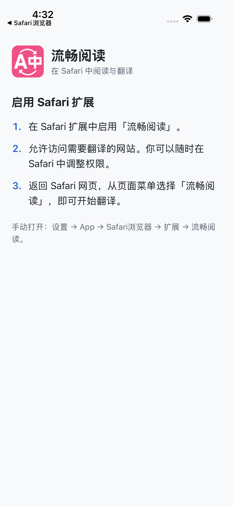

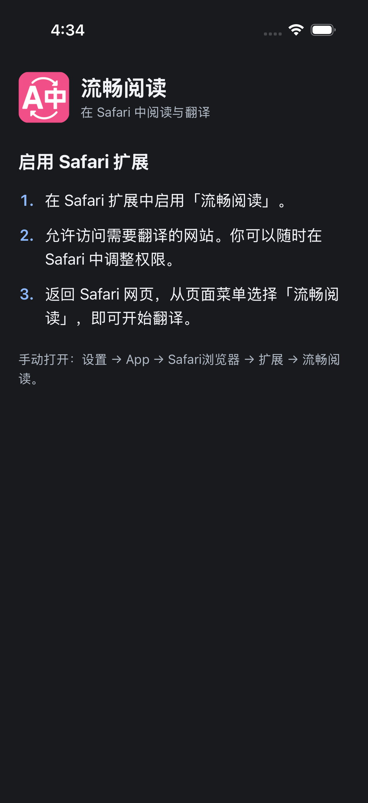

下图为修复入口定位后的 `c24aab…` App 的真实 Simulator 长按选区：触摸入口位于端点行侧，与 Safari 原生菜单保持间隔。下一张图来自后续 `e3f9c0…` App：实际点击后菜单已消失，词典补充完成，复制译文反馈可见。

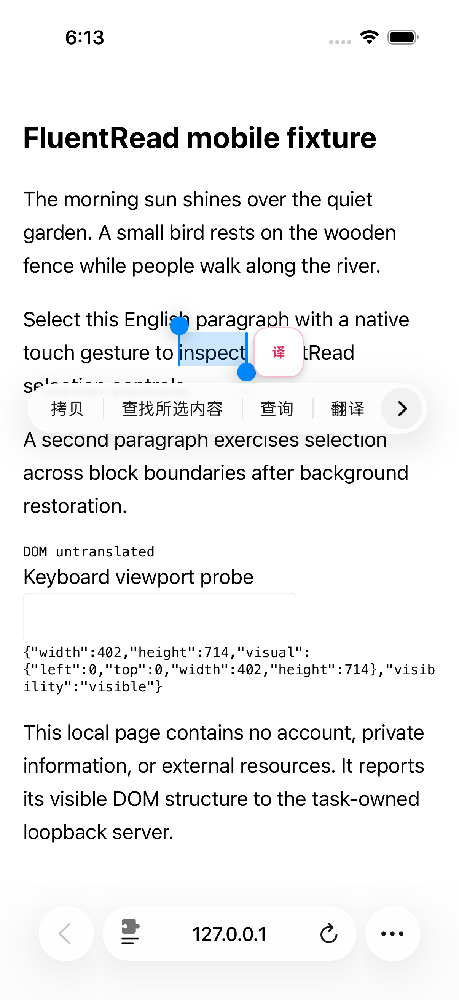

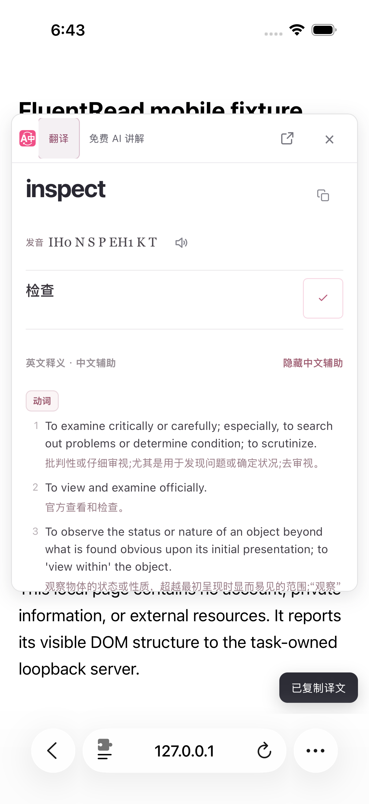

以下是精确生产模块在真实 iOS Simulator AVKit 全屏中的双语字幕；纯色本地视频与字幕是受控平台夹具，不是 YouTube 完整路径。

最终 `e3f9c0…` App 的 Safari 初始半屏保留主操作与授权状态；按钮原生实测高度 46 点，展开状态另行验证。

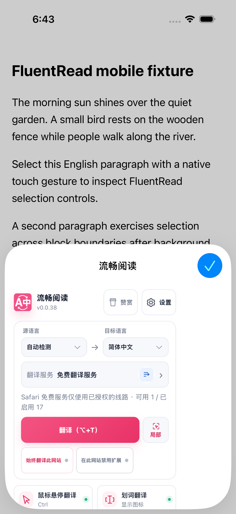

以下为实际公开 YouTube 视频在正式 `e3f9c0…` 扩展中的系统全屏播放截图，字幕随视频时间更新；视频画面来源为上文 TED-Ed 候选，译文具体来源未归因为机器服务。

以下为正式 `1cfa94…` App 的真实 iOS Simulator 服务搜索与软件键盘：搜索、清除、返回和关闭均在键盘上方，实际点击已另行核验。

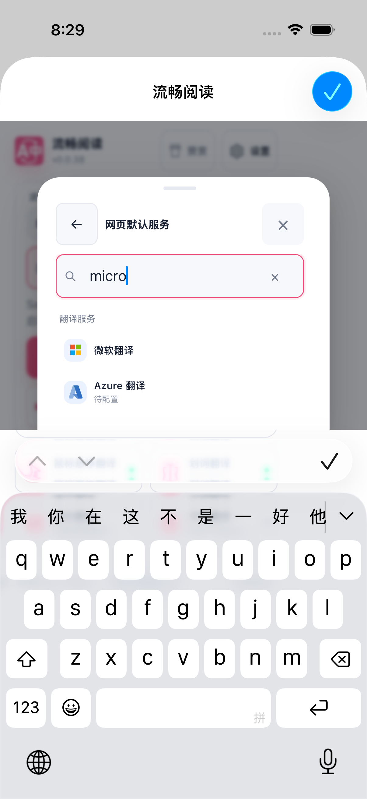

以下为最终布局包在专用 Android 12 / Firefox 158 模拟器中的实际画面：页脚经真实滑动完整可见，服务搜索使用原生软件键盘。已另行实际验证关闭按钮四边命中及长列表返回，区别于前述桌面可见视口夹具。

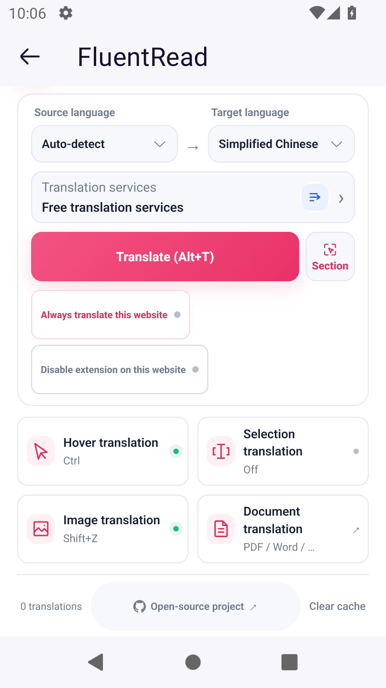

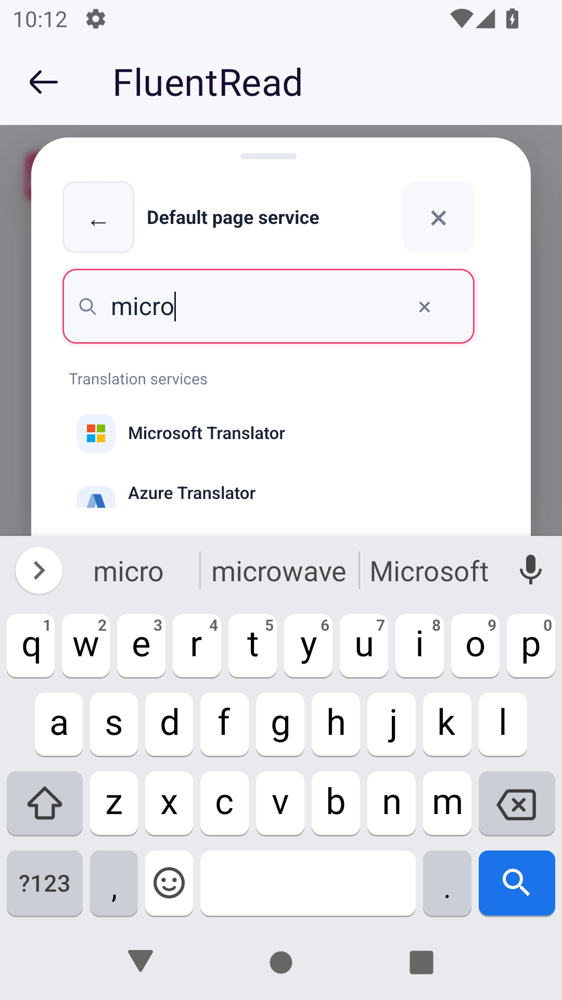

以下为同一最终布局源在正式 Safari App 中的实际 iOS Simulator 键盘画面：整页遮罩连续，内部服务抽屉在系统键盘上方，搜索与关闭控件保留完整命中区域。

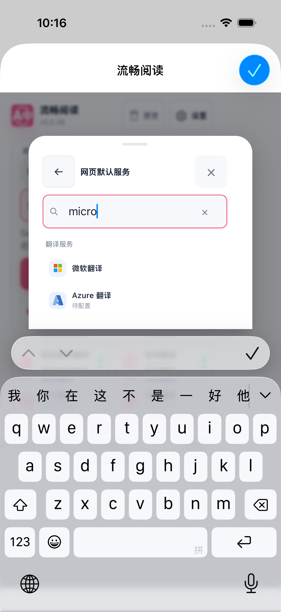
