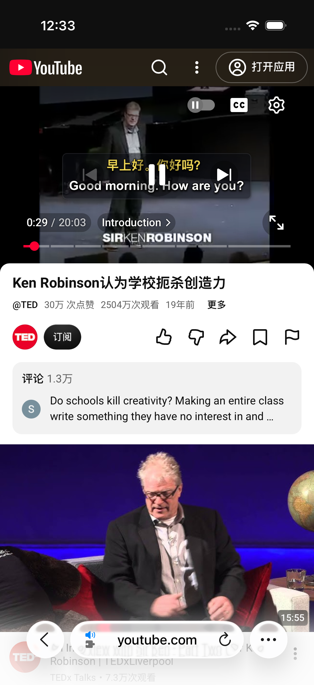
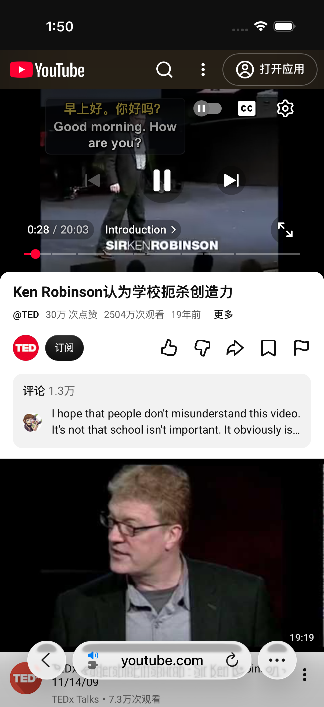
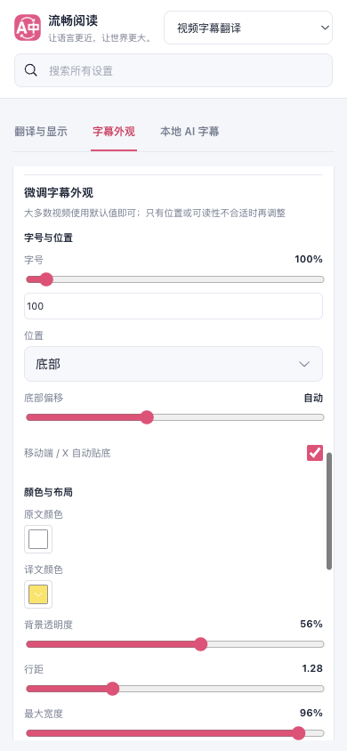
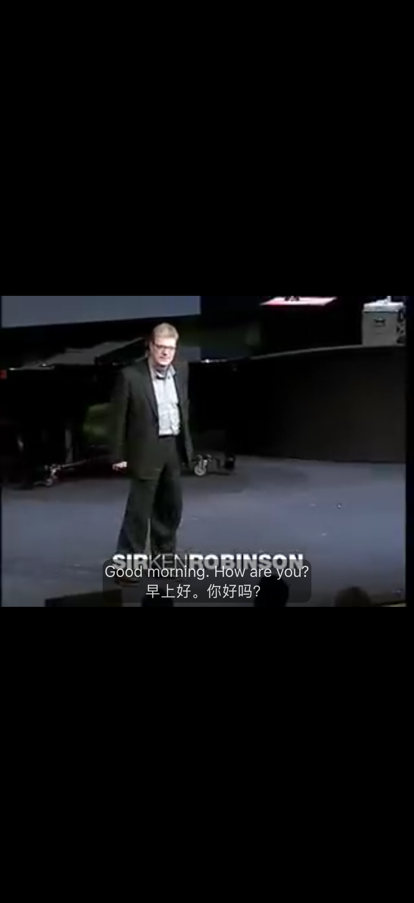

# 移动字幕控件避让与 Safari 打包修复

最新已验收产物源码为 `84189a30e1b8ac0da97ce16dba76be3e01e5e8cb`。`c5aedabc2` 的真实 Safari 复验曾发现中心按钮遮挡，`3439249d6` 修复控件避让，`84189a30e` 再修正实际截图中自动贴底复选框掉到下一行的问题。Safari 包装修复为 `068f4e8a5`。以下保留每轮结果与版本边界；此前记录见 [主线整合报告](./main-followup.md)。

## 已确认的问题与修复

在专用 iOS Simulator 的真实移动 YouTube 页面中，`movie_player` 外的同视频容器承载底部时间、章节和全屏控件。播放器内查询无法找到这些兄弟节点。一次正常触摸后的三次只读采样确认：控件位于同一视频容器，祖先可见性从隐藏变为可见。该轮处于视频片头，字幕面板为空，因此采样只证明查询范围缺口，不能用作修复后的视觉验收。

字幕布局仅在已识别的移动 YouTube 容器中扩大查询范围，并要求容器内只有当前视频。后续修复同时读取顶部、中部、底部与进度控件，优先保留字号和卡片宽度，在有限空区中放置；极长句使用自有卡片滚动，并在菜单打开时解除临时滚动宿主。显隐与结构变化合并到一帧，关闭、重绑和卸载时清理订阅。查询不扩展到整页，不修改站点样式或播放器定位。自动贴底设置标签为“移动端 / X 自动贴底”。该布局已完成受控生产浏览器与真实 Safari 专用模拟器的限定场景复验，菜单入口仍未通过。

Apple 单平台包装工具曾保留默认 App 标识，而扩展标识使用传入值。打包脚本现在沿实际 native target、配置列表和 Debug/Release 配置校正 App/Extension 标识，并在全部工程写入后重新核对。已有工程仍不会被覆盖；未知模板结构会明确失败。研究用 iOS 单平台包已验证编译后的实际标识一致。

## 验证范围

- `c5` 初版字幕几何与挂载生命周期测试 68 项通过。后续避让修复的三份直接消费者共 91/91 通过，四个布局、观察和范围模块的 statements、branches、functions、lines 均为 100%。覆盖控件显隐、长句、滚动位置、焦点、菜单、全屏边界、换视频与清理；挂载菜单用例保留既有桌面入口端口，因此不证明实际 m.youtube 入口触摸。
- Safari 交付契约专项：52 项通过。新增测试的类型声明补齐后，TypeScript/Vue 类型检查通过。
- 六种旧界面词典与 English 基线的指定用例通过；未运行整份语言测试。
- `c5` 的 Chrome、Firefox、Safari Web 生产构建通过；`aeb98993e` 的 userscript 本地构建与产物校验通过，但 CI 发现新增语言文件不存在于固定远程提交中，因此该 userscript 产物不能作为有效交付。`041745eeb` 恢复已发布词典投影与原 hash 文件，扩展保留新标签；语言专项 262/262 通过，固定提交、整文件字节和文件名断言均通过。`3439249d6` 与 `84189a30e` 的 Chrome、Firefox、Safari Web、userscript 构建及所有产物校验均通过；有效 userscript SHA-256 为 `315517cdf1ee2b0a319f110eba2297c9db84678e82a4700d9ee146c6df5d465e`。
- 新生产 Safari 包的 macOS、iOS Simulator、iPhoneOS 三目标顺序编译通过；三者的 App/Extension 实际标识和 467 份 Web 资源均核对一致。Simulator App 的完整身份包含 485 文件，后续运行必须使用该新包。macOS 与 Simulator 为链接器 ad-hoc、无开发者团队，iPhoneOS 未签名；未发布或操作真机。
- 独立审查发现的滚动宿主遮挡菜单问题已修复，并复核代码与挂载消费者。设置组件真实 SFC/DOM 8 项测试，加上验证所有权与模块边界共 44/44 通过。后续修复的测试审计、TypeScript/Vue 类型检查和 diff check 均通过；未运行本地全量回归。

生产包已在专用 iOS Simulator 中取得真实双语字幕。第一轮动作测试为 1 PASS、0 SKIP、0 FAIL，但视觉验收失败：底部时间、章节和进度区域的重叠消失后，字幕上移到中心暂停按钮下方。原图明确显示遮挡，相邻 AX 采样中的交叉面积为 3192 平方点；字幕句子在截图与 AX 之间发生正常推进，不能把二者当作同一瞬时文本。这是保留的失败基线，不能将当时的动作测试通过记为布局通过。

后续 `84189a30e` 在专用 iPhone 16 Pro / iOS 26.2 Simulator 的真实 YouTube 页面重新取得同一英中句子，并正常显示原生控件。字幕移到左上可用区，英文两行和中文一行完整可读；根 Agent 与独立 Agent 均查看了两张原图。面板 AX 为 `(56, 121, 174, 71)`，与中心 Pause、章节和进度的交叠均为 0；原始 XCTest 为 1 PASS、0 SKIP、0 FAIL。控件遮罩仍使字幕变暗，这不是对比度合规验收。上/下视频的宽透明 AX 点击框与字幕下缘有交集，未测试这些边缘触摸，也未验证真实极长句滚动，不能扩称所有点击区域通过。

`841` 的新包仅重新编译 iOS Simulator：467 份 Web 与完整 485 文件匹配新身份 `39dfaa29e70fc617b53f309c3dcb989af69ad74c86e662c9d8088968e19bb9f2`。macOS/iPhoneOS 保留 c5 的历史工具验证，不转记为新包结果。复验结束后原 d9 完整 485 文件恢复，Userscripts47、Demo 和所查 FR 私有17文件边界保持，A407 Shutdown，100 个已知 PID 已退出；focus、violations、cleanupErrors 均为 0。

受控生产 Edge 在不抢焦点的第二屏独立 profile 中验证了短、中、超长双语、16px 字号保留、滚动首尾可达、同句重排、显隐恢复、原生播放/设置/全屏按钮命中与正常点击，以及 Off 撤回自有 UI。14 张原图逐张复核，无页面或控制台错误。中俄设置行同排完整，整行点击与配置保存通过；8 项真实 SFC 行为和类型检查在样式修复后再次通过。关闭后夹具原生长字幕会溢出，只接受自有 UI 清理，不宣称整页 Off 视觉通过。

`841` 受控 m.youtube 拓扑和真实 Safari 的菜单入口均未创建/找到，尚未执行入口点击或菜单打开。因此该版受控报告整体 `success=false`，仅字幕和设置项范围通过。

后续源代码修复将入口挂到已验证同视频容器中、包含原生全屏按钮的底部控件组；外部菜单使用自有宿主，保持原菜单实例、媒体目标和关闭后焦点。尺寸、方向或可见视口变化时，既有布局帧先校准宿主再测菜单，不必等待周期更新。普通避让字幕也移到外部暗罩之上，并保持点击穿透；菜单或句子学习面板打开时字幕退回原层，关闭后恢复同句滚动位置。

学习面板同样在已验证的单视频移动容器内使用透明渲染层，保持既有 Vue 实例、播放器坐标与拖动位置；HTML 全屏不包含外部容器时退回播放器，关闭时清理渲染层。组件使用明确的逻辑播放器识别快捷键范围，不再依赖面板物理父链；关闭面板只在已验证的同视频范围内寻找返回焦点入口。初次布局测量失败时也会回收尚未交给宿主的节点和监听器。

入口与菜单消费者 171/171 通过，包含四个实际布局帧事件的失败复现与修复验证；后续学习挂载、互斥、字幕布局和会话消费者 145/145 通过，相关七个模块四维覆盖率均为 100%。这些专项存在重叠，不能相加作为唯一用例数。测试使用实际绑定和挂载运行时，学习视图挂载端口使用轻量 DOM；组件另外执行实际 SFC setup 消费者 37/37 通过，包含实际注册的窗口按键与外部菜单隔离。独立代码复查已确认菜单帧校准和学习键盘归属问题闭环。新源代码的生产浏览器与 Safari 实际点击、绘制验收待重新构建后进行，不能用 `841` 的截图代替。没有把 Chromium 视口测试当作真实触摸或 Safari 证据。

`65d4cec78` 的四种 Web 生产构建及产物校验通过。受控生产 Edge 找到唯一入口，正常点击能够打开、关闭菜单；播放器从 402×226 缩至 320×180 后，菜单宿主在 17.3ms 内随实际 ResizeObserver 更新。短、中、极长字幕避让与原生控件正常点击通过，原图确认字幕不再受外部暗罩压暗。

该轮整体仍失败：长字幕滚动至 2720 后，关闭菜单回到了 0。第二轮去掉尺寸变化和字幕模式点击，仅保留正常打开、关闭动作，仍得到相同结果，证明不能以此前无真实滚动盒的 DOM 测试宣布恢复通过。两轮均保留原始截图，所创建的临时 profile、浏览器和观察进程均已清理，无抢焦点记录；句子学习的生产操作链尚未执行到，新 Safari 包也尚未编译或运行。

补充修复只调整恢复顺序：最终物理挂载位置和滚动 CSS 就绪后，再恢复并消费保存的位置。新的浏览器边界用例模拟范围钳制及重挂归零，先验证旧源码失败，再得到 100/100 通过、四个模块四维覆盖率均 100%；独立代码复查通过。该端口测试不代表真实浏览器，新产物仍需重新走正常菜单、学习面板与同句滚动恢复链路。

`061d0f32b` 重建后，受控 Edge 完整动作链通过：正常打开、关闭菜单和学习面板、焦点返回入口，同句滚动位置均保持 2720，菜单尺寸跟随为 32.2ms，无页面或控制台错误。但 15 张原图复核发现：学习卡片只有 162px 可用高度，固定顶栏、导航和底部操作将正文压成窄缝。因此只接受动作、字幕和菜单范围，学习视觉与整体视觉验收仍失败；尚未执行新 Safari 包。

后续短高修复在可用高度不超过 240px 时改为整卡单区滚动，关闭按钮随顶栏固定，正文保持字号，导航与底部操作随内容流可达；粗指针下相关操作保留 44px 目标。换句时同时归顶自有短高卡片，普通播放器仍只归顶正文区，不改变页面滚动。直接组件与布局专项 61/61 通过，placement 四维覆盖率均为 100%，实际像素、滚动到底与点击目标仍须新生产产物复验。

系统全屏使用独立用例，复用同一份 XCTest 编译产物，不要求先暂停或打开扩展菜单。实际进入竖屏 AVKit，系统字幕菜单存在 FluentRead 轨道，选择后显示勾选，两个播放时刻的原图可见英中双语字幕，并正常返回网页。原始结果为 1 PASS、0 SKIP、0 FAIL。中间一次原图没有字幕，只记录该时刻，不能据此判断漏 cue；也不把底层 WebView 文本当作系统字幕证据。

两张系统字幕菜单原图同时出现屏幕键盘，整体菜单体验不能记为通过。离线时序确认键盘在进入 AVKit 后、选择 FluentRead 之前出现；中间操作没有再次键入文本，AX 也未提供可归属的实际输入框焦点。无法区分具体触发步骤或产品、站点、系统及测试工具的原因，不据此修改选轨逻辑。未进行横屏系统全屏或真机验证。两轮均通过正常同 bundle 安装新生产包并在结束后恢复原 d9，完整 485 文件、所检查的 17 份 App 私有文件与 Userscripts 测试包保持；模拟器已关闭，所属进程已清理。

此前受控浏览器启动接口、清单本地化名比较与未同步夹具原生字幕文本造成的失败均保留原始记录。更正后使用命令行加载生产扩展、真实扩展 API 与同步媒体/字幕夹具完成上述限定验证；未将这些测试脚本问题混作产品回归。

## Userscripts 的实际边界

专用模拟器中的未签名 Userscripts 测试包，通过正常链接和指向同一 App 的系统确认完成冷启动。App 主页显示默认文档目录；返回 Safari 并重新打开扩展面板后，首次使用引导仍存在，目录与刷新控件明确禁用。该轮原始结果为 1 SKIP、0 FAIL，未读取 Demo，更没有验证 FluentRead 脚本运行。

源码表明面板读取缓存的 native 检查错误；现有证据不能区分旧错误尚未刷新与扩展当前仍无法读取目录书签，也不能归因于 App Groups 或签名。临时本地网站权限已在实际设置界面恢复为“询问”，所属进程与模拟器已清理。此结果不代表商店版本或签名真机行为。

物理设备、VoiceOver/TalkBack、完整安装更新与后台恢复矩阵，以及此前 Android Edge 商店版的页面质量异常，仍保留为未覆盖项。本轮未借用参考仓库实现，也未签名发布或操作真机。
