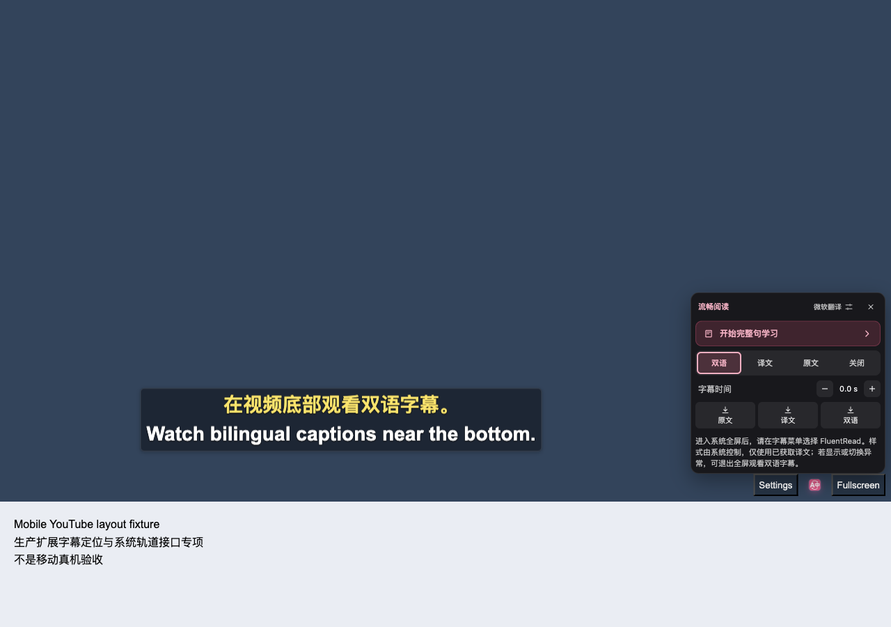

# 字幕菜单滚动与键盘焦点修复

短播放器中的字幕菜单滚到时间调整或底部提示时，关闭按钮会随标题滚出可见区域。现在标题和关闭按钮保持可见，滚动顶部背景完整；键盘切换项目时预留标题空间，避免焦点落到标题下方。产品改动仅为字幕菜单的六条 CSS 声明，桌面保持紧凑尺寸，触屏保持至少 44×44 的操作目标。

## 缺陷与复验

| 阶段 | 实际结果 |
| --- | --- |
| 原生产基线 | 时间行位置的关闭按钮可见高度仅 14.50px，中心命中视频；底部提示位置完全不可见。 |
| 首个固定标题候选 | 正常关闭及焦点返回恢复，但第 6 次键盘操作到 Off 时，目标被标题遮住，五个采样点全部命中覆盖层，仍然失败。 |
| 最终菜单专项 | 退出 0、错误为空；18 个菜单几何场景，触屏 12 次真实键盘操作、正常关闭和 Escape 焦点返回、桌面紧凑呈现及禁用清理通过。 |
| 修正旧测试预期后的完整受控流程 | 退出 0、12 个具名场景、错误为空；轨道选择、换视频、刷新、合成 pageshow 后就绪及菜单清理断言通过。 |

原始[基线失败](./current-menu-scroll/baseline-geometry/report.json)、[首个候选失败](./current-menu-scroll/sticky-only/report.json)、[菜单专项结果](./current-menu-scroll/menu-suite/report.json)与[完整受控结果](./current-menu-scroll/lifecycle-corrected-oracle/report.json)分别保留。所有触屏目标在实际裁切范围内完整可见，五个内部采样点均命中所属控件；键盘按键没有通过手工聚焦或强制滚动来修补结果。独立审查实际查看了菜单专项 23 张原图和完整流程 11 张关键原图，见[菜单审查](./current-menu-scroll/independent-menu-suite-runtime-review.json)与[生命周期审查](./current-menu-scroll/independent-corrected-lifecycle-review.json)。

## 字幕选择测试的预期更正

旧完整脚本在 `A→FluentRead→Off→FluentRead→退出` 后要求恢复最初的站点字幕 A，实际保持 disabled，原始[失败记录](./current-menu-scroll/final-geometry/report.json)没有覆盖或改写。现有产品状态机及既有单测要求保留用户的最新选择：Off 会清除过时的来源归属，之后再选 FluentRead 也不应复活 A。

测试现在分别要求 `A→FluentRead→退出` 恢复 A，以及含 Off 的链路保持 A disabled，并保留 Off 跨重进、另选站点轨道 B 和禁用后的来源保护。产品原生轨道状态机未修改。每次测试选择写入前订阅真实 `TextTrackList.change`，要求可信事件，在事件分发后的下一任务复核全部目标模式，并保留绝对 2 秒截止。实际 11 份选择回执共记录 17 个可信事件，最长约 6.3ms；cue 数量仅另作就绪检查。见[更正补丁](./current-menu-scroll/native-oracle-preparation/native-oracle.patch)、[静态审查](./current-menu-scroll/native-oracle-preparation/independent-code-review.json)及[实际结果](./current-menu-scroll/root-corrected-lifecycle-outcome.json)。静态审查当时尚未执行浏览器，其待验证项由后续独立[事件回执补充审查](./current-menu-scroll/native-oracle-preparation/independent-browser-ack-addendum.json)关闭，两个时点分别保留。

## 构建与证据边界

三份布局相关测试共 147 项、原生轨道既有测试 27 项、类型检查及测试审计通过。Chrome、Firefox、Safari Web 和 userscript 生产构建以及相关校验通过；[第一组验证](./current-menu-scroll/final-build/summary.json)、[跨平台验证](./current-menu-scroll/cross-platform-build/summary.json)与[完整产物身份](./current-menu-scroll/artifact-gate.json)分别绑定源文件和逐文件清单。两轮浏览器运行的所属关闭检查完成，临时 profile 删除，未观察到本轮浏览器抢焦点；[随后资源检查](./current-menu-scroll/root-fresh-corrected-lifecycle-release.json)确认专用进程、端口和模拟器已释放。

- 运行使用本地 YouTube 拓扑、timedtext 与翻译响应夹具、Chromium 触屏和视口模拟。时间行与提示位置由受控 DOM 设置，未验证原生手指惯性滚动或在线供应商。
- 标准 TextTrack 模式写入及隔离世界的 webkit 事件 shim 只验证共享逻辑，不能证明 Safari/AVKit 系统菜单选择或渲染。
- CDP 安全区注入 API 不可用，本轮只通过 fallback 与 DOM 全屏几何，没有验证 44px/24px 刘海安全区或系统窗口全屏。
- 桌面确实为 `coarsePointer=false`、`maxTouchPoints=0`，四个记录的 scrollTop 均为 0；只接受紧凑呈现、End/Home 和正常关闭，未覆盖桌面溢出滚动。
- pageshow 使用合成 persisted 事件后检查就绪，没有真实 BFCache 转移或独立 pageshow 截图。刷新截图证明网页双语恢复；该时刻原生 cue 仅英文，未断言刷新瞬间的原生双语就绪。
- 最近一次独立真实 Safari 运行仍为 [0 PASS、1 SKIP](./current-menu-scroll/safari-precondition-skip/inline-attempt1/runtime-summary.json)。只执行一次正常播放器中心触摸，未达到入口和关闭控件前置，未打开、滚动或关闭菜单；[限定结论](./current-menu-scroll/safari-precondition-skip/root-runtime-outcome.json)不能转记为这份修复产物的验收。

本分项通过不等于移动端完整矩阵完成。物理设备、辅助技术、原生键盘、旋转与后台回收、真实 Safari 播放及菜单滚动仍需单独验收。本次未借鉴参考仓库代码，没有变更版本、依赖或权限；所有选取的原件及复制哈希见[复制索引](./current-menu-scroll/provenance.json)。
