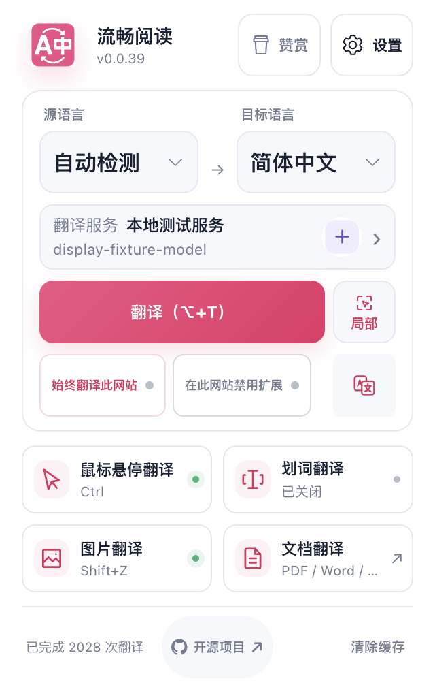
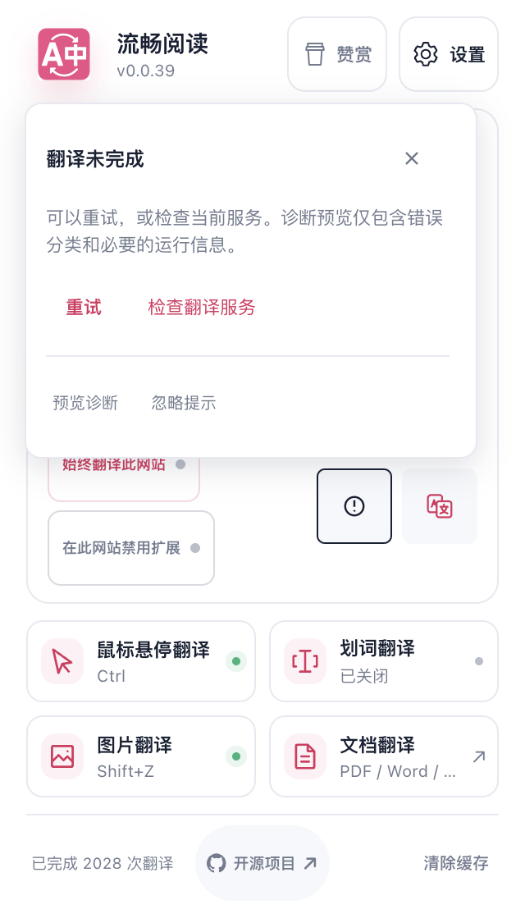

# 显示模式按钮与手机布局的集成复验

主分支新增右下角显示模式按钮后，Popup 与手机布局修复发生四处集成冲突。产品提交 `4aa991c60348e7070405a8d93544b91d549abc97` 整合主分支 `36be753f`，保留两边的服务抽屉、语言菜单、触屏尺寸及配置生命周期。实际冲突位于说明注释和 CSS 末尾的相邻规则；手工整合没有删去任一方的运行逻辑或测试。

触屏显示模式按钮保持 46px，语言菜单仍使用 46px 选项和 16px 搜索输入。服务抽屉的可见视口订阅、极矮高度布局、搜索边框恢复以及关闭／失活／卸载清理均保留。模式按钮复用主分支的配置持久化与过期回调保护，没有在此新增另一套状态。

七文件专项 **497 项通过、0 跳过**，类型检查和静态测试审计通过；执行时的暂存树与随后提交的产品树一致。干净产品提交的 Chrome、Firefox、Safari MV2 与 userscript 四类生产构建，以及脚本、清单、Safari 资源校验通过。审计清单不代表全仓测试执行。

隔离后台 Edge 的生产扩展通过 **7 个场景与 4 项持久化检查**。中文、英文、深色和 coarse 触屏模拟布局没有水平溢出；模式图标与局部按钮对齐，诊断浮层边界完整。键盘切换、快关重开、连续写入保留最终选择、Options 同步及 Google 服务禁用提示均通过。一次本地受控翻译后，双语／仅译文切换与恢复原文没有增加供应商请求，并保留原文节点。

14 张原始 PNG 已由 Root 与独立审查者逐张查看；以下两张按原字节公开。控制台与清理错误为 0，浏览器正常关闭，临时 profile 已删除；连续应用激活观察器记录 0 个事件，仅说明该轮未观察到应用激活，不保证所有输入焦点。

| 触屏布局 | 触屏诊断浮层 |
| --- | --- |
|  |  |

本轮 Popup 以扩展页面打开，活动标签页查询绑定本地页面，诊断响应和翻译服务为夹具；coarse 由桌面 CDP 模拟。它不替代 Safari 原生 sheet、软键盘、真实网站、手机真机或 VoiceOver／TalkBack 验收。原 D9 的原生基线读回单独推进，新产品未由本轮检查安装；没有开发者签名、发布、真机操作或 PR 合并。

[结构化摘要](./popup-display-mode-integration-evidence/summary.json) · [分版本验收](./acceptance.md)
