# 视频菜单极矮视口与正文可达性补充（2026-10-18）

本轮修复视频菜单在极矮可见区域中关闭按钮裁切、以及正文控件不可见却仍能获得键盘焦点的问题。安全高度不足 128px 时保留完整 Close；达到 128px 时，标题下方至少保留一个 44px 正文滚动窗口，并显露当前明确聚焦的控件。128px 不代表全部菜单内容能同屏显示。

## 已保留的失败与修复

旧生产包在 58px 受控可见高度下，44px Close 只有 32px 可见，两个下方命中点落到播放器；该轮退出 1。第一版修复让 Close 通过，但逐图审阅又发现：84px 正常态的正文窗口只有 4px，44px 控件仍可进入键盘导航。此前 runner 的成功只覆盖 Close，不能验收正文可用性。增强断言在该版生产包上复跑，于 84px 预期 close-only 的检查再次退出 1；这些旧记录均保留。

最终规则是：44–127px 折叠正文与非 Close 标题分支，并以 `inert` 隔离其焦点；Close 保持 44×44px。需要显露正文焦点时，只滚动 FluentRead 自有正文，使用户打开菜单所选项或键盘下一目标完整显露，不滚宿主页。正文几何按宿主缩放折回 CSS 像素；同尺寸周期刷新不会拉回手动滚动。恢复高度保留节点、模式、子页和原有 hidden/inert 归属，不自动把焦点搬回正文。桌面与正常提示面板保留原焦点行为。

## 本轮实际验证

三份专项共 **183 项通过、0 跳过**（绑定 112、菜单与本地化 36、视口 35）；类型检查、静态测试审计、Chrome／Firefox／Safari Web 生产构建及 Safari Web 资源校验退出 0。随后一次隔离生产扩展 `--suite menu` 运行退出 0，耗时 22.992 秒，报告记录 7 个共享场景及菜单几何检查，错误数组为空，共保存 49 张原图。49 张原图已由非作者逐张审阅，代码和操作逻辑独审均无未解决项；149 份完整可见目标记录的 745 个命中点均通过，另外 22 份是正常滚动区的部分可见记录，不据此声称全部内容同屏。此页逐字节复制其中六张原图。

| 实际检查 | 本轮结果 |
| --- | --- |
| 44、54、58、80、83、84、127px | Close 完整至少 44px、五点命中；菜单位于宿主内、宿主位于受控可见区域内；正文不参与布局和键盘导航 |
| 128px 正常正文 | 正文 clientHeight 为 44px；选中首项、End 末项、返回首项均完整 44px 且五点命中；仅正文 scrollTop 为 3 → 216 → 3，页面滚动均为 0 |
| 非零滚动折叠再恢复 | 216 → 127px 折叠无滚动框时读数 0 → 128px 展开恢复 216；同一正文、模式节点与选中值，Close 留焦，不自动回正文 |
| 恢复 280px | 正文恢复可达；正常关闭重开后六个主要模式／校时控件完整，节点与选中值保留 |
| 焦点与关闭 | 自有正文折叠时移至 Close；页面已有焦点不抢夺；具名 Close、Escape、外部点击关闭后菜单无矩形／采样命中；普通 Close 返回已知入口 |

单元用例另覆盖变换缩放与边框换算、上下显露、可见目标不写 scrollTop、同尺寸手动滚动不重置、外部目标不写及桌面／非正文焦点行为。它们不替代新的原生 prompt 验收。

## 六张原始截图

320px 竖屏保留两列模式；844px 横屏保留主要控件。两图来自受控页面中的真实生产扩展。

| 320px 竖屏 | 844px 横屏 |
| --- | --- |
| 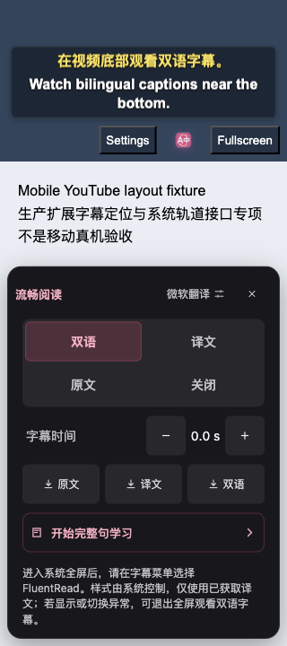 | 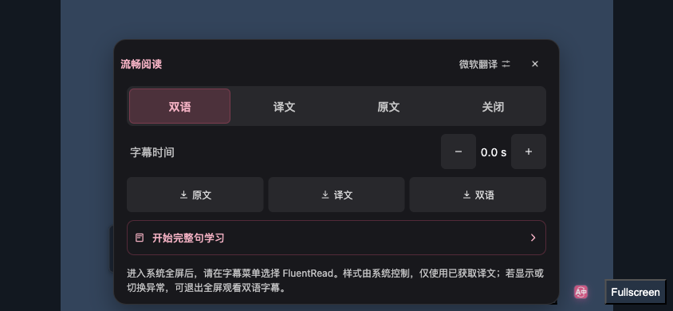 |

44px 受控区域只保留 Close；128px 显露选中项，正文其余内容通过自有滚动访问。

| 44px 完整 Close | 128px 选中项 |
| --- | --- |
| 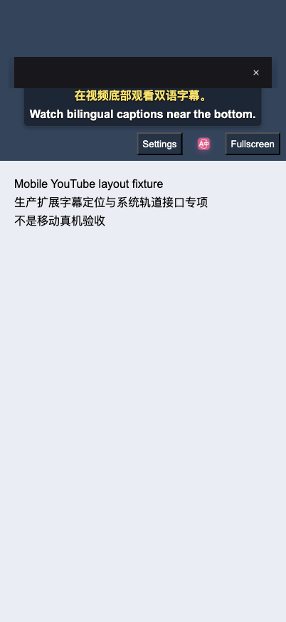 | 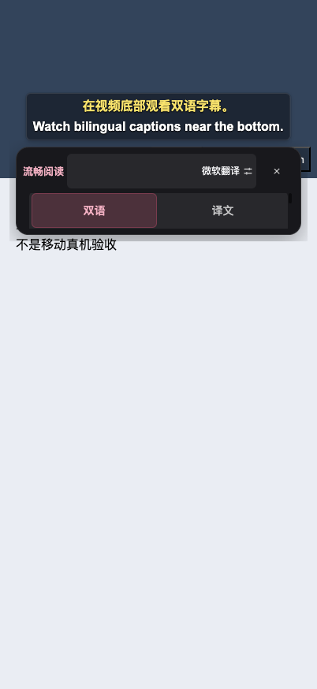 |

128px 用 End 显露末项；280px 恢复正常正文。以下截图未裁剪、拼接或重绘。

| 128px 末项 | 280px 恢复 |
| --- | --- |
| 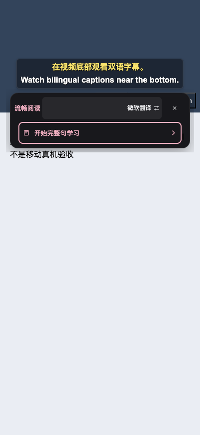 | 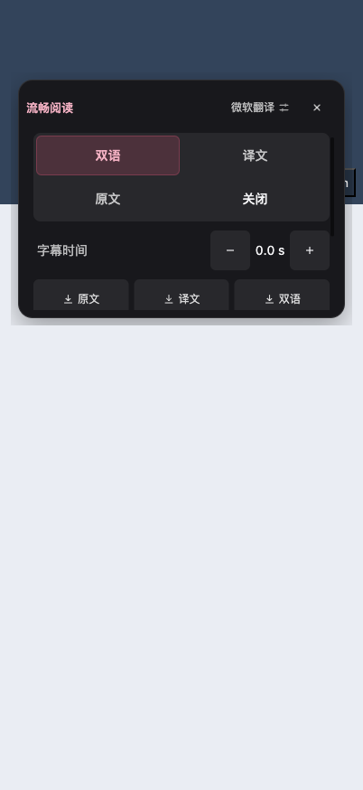 |

## 源码和证据边界

执行时源码基于 `00c9770bfbb6e392ba5f44da69059230b19a9e01` 加未提交的三个产品文件改动，尚无本修复的新提交 SHA。测试、构建与浏览器回执记录同一文件字节；[公开摘要](./video-menu-minimum-viewport-evidence/summary.json) 保留这三个源码的完整 SHA256、生产 content 脚本与 manifest 摘要，manifest 相同本身不能证明产品源码相同。[复制索引](./video-menu-minimum-viewport-evidence/copy-index.json) 记录六张副本与原图的相同字节和 SHA256。

本轮是隔离 Chromium、受控 HTML／字幕／翻译响应及真实生产扩展的布局与操作验证。极矮高度来自 VisualViewport 数值夹具，不是真实软键盘；coarse 和 DOM 全屏属性也属受控条件。实际 safe-area inset 模拟接口不可用，不能将已有 offset／root-transform 检查称为系统安全区通过。没有新 Safari／Firefox 运行时、原生 UI、物理设备、供应商或全语言主题验收，不沿用旧原生 PASS，不证明系统全屏字幕绘制。本修复未借鉴参考仓库。

## 2026-10-19 手机触摸与阅读菜单补充

后续逐图和实际操作又发现：阅读菜单按 layout viewport 计算位置，短可见区域中可能越界；菜单项仅30px、入口32px；完整句学习的模式和编辑目标过小、交互文字仅11px；赞赏 Close 为28px。现将阅读菜单定位改为已有安全 VisualViewport 公共接口，并保留宿主缩放、RTL、上下展开和原有关闭生命周期。触摸模式下阅读按钮及菜单至少44 CSS px、14px字号；整句学习模式及编辑目标至少44px，交互文字13px、译文至少14px、编辑框至少16px，并保留用户配置的更大字号。赞赏 Close 在触摸与 Android Popup 条件下46px，桌面保持28px。

| 真实生产扩展操作 | 本轮受控结果 |
| --- | --- |
| 阅读菜单，两组粗指针 | 390×760页面，数值可见区域366×280、offset(12,80)；菜单在可见区域内。原尺寸入口44×44、菜单项高44/字号14；宿主0.8变换后的实际目标35.2px，仅证明缩放可达性。正常滚轮到首末项、查看精确原文、打开并只关闭本次设置页均通过 |
| 整句学习，两组短播放器 | 实际播放器374×260和320×180，卡片高196与116。每行9次可信点击，循环/正常、译文与解释编辑完成、回到当前句、解释和关闭均通过；编辑不改原文，实际编辑框至少16px。仅滚自有卡片，8与11次滚轮可达首末目标，宿主页不滚动 |
| 赞赏弹窗，四组 | 粗指针320×760及390×280、受控 Android marker、桌面 fine。4次打开/关闭、短卡2次可信滚轮到末尾链接再返回；46/28px及标题不重叠、同一入口还焦通过。没有点击支付或外链 |

最终五份专项测试为226项通过、0跳过；类型检查、Chrome／Firefox／Safari Web／userscript生产构建及完整userscript校验全部退出0。userscript为2,099,416字节，小于2,101,100字节上限。构建不代表这些浏览器均完成运行时验收。

首次滚动定位和点击记录器的失败均保留：学习脚本原固定128px步长跨过目标反复振荡，现按实时sticky顶栏下方区域滚动；点击记录改在捕获阶段读取原动作，避免Vue处理后动作属性已变。滚动后右缘命中一度落到自有滚动容器，有限2秒只读观察后恢复到按钮；最终点击仍要求完整尺寸、可见区域及五点命中，没有重复点击或放宽门槛，也不据此推断系统滚动条的具体原因。

以下六张图为原图逐字节副本；截图中的部分正文通过自有滚动访问，并非全部同屏。

| 阅读首项 | 阅读缩放后末项 |
| --- | --- |
| 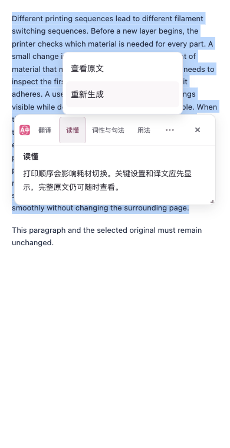 | 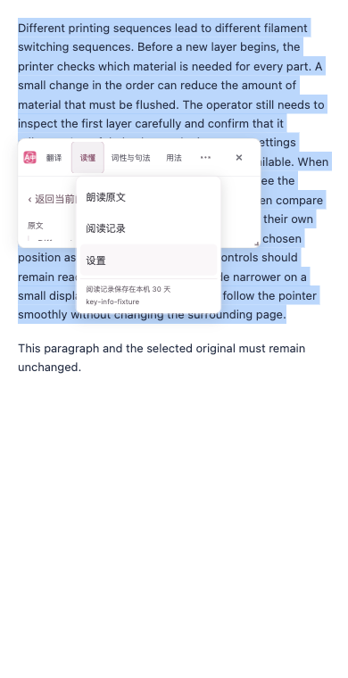 |

| 较短学习卡 | 极短学习卡 |
| --- | --- |
| 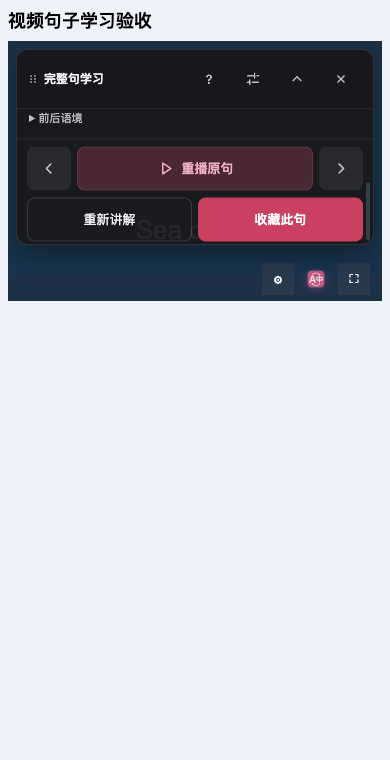 | 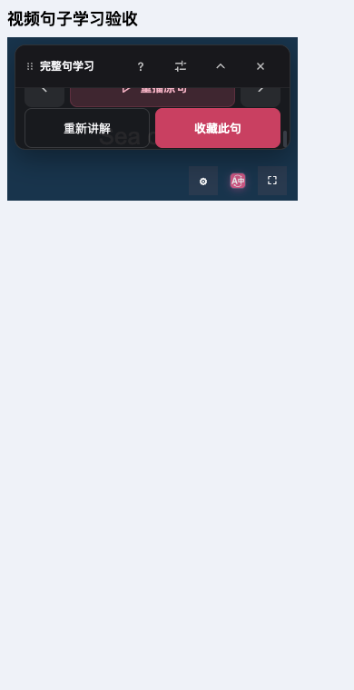 |

| 矮屏赞赏卡 | 桌面赞赏卡 |
| --- | --- |
|  | 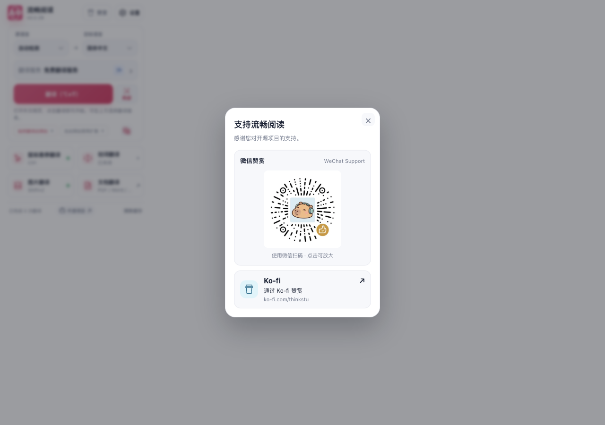 |

[源码、生产产物和实际回执摘要](./mobile-touch-followup-evidence/summary.json)保留每次执行的不同产物身份；[原图副本索引](./mobile-touch-followup-evidence/copy-index.json)记录SHA256。赞赏专项早于最后的阅读/学习字号补充，Popup自身两个源码文件的字节在最终版保持相同，不将三次执行混称为同一整包验收。

本补充仍是隔离Edge和本地翻译/解释响应；无供应商、真实触摸、原生键盘、Safari运行时或新全语言主题结论。当前专用原生App仍为此前e1fee产物，新源码的Safari Web构建已过，但新原生包装/更新/UI尚未验收。原生进程观察中断、正式UNKNOWN与既有SKIP保持原记录，未转写为通过。本轮未借鉴参考项目。

## 2026-10-19 输入预览与分享卡补充

输入翻译原先只按布局视口定位，拒绝粘贴后的译文预览可能落在可见区域之外。旧生产包实测 tooltip 底部437.89px超出受控可见区域底部360px，关闭按钮仅24×16.80px。现在使用所属窗口的安全 VisualViewport，先限制真实宽高再测量、定位，并随可见区域的 resize/scroll 更新；关闭与卸载撤销监听。触控操作至少44×44px、14px文字，预览文字16px，长内容保留自己的滚动。普通桌面维持12px文字。

独立代码审查另发现固定上下留白会在58px可见高度把提示压成34px；生产包复现关闭按钮部分被裁切后，已在不足84px时逐步回收纵向留白，不足60px时回收内边距。最终58px提示位于y130–188，完整44px关闭按钮位于y137–181，五点命中及正常关闭通过。原预览对象保留在同一提示内，不声称所有译文都在58px内同屏可见。

分享卡触控关闭、分段选择、折叠入口与导出按钮均至少44px；编辑框16px。短屏将标题和关闭区留在滚动体外，预览、选项、编辑和导出区在同一正文滚动体内访问，避免固定标题和底栏同时挤占正文。普通尺寸沿用原布局及桌面分段选择34px高度；配置、取消渲染、导出与关闭的业务脚本保持原样。

| 最终生产扩展操作 | 实际受控结果 |
| --- | --- |
| 输入预览，6行 | 390px布局配合280/260px动态可见区、同一提示58px可见区、320×180短窗、1280×900桌面及普通textarea恢复。4次真实快捷键、4次正常关闭/恢复、4次预览双向滚轮；同一预览的内容与滚位随动态视口保持，宿主不滚动 |
| 分享卡，4行 | 320×760、390×280、法语390×760、桌面1280×900。4次真实拖动选词、24次可信坐标点击、9次自有滚轮；真实打开更多选项、选择大字、展开编辑与关闭。短屏滚到底部后直接关闭，未先返回顶部；标题区原始像素与首屏一致 |

最终3份相关测试121项通过、0跳过；类型检查及Chrome、Firefox、Safari Web、userscript生产构建和userscript校验均退出0，执行前后3个源码文件字节一致。userscript为2,100,290字节，小于2,101,100字节上限；本机结果不能提前代替新提交的远端CI。所有本地构建和浏览器操作串行使用40% CPU目标、1 worker、1 concurrency。

以下均为原始PNG逐字节副本，完整16图及原始行记录见[副本索引](./mobile-input-share-touch-evidence/copy-index.json)、[输入记录](./mobile-input-share-touch-evidence/input-report.json)、[分享卡记录](./mobile-input-share-touch-evidence/share-report.json)与[源码/产物/回执摘要](./mobile-input-share-touch-evidence/summary.json)。旧包和58px修复前的红例也保留，未改记通过。

| 动态可见区内的输入预览 | 58px内完整关闭按钮 |
| --- | --- |
| 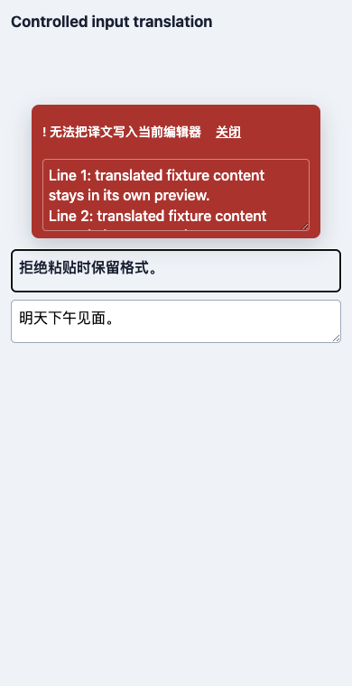 | 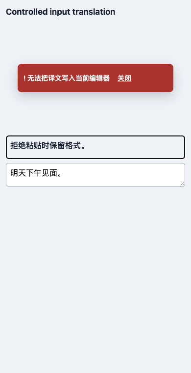 |

| 短屏分享卡首屏 | 滚到底部后直接关闭 |
| --- | --- |
| 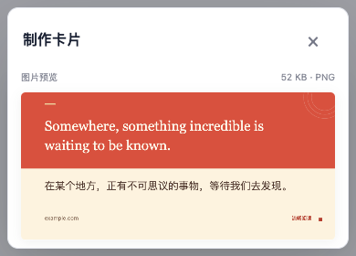 | 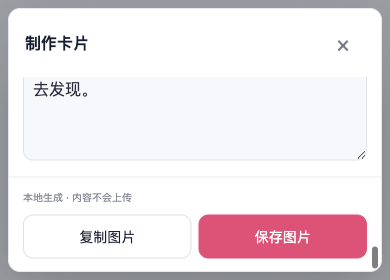 |

本轮使用隔离后台Edge、生产扩展及本地Microsoft协议响应；输入VisualViewport数值和coarse条件受控，分享卡为实际调整浏览器视口。没有真实软键盘、物理触摸、Safari运行时、缩放手势或live供应商验收；长预览只验了双向滚动，未验最后一行，恢复原文仅桌面行；分享卡未点击复制、下载。中途图片预览曾被误读为标题缺绘，但原PNG标题区域逐像素完全一致，已撤回该缺陷判断，不将几何命中或错误预览当成产品绘制结论。

此前ce3源码的Safari本地包装及macOS/iOS Simulator/iPhoneOS编译已另行通过，467份Web资源在包装和三平台产物中一致；它们没有安装到专用模拟器，不能替代本轮新源码的原生构建或UI验收。已安装App仍是旧e1fee；原生UNKNOWN、SKIP和配置保留未知保持原记录。本轮未借鉴参考项目。
