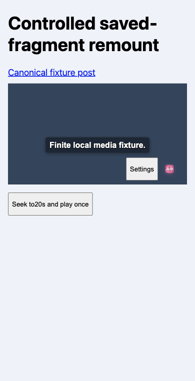
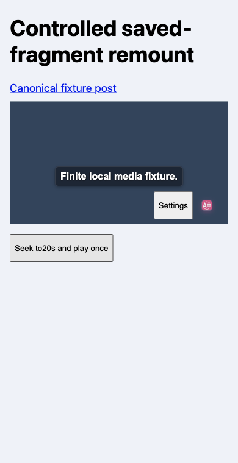

# 视频恢复与 Safari 包要求补充（2026-10-18）

本轮代码为 `a21bb4e9c6b112ca7757bbe0f1420c0d491b9c84`，接续[手机字幕菜单自适应修复](./video-responsive-followup.md)和[主分支集成复验](./main9d6-integration-followup.md)。本轮修复视频恢复状态和 Safari 打包报告，不新增整套移动端验收结论。

## 保留用户已经调整的播放进度

从保存的视频片段打开页面后，第一次恢复到 3 秒；用户随后手动跳至 20 秒并播放。此前关闭再开启扩展会创建新的恢复器，丢失成功恢复记录，再次暂停并跳回 3 秒。现在成功记录由当前 Document 和 video 的弱引用持有，同一来源和片段只恢复一次。仅在暂停、跳转都成功后记账，失败仍可重试；新来源、新片段、新 video 或新 Document 仍分别恢复。没有新增持久化配置。

生产扩展实际通过配置消息关闭、开启，确认旧入口被移除，新入口挂载到同一个 video，时间继续推进；改为新片段后仍恢复到 6 秒并暂停。以下为 **1 个场景的 6 个阶段**，不是 6 个独立用例。

| 阶段 | 实测时间（秒） | 播放状态 | 字幕入口 |
| --- | ---: | --- | --- |
| 首次片段恢复 | 3 | 暂停 | 已挂载 |
| 用户手动跳转 | 20.012027 | 播放中 | 原入口 |
| 关闭扩展 | 20.058579 | 播放中 | 已移除 |
| 开启扩展 | 20.153 | 播放中 | 同一 video 上的新入口 |
| 继续计时 | 20.288133 | 播放中 | 新入口 |
| 新片段 | 6 | 暂停 | 新入口 |

环境是隔离桌面 Chromium 的 390×760 CSS 视口，使用受控 X 页面、本地真实解码 MP4 和原文 TextTrack。第二屏正常窗口通过后台启动，只有 3 个离散焦点样本。页面、控制台、未知请求和清理错误均为 0；四项配置已恢复，任务页面已关闭。它未执行实际 X 网站、翻译供应商、触屏、BFCache、原生 Safari、AVKit 或长时间后台回收。

三张未加工原图已逐张审阅，生产入口图标可见，页面无横向溢出。第二、三张字节相同，不能靠截图证明时间或播放状态；上表来自实际媒体属性记录。[公开结果、内容脚本哈希及原始记录指纹](./video-remount-package-evidence/summary.json)保留这一边界。

前两轮浏览器检查因测试请求许可规则而失败，失败记录保留。第二轮实际记录到图标使用当前会话的动态扩展地址，与固定 popup 扩展 ID 不同；这符合 Chrome 的 [web-accessible resources 动态 URL 机制](https://developer.chrome.com/docs/extensions/reference/manifest/web-accessible-resources)。测试仅放行与当前生产图片关联的精确图标请求，没有更改产品 manifest 或伪造图片响应。第三轮通过后，独审发现测试脚本未捕获 `route.continue()` 的异步拒绝；修正错误归因后，第四轮重新通过。最终两个真实图标响应体均与生产文件 SHA256 相符，三次截图前均确认图片解码成功；未知请求仍记录并阻断，控制台及图标完整性错误仍导致失败；本轮未知请求实际为 0。

## Safari 包报告读取实际项目要求

打包过程原本保留高于基线的 deployment target，但报告仍固定写 iOS 26.0／macOS 14.0。现在从最终写出的项目读取 App、Extension、Debug、Release 的直接设置或同名项目配置继承，按数字版本取对应平台最高要求；缺失、歧义、条件化、宏或外部配置等无法确认的输入会报错。既有 deployment target 调整及身份校验接口保持不变。

当前本机生成项目的 4 个 target、8 项配置读回为 iOS 26.0／macOS 14.0；实际 Release 的 macOS、iOS Simulator 和 iPhoneOS 三目标编译通过，六份 Info 和十个 Mach-O 架构片段的最低系统版本相符。八项配置读回不等于八次编译。较高版本的输入由单元夹具验证，本轮未额外用 SDK 编译这些夹具。

源 Web、转换包和三目标资源中的 467 个文件逐项比对，共 1868 次字节比较；独审重算了 11 份完整文件清单。构建关闭开发者签名：macOS／Simulator 的保存观察为链接器 ad hoc、无开发团队，iPhoneOS 为未签名。没有安装、启动、发布或真机操作，也不据此宣称所有架构签名或商店资格通过。Web 版本仍为 0.0.39，原生包装版本为 1.0／build 1，安装更新迁移仍待验收。[本轮原生编译摘要](./video-remount-package-evidence/native-build-summary.json)含证据指纹及限制。

## 专项与未完成项

五个直接相关测试文件共 189 项通过、0 跳过。它们运行时四个改动文件尚未提交，其执行前后哈希已与随后提交的 `a21bb4e9` 逐一核对；生产构建和 UI 则在该提交的干净工作树执行。恢复器另有 22 项严格覆盖检查，语句、分支、函数、行均为 100%。测试审计通过，757 个文件／14163 项是静态清单规模，不是本轮全量执行结果。

类型检查、Chrome、Firefox、Safari MV2、userscript 生产构建及相应校验通过。恢复器、打包报告和最终浏览器操作脚本分别完成独审。未借用或修改参考仓库。

新产物的原生键盘／横竖屏、触摸选词、视频全屏与 #992 原生字幕、后台回收、安装更新和物理设备仍未全部验收。此前原生 C4 流程中止，没有正式原生结果；保留其恢复检查记录，不转记为通过或跳过。本轮三目标编译与桌面生产检查不替代这些项目。历史各版本的原生结果仍见[验收总记录](./acceptance.md)。
