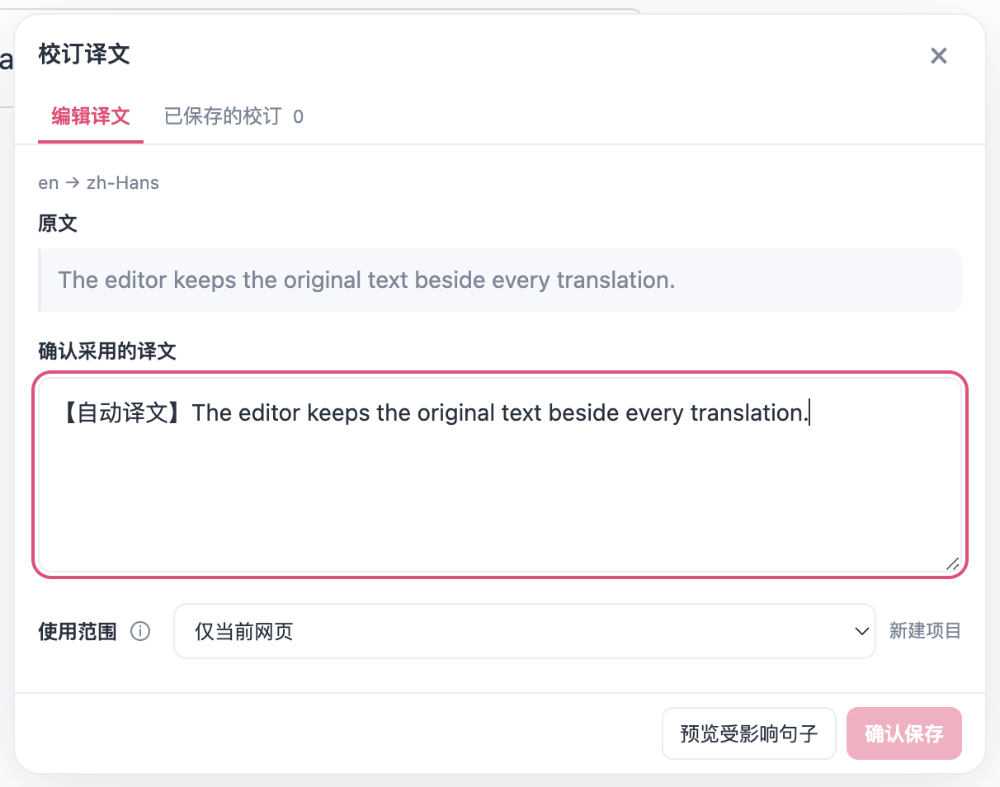
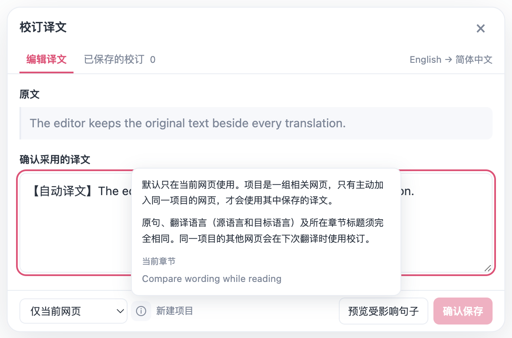
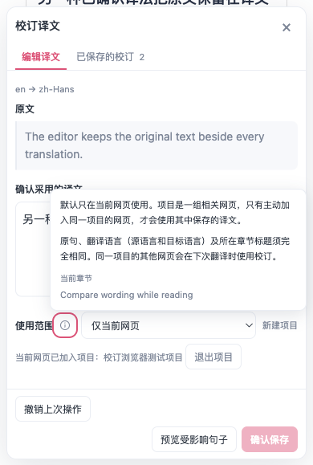
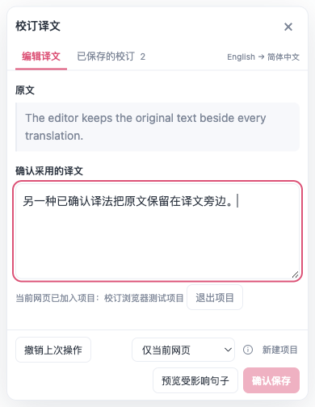
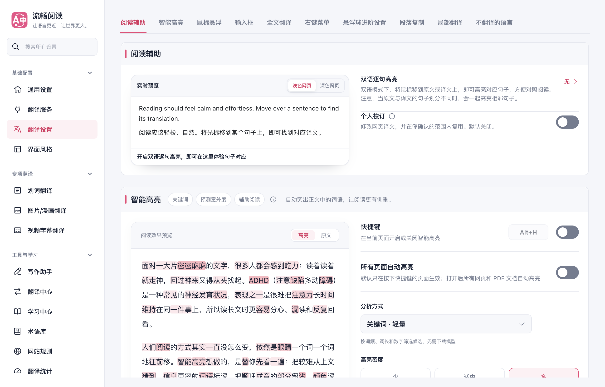
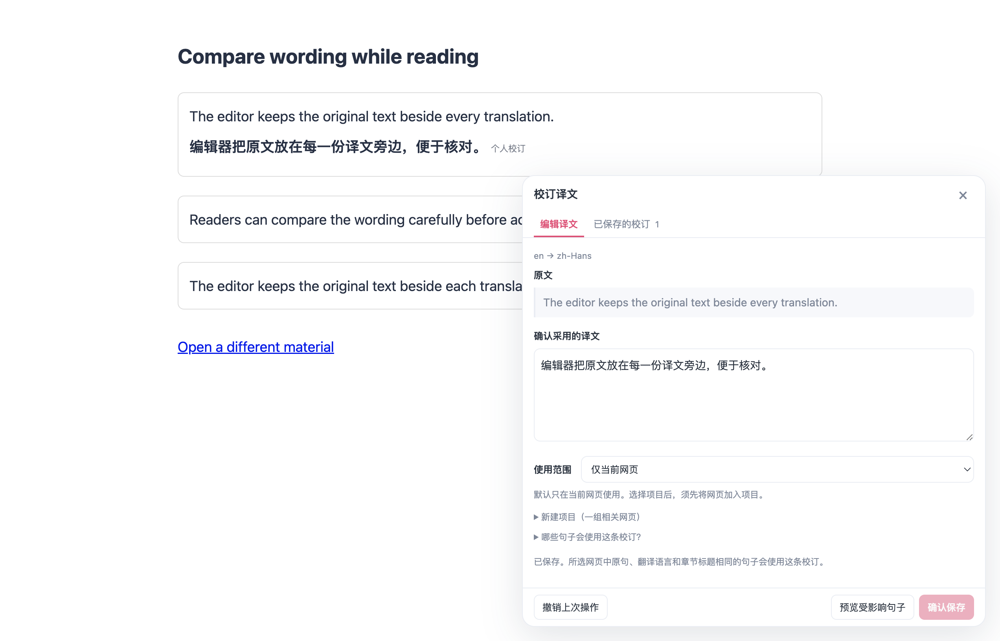
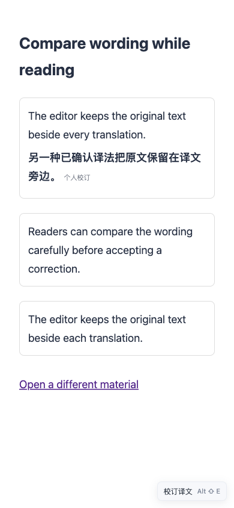
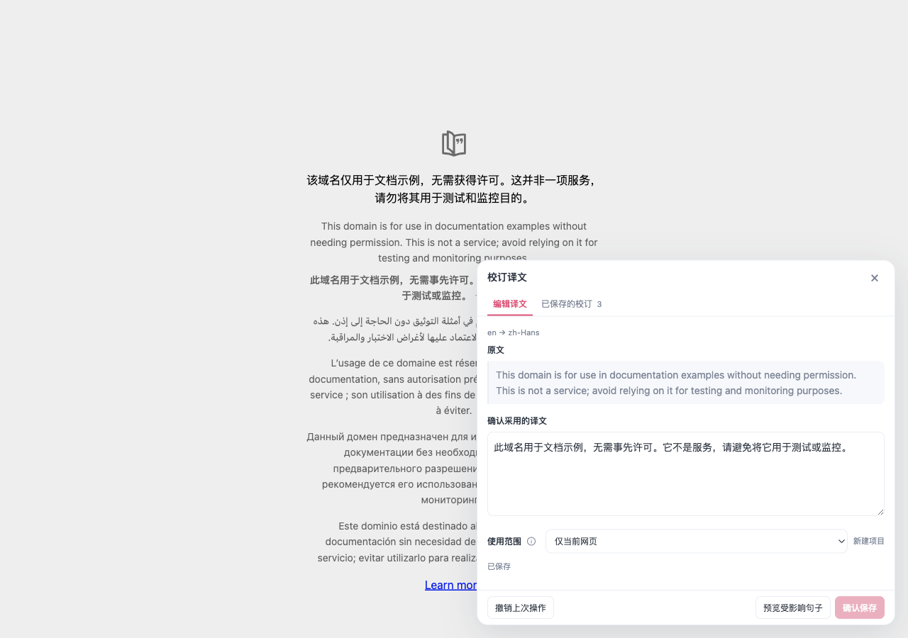

# 个人校订：生产扩展浏览器验证

实现与其他检查见[功能报告](./personal-corrections-20261011/README.md)。本报告只记录 Chrome MV3 产物在真实 Edge 中的网页运行验证。

## 运行结果

最终冻结源码的 production Chrome MV3 产物通过 **20 / 20** 项矩阵，进程退出码为 0。页面异常、控制台错误和测试 Edge 的原生前台激活事件均为 0；测试结束已关闭拥有的浏览器并删除临时 profile。公共 provider 缓存抽查有 1 条普通记录，不含个人校订译文。八张归档截图均已目视检查，设置、编辑器、帮助提示和主要操作在视口内。

覆盖项目如下：

- 默认关闭时校订消息为零，没有悬停入口或快捷键编辑器，普通段落及全文翻译正常。
- 真实阅读辅助设置开关五次切换，反馈后立即关闭设置页，重新打开和 popup 重新加载均保持正确状态。
- 主动开启后直接编辑已有双语译文；修改、预览并确认保存，修改后必须再次预览。
- 默认编辑器不再显示常驻范围及章节说明；底部范围旁的 24px 信息图标由真实鼠标悬停或 Tab 聚焦打开提示，移开收起，Escape 只关闭提示并保留编辑器，普通保存反馈严格为“已保存”。
- 语言对位于页签栏最右侧，与最后页签的间隔桌面 292.42px、390px 视口 93.06px；正文直接从原文标题开始。范围选择位于底部，实测 128×30px，正文没有语言或范围行。
- 桌面和390px有撤销按钮时，新建项目输入浮层完整位于面板内、输入和创建按钮中心可点击；390px实际键盘输入及创建后自动收起，原项目关系与保存条数不变，新项目仍须明确加入。
- 390px 下展开真实受影响句子后，预览 scrollHeight/clientHeight 均为659，不产生溢出。本轮未执行滚轮断言；上轮已有滚轮证据不作为本轮结论。Vue用例另覆盖提示滚动监听与视口定位。
- 关闭时编辑器退出，有底稿的当前个人译文恢复底稿，无底稿的复用单元恢复原文；保存记录保留，再开启不会自动改写已有服务译文，后续翻译仍能复用。
- 来源文字继承译文颜色、11px 小于 18px 正文，边框为 0、底色透明；390px 的文档宽度仍为 390px。
- 清除公共 provider 缓存后精确复用个人译法，显示来源，额外 provider 请求为零。
- 近似原句展示差异；采用候选只填草稿，不自动替换或保存。
- 撤销、管理中编辑、删除后失效；恢复与再次翻译回到普通服务流程。
- 刷新后仍可复用；相同句子在另一材料、另一源/目标语言中隔离。
- 项目创建、显式加入、复用、另一材料加入及退出；加入不自动收集句子。
- 可见个人译文在标题变化、SPA 地址变化时立即恢复原文；冲突译法需人工解决。
- 重复打开仍只有一个编辑器；390 × 844 布局及 Escape；全文翻译、恢复、再翻译。
- 未修改的远程 `https://example.com` 网页原句完成编辑、预览、保存、复用、撤销和再次翻译。

## 夹具与验收边界

运行使用第二块屏幕上可见且不抢前台焦点的临时 Edge profile。页面、生产内容脚本、后台消息与持久化端口均真实运行；Google 请求由后台 `fetch` 的确定性夹具返回。它验证扩展行为，不证明在线供应商质量、延迟或可用性，也不构成 Firefox 或 userscript 实机验收。

编辑文字、按钮与翻译快捷键使用可信 CDP 输入。唯一例外是项目原生 `<select>` 的选项选择：macOS 后台原生菜单无法接收普通页面 CDP 选择按键，因此使用明确标注的 DOM `change` 夹具；之后仍经过 Vue 原生事件监听和实际项目加入/保存/退出动作。

远程页面通过只读英文正文发现选择目标；实际选择器为 `html:nth-of-type(1) > body:nth-of-type(1) > p:nth-of-type(2)`。没有替换远程页面源码或正文；其翻译运输仍使用上述确定性夹具。

## 产物与重现

最终启动前通过 production manifest 新鲜度检查，并记录所有 manifest content script、background 与 CSS 的 SHA-256。完整结果见 [`browser-report.json`](./personal-corrections-20261011/browser-report.json)。主要产物如下：

| 产物 | SHA-256 |
| --- | --- |
| `background.js` | `e2d51a6c6b3ef078bef01e58bd5f0203ba9b59aec3d73ccdae00ac80dc27d383` |
| `content-scripts/content.js` | `d71b92a5c0505e89fef6a12afd0047cd78695ef28b96835c100c063bb4ba6201` |
| `content-scripts/content.css` | `54f4ed02f23881893e8e9094d5cb6e61813d4cffad3c230c4df75b24efc6db02` |

完整临时证据目录为 `/private/tmp/fluentread-personal-corrections-merge-20261011-r1`；其中保留 31 张截图、各项结果、新鲜度与清理记录。本报告归档的是整合 main `1983644df` 后的新生产产物；语言位于页签右侧、范围位于底部操作栏。此前 compact-layout r1、收起常驻说明的 help r1、整合 main 的 r1 及原先 opt-in r1/r2 证据仍保留。旧 r1 的撤销用例假设启停后仍保留上一编辑会话的撤销按钮，与关闭后重建会话不符；后续用例先通过真实管理删除和重新确认保存建立本会话撤销点，再验证撤销及普通服务回退。

测试入口为 [`scripts/testing/run-personal-corrections-test.cjs`](../../scripts/testing/run-personal-corrections-test.cjs)。运行参数必须指定 `--playwright-root`，并使用 `--background --display secondary --real-url https://example.com`；`--artifacts-dir` 指定本次独立证据目录。脚本自动创建临时 profile，检查原生焦点事件并只关闭本次拥有的浏览器，完成后按目录身份与 `.owner` 标记删除 profile。

## 截图

