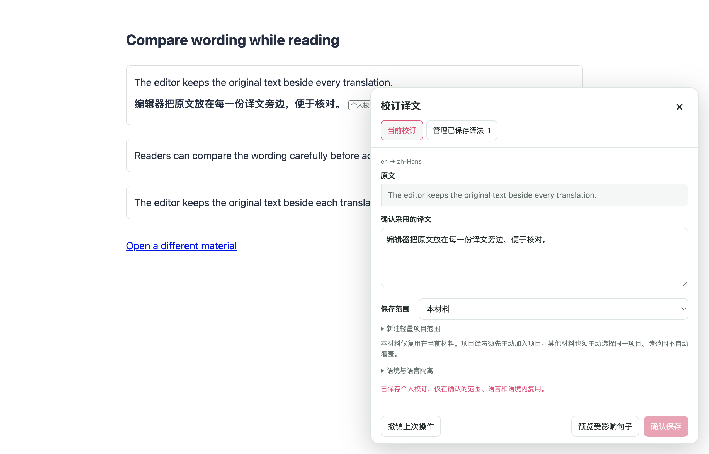
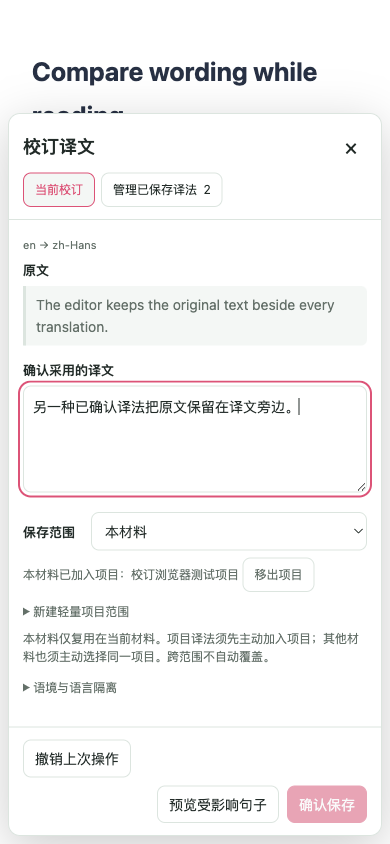

# 个人校订：生产扩展浏览器验证

实现与其他检查见[功能报告](./personal-corrections-20261011/README.md)。本报告只记录 Chrome MV3 产物在真实 Edge 中的网页运行验证。

## 运行结果

最终冻结源码的 production Chrome MV3 产物通过 **16 / 16** 项矩阵，进程退出码为 0。页面异常、控制台错误和测试 Edge 的原生前台激活事件均为 0；测试结束已关闭拥有的浏览器并删除临时 profile。公共 provider 缓存抽查有 1 条普通记录，不含个人校订译文。三张归档截图均已目视检查，编辑器和主要操作在视口内。

覆盖项目如下：

- 段落翻译后打开编辑器、修改、预览并确认保存；修改后必须再次预览。
- 清除公共 provider 缓存后精确复用个人译法，显示来源，额外 provider 请求为零。
- 近似原句展示差异；采用候选只填草稿，不自动替换或保存。
- 撤销、管理中编辑、删除后失效；恢复与再次翻译回到普通服务流程。
- 刷新后仍可复用；相同句子在另一材料、另一源/目标语言中隔离。
- 项目创建、显式加入、复用、另一材料加入及退出；加入不自动收集句子。
- 可见个人译文在标题变化、SPA 地址变化时立即恢复原文；冲突译法需人工解决。
- 重复打开仍只有一个编辑器；390 × 844 布局及 Escape；全文翻译、恢复、再翻译。
- 未修改的远程 `https://example.com` 网页原句完成编辑、预览、保存、复用、撤销和再次翻译。

## 夹具与验收边界

运行使用第二块屏幕上可见且不抢前台焦点的临时 Edge profile。页面、生产内容脚本、后台消息与持久化端口均真实运行；Google 请求由后台 `fetch` 的确定性夹具返回。它验证扩展行为，不证明在线供应商质量、延迟或可用性，也不构成 Firefox 或 userscript 实机验收。

编辑文字、按钮与翻译快捷键使用可信 CDP 输入。唯一例外是项目原生 `<select>` 的选项选择：macOS 后台原生菜单无法接收普通页面 CDP 选择按键，因此使用明确标注的 DOM `change` 夹具；之后仍经过 Vue 原生事件监听和实际项目加入/保存/退出动作。

远程页面通过只读英文正文发现选择目标；实际选择器为 `html:nth-of-type(1) > body:nth-of-type(1) > p:nth-of-type(2)`。没有替换远程页面源码或正文；其翻译运输仍使用上述确定性夹具。

## 产物与重现

最终启动前通过 production manifest 新鲜度检查，并记录所有 manifest content script 与 background 的 SHA-256。完整结果见 [`browser-report.json`](./personal-corrections-20261011/browser-report.json)。主要运行脚本如下：

| 产物 | SHA-256 |
| --- | --- |
| `background.js` | `3adab798bcd9b7c5cd7f6dfb089b91635672c4b297eb2326028356d9093cae5b` |
| `content-scripts/content.js` | `51d80178f42b10173975ebc9e5a4f5b811aa402de2a278f59caf55827db7a4da` |

完整临时证据目录为 `/private/tmp/fluentread-personal-corrections-20261011-final2`；其中保留 17 张截图、各项结果、新鲜度与清理记录。本报告归档的是最终重跑；此前尝试分别遇到测试读取竞态、后台原生菜单限制和远程页面选择器变化，均保留在各自临时目录，不计作产品回归或最终通过结果。

测试入口为 [`scripts/testing/run-personal-corrections-test.cjs`](../../scripts/testing/run-personal-corrections-test.cjs)。运行参数必须指定 `--playwright-root`，并使用 `--background --display secondary --real-url https://example.com`；`--artifacts-dir` 指定本次独立证据目录。脚本自动创建临时 profile，检查原生焦点事件并只关闭本次拥有的浏览器，完成后按目录身份与 `.owner` 标记删除 profile。

## 截图

