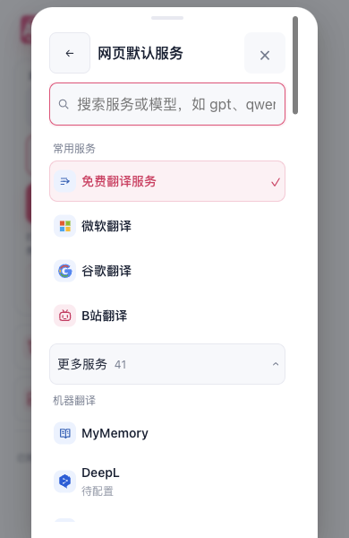
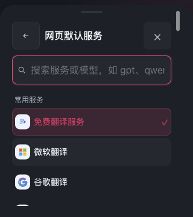

# Popup 服务列表触屏可读性补验

服务名称原先沿用桌面10px字号，在手机上偏小。改为触屏名称14px、辅助文字12px、搜索16px；普通高度的说明允许换行。图审又发现窄双列把“免费翻译服务”挤成5字加1字，因此按列表自身宽度调整：300px及以内的触屏列表采用单列，空间充足时保留双列。桌面细指针仍采用原来的紧凑双列。

极矮视口继续使用紧凑双列和单行省略，缩减项内留白，让名称及说明在46px操作区内显示；搜索、返回和关闭沿用原控件，列表在自己的滚动区中移动。

## 实际生产界面

本轮在独立临时Edge配置加载Chrome production扩展，通过真实媒体条件和视口大小检查，未注入Safari或Android平台标记。Root实际查看全部5张原图；此处按原字节选取3张。

| 场景 | 实际结果 |
| --- | --- |
| 400×600细指针 | 列表宽264px、双列、名称10px；当前免费服务名称保持单行。 |
| 390×600粗指针 | 列表宽264px、单列、名称14px／辅助12px；免费服务名称保持单行。 |
| 320×360粗指针深色 | 单列、无横向溢出；列表实际向下和回滚，正常关闭。 |
| 844×390粗指针横屏 | 根据实际列表宽264px采用单列，未把浏览器视口宽度当作Popup宿主宽度。 |
| 已开列表缩至844×58 | 产品根据真实视口生成short状态，双列45项实测均46px；当前选中项完整进入50px滚动口且中心命中，滚动0→85→0，反滚后搜索和关闭仍为46px、五点命中通过。 |

四组常规场景都执行打开列表、进入默认服务页、正常关闭；三个触屏场景各有向下及回滚，极矮口另有两次滚轮，共14次可信点击、8次滚轮。仅在临时配置中正常确认中文引导一次，未选择服务、输入搜索词或发起翻译。生产包483文件在暂存及执行前后完全一致；无页面错误、连续焦点监测0次测试浏览器激活，所属浏览器、监测器与临时配置均清理完成。

## 范围

这证明受控Chromium生产界面的字号、窄列表换列、深色、横屏、真实视口收缩和内部滚动，不是Safari原生软键盘或真机验收。当前矩阵没有实际覆盖300px以上的触屏列表。原双列版本的几何通过和孤字折行发现均保留，未改写成最终结果。

另在34cec安装包的专用iOS模拟器检查中，正常Popup已打开完整设置，搜索框原生图可见；分类控件点击前未通过原live复合门，具体失败谓词未知。正式0PASS／1SKIP／0FAIL，5AX／4UI／1PNG；不能算分类选择或阅读键盘通过。21命令闭合，安装映射保持，其他14台设备记录未变，15台最终关机。

本次改动限Popup CSS与使用说明，未借鉴或修改参考项目。
