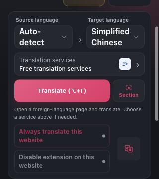
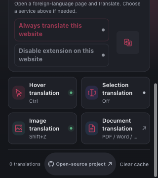
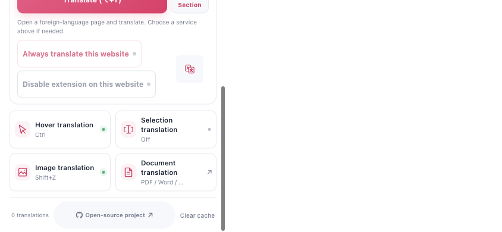

# Popup 标签页窄屏与网站规则文字补验

网站规则原来使用9px文字，触屏阅读偏小，现改为12px、允许长标签换行，并保留46px操作高度。英文生产界面复验又发现：在独立扩展标签页中，320px视口仍显示380px宽画布。现在通过公开的 `tabs.getCurrent()` 确认真实标签页宿主，按其视口限制宽高，内容在面板内滚动。工具栏保留原有固有尺寸，Safari、Android与嵌入宿主继续使用现有布局规则。

宿主查询不阻塞引导或挂载，不读取URL或网页内容，也不新增权限。返回空值、API缺失或失败时沿用原布局；页面普通退出、卸载、挂载失败及迟到结果均保持终止。已挂载页面往返缓存时释放自有标记，恢复后复用已取得的宿主结果。

## 生产界面复验

使用独立临时Edge配置和Chrome生产扩展，真实公开API返回标签页身份。没有注入平台标记、样式或API结果。仅在新配置中正常选择英文并确认引导；网站规则在扩展页上不可用，本轮不切换规则、不选择服务、不请求翻译。

| 场景 | 实测结果 |
| --- | --- |
| 400×600细指针 | 画布380×518.875px，规则文字保留桌面9px。 |
| 390×600粗指针 | 画布380×560px，规则12px、46px高，英文标签完整。 |
| 320×360粗指针深色 | 画布320×360px，无横向溢出；两个规则192×46px，英文完整换为两行，指示点不重叠。 |
| 844×390粗指针浅色 | 画布380×390px，保持合理阅读宽度；46px规则区和页脚可通过内部滚动到达。 |

两个矮屏均检查规则文字的Range字形边界、指示点间距和操作区五点命中，再滚到页脚检查开源及清缓存按钮的完整文字、46px高度和五点命中。共5次可信滚轮操作，之后恢复顶部；几何检查使用0.5px舍入容差。Root与独立审查者都查看了全部6张原图，以下3张保持原字节。

首次窄屏失败结果保留，未改写为通过。第二轮几何通过，但横屏规则图捕获主题过渡中间帧；最终轮在面板子树CSS过渡结束后取图，六图及四场景均通过。连续焦点监测记录0次测试浏览器激活，无页面错误，浏览器、监测器和临时配置均已清理。483个生产文件在暂存、执行前后保持一致。

## 验证边界

挂载行为105项测试通过，挂载模块statements、branches、functions、lines均为100%。覆盖合法和异常宿主返回、API失败、挂载期间退出、往返缓存、多次恢复及标记所有权。保留原有工具栏与Safari测试预期。

上述图像与操作证明受控Chromium扩展标签页的布局、换行和滚动，不能替代Safari原生软键盘、Android或真机验收，也不证明网站规则实际保存功能。本次独立实现，未借鉴或修改参考项目。
