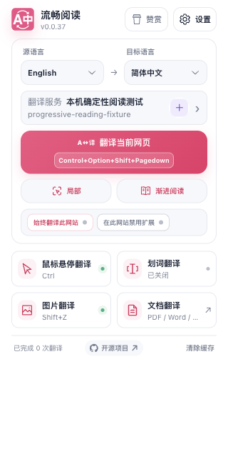
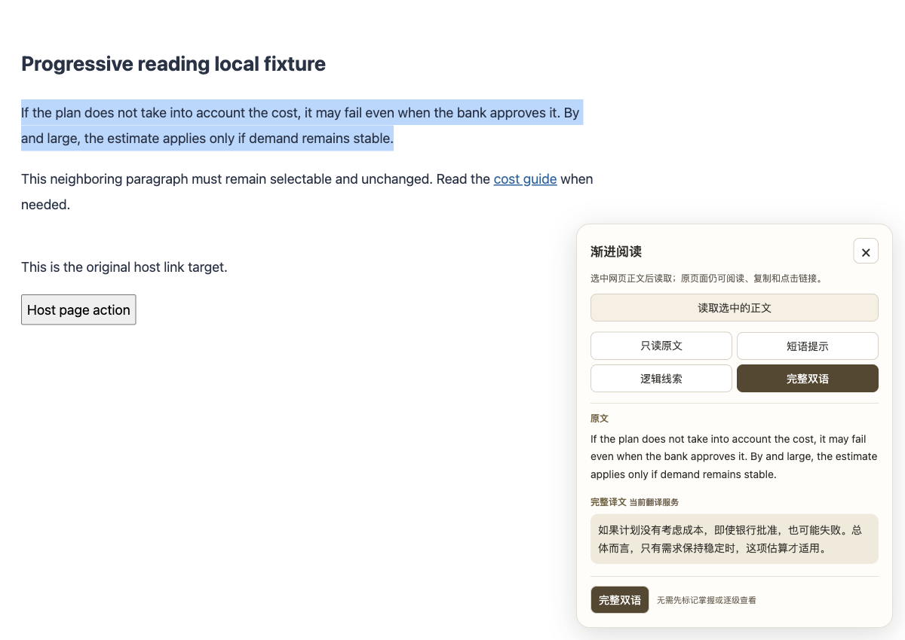
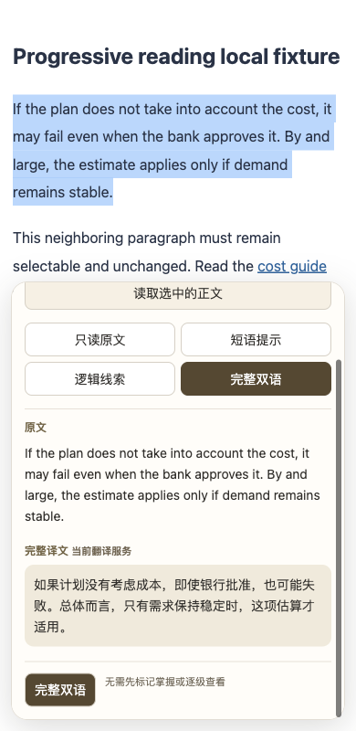

<!--
 * @file docs/reports/progressive-reading-20261011.md
 * 文件职责：记录主动渐进阅读的交付范围、验证结果和证据边界。
 * 主要内容：说明四档帮助、明确掌握提示退场、页面所有权，以及针对性测试、构建和隔离浏览器验收。
 * 模块边界：只记录本次实现与可复验事实，不声称真人理解提升、在线翻译质量或未执行的平台运行时验证。
 -->

# 渐进阅读：2026-10-11

从 `origin/main` 的 `c8a06bb5fe0148f629ecaf60e70e5bf6ebb4f957` 开始，在 `codex/progressive-reading-20261011` 独立工作树实现；最终整合主分支 `69d41e5e1050e5004d4656963d5105f24df9d8ed` 的网站规则和导航改动后复验。没有修改参考仓库或复制参考实现，没有新增权限、依赖或持久配置。Popup 整合保留主分支的规则保存确认、忙碌状态和禁用中断，并在规则保存时阻止渐进阅读重复发起。

## 使用与行为

网页选择一个词、表达或正文段落后，点击 Popup 的「渐进阅读」；也可以先开启面板，再选择正文并点击「读取选中的正文」。每段新原文从「只读原文」开始，可以自由切换短语提示、逻辑线索和完整双语。任何档位均可一步打开完整双语，无需学习反馈或逐级查看。

短语提示合并少量本地多词表达、主动选中的短表达和现有收藏。收藏只投影最多 24 次命中的坐标、所请求目标语言的已有参考及保守掌握证据，不返回收藏地址、笔记、语境或学习日志。只有当前状态为 mastered、最新时间的日志均为 manual-mastered、时间与当前学习状态对应、原文与保存语境相同且没有跨源语言同词歧义时才自动收起。「仍需要帮助」可恢复这些提示；学习中心的显式变更沿用已有通知刷新提示。停留、滚动和模式切换不写学习状态。

逻辑线索只引用否定、可能性、条件和适用范围的词面标记。表达翻译沿用当前服务及页面上下文开关，不保证判断当前义项；完整双语提供理解歧义的额外原文语境。原文、规则和已保存释义不会自动调用模型，表达或完整译文仅在用户请求时调用既有翻译客户端。

面板使用封闭 Shadow UI，不改写网页文字、链接或原生 Selection。只读快照排除表单、编辑区、代码、交互控件、隐藏和禁止翻译内容及扩展 UI。关闭、禁用和页面卸载释放监听、观察器及请求；原文变化清空旧结果并提示重新选择，迟到结果不得返回旧会话。精确匹配的已完成网页双语摘录可复用；同一阅读会话已取得的译文也直接复用。

无痕模式不读取学习库，用户脚本、原生 PDF 和 Thunderbird 不提供 Popup 入口。当前面板使用固定浅色阅读配色，深色配置专项只验收可读布局。

## 验证

验证命令均限定为本次功能和受影响组合入口，未运行全量测试矩阵或全仓 coverage。

| 专项 | 结果 | 覆盖率边界 |
| --- | --- | --- |
| 提示规则与异步会话 | 36 tests 通过 | hints/session 四维均 100% |
| 原文所有权与内容生命周期 | 14 tests 通过 | source/content 四维均 100% |
| 学习库只读提示与后台 handler | 27 tests 通过 | readingHints/handler 四维均 100% |
| Popup 页面动作及内容入口组合 | 9 文件、400 tests 通过 | pageActions/messageRuntime/learningFeatures 四维均 100% |
| Popup 可见性 | 31 tests 通过 | 用户脚本、PDF 和 Thunderbird 门禁 |
| 用户脚本构建隔离契约 | 35 tests 通过 | public alias、空适配与无副作用拒绝 |
| 模块边界、源文件说明及验证所有权 | 951 tests 通过 | 3 个限定架构文件 |
| TypeScript/Vue 类型检查 | 通过 | pnpm compile |
| 测试归类审计 | 通过 | 656 文件、11,014 cases 的静态审计；不代表执行全套用例 |
| Chrome / Firefox 生产构建 | 均通过 | WXT 0.20.18；不是 Firefox 实机验收 |
| 用户脚本构建与 verifier | 均通过 | 2,026,951 bytes，整合主分支的既有预算 2,027,000 bytes |
| 文档构建 | 通过 | VitePress 1.6.3 |
| 隔离真实 Edge 专项 | 18/18 通过 | 生产扩展、确定性本机 HTTP 响应 |

额外组合初查发现 `tests/implementationAudit48A.test.ts` 的 1 个既存请求头期望失败：HEAD 的 Bilibili 内置 Origin-removal 规则与同一 HEAD 测试的 `addRules=[]` 期望不一致。该测试和请求头 runtime 在本分支均未修改；本次不修复范围外规则、不将该测试计作通过。最终入口 coverage 排除 48A，依靠直接覆盖消息入口的测试验证上述三个模块。

```sh
pnpm test tests/progressiveReading.test.ts tests/progressiveReadingSource.test.ts tests/progressiveReadingContent.test.ts tests/vocabularyReadingHints.test.ts tests/vocabularyBackgroundHandler.test.ts
pnpm test tests/popupFeatureVisibility.test.ts tests/userscriptViteConfig.test.ts tests/userscriptUnsupportedCapabilities.test.ts
pnpm test tests/popupPageActionsOwnership.test.ts tests/contentMessageRuntime.test.ts tests/sentenceActionsMount.test.ts tests/implementationAudit48K.test.ts tests/implementationAudit49F.test.ts tests/contentTrustBoundary.test.ts tests/contentRuntimeLifecycle.test.ts tests/popupAppLifecycle.test.ts tests/popupFeatureVisibility.test.ts
pnpm test tests/architecture/moduleBoundaries.test.ts tests/architecture/sourceFileHeaders.test.ts tests/architecture/verificationOwnership.test.ts
pnpm test:audit
pnpm compile
pnpm build
pnpm build:firefox
pnpm build:userscript
pnpm docs:build
```

新可执行模块已登记 coverage 所有权。专项通过 `pnpm test:coverage` 的 `--coverage.include` 分别限定 `hints.ts`、`session.ts`、`source.ts`、`content.ts`、词书 `domain/readingHints.ts` 与后台 handler，以及三个受影响入口模块，执行四维 100% 门槛，不降低现有阈值。用户脚本在构建期排除渐进阅读注册和消息分支，并以既有 alias 机制隔离 Vue 面板；沿用整合后主分支的体积预算，本功能未放宽预算。

浏览器专项命令：

```sh
node scripts/run-progressive-reading-test.cjs \
  --extension-dir .output/chrome-mv3 \
  --playwright-root <本机 Playwright 包目录> \
  --focus-safe-helper scripts/testing/focus-safe-browser.cjs \
  --artifacts-dir /private/tmp/fluentread-progressive-reading-final
```

专项使用自有临时 Edge profile、第二屏后台正常窗口和生产扩展。真实输入通过 CDP 操作，持续采样焦点，结束后关闭自有浏览器并删除临时 profile。服务端响应是本机确定性 HTTP 夹具；Popup 在测试标签中替换 active-tab 查询并捕获关闭动作，其余页面与后台路由真实执行。

验收覆盖 Popup 入口与 320px / 400px 两行页面操作、原生正文拖选与宿主 HTML 保留、四档自由切换、多词表达、明确掌握退场和恢复、熟词异语境仍有帮助、词面逻辑线索、一步完整双语、同会话译文复用、Tab/Enter/Escape、390px 滚动控件可达、宿主链接和按钮、DOM 替换、延迟请求关闭重开、总开关禁用恢复及页面卸载。

最终专项还检查 320px / 400px Popup 中长快捷键和完整主按钮文字、宿主 DOM 不变的纯 history.pushState 路由切换与迟到请求取消。报告记录 38 次焦点采样，`launchMode=macos-background-cdp`、`focusPolicy=launchservices-no-foreground`、`windowPlacement.mode=background-visible-no-focus`、第二屏 normal 可见窗口及 `browserFrontmost=false`；控制台错误为 0，自有浏览器已关闭且临时 profile 已删除。

可审阅证据：[浏览器报告](./progressive-reading-20261011/report.json)、[验证摘要](./progressive-reading-20261011/verification.json)。截图逐项复核布局、文本及焦点可达性：







网页已有双语 artifact 的精确复用本次由单元合同验证，未做浏览器专项验收。Firefox 只验证编译和生产构建；未验证 Firefox 实机、真实服务的义项/翻译质量、真人理解率或真实移动设备。
