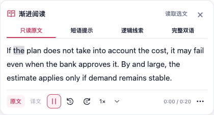
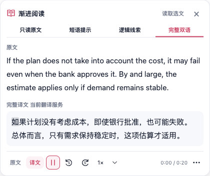
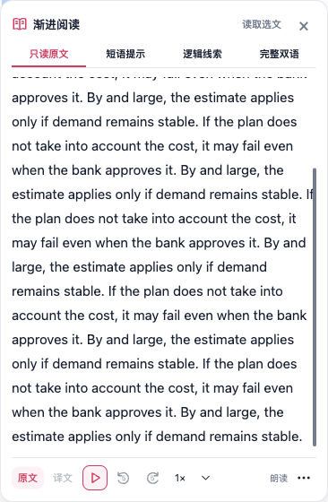
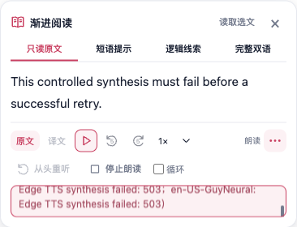

<!--
 * @file docs/reports/progressive-reading-compact-20261011.md
 * 文件职责：记录学习面板正文优先布局的操作、真实截图和限定验证。
 * 主要内容：说明标题与重复动作收紧、正文独立滚动、常用音频栏和更多选项，以及同文本布局量测的适用范围。
 * 模块边界：只记录本轮界面与可访问性变化；朗读算法覆盖沿用精确未改源码证据，不宣称线上音质、学习收益或整页速度提升。
 -->

# 学习面板：正文优先

此版本针对标题、说明与重复按钮占用过多空间的问题，调整此前 [朗读面板](./progressive-reading-speech-20261011.md) 的内容顺序和操作密度。保留 FluentRead 的粉色品牌、亮暗主题及主动选文流程。

已有正文时，顶部只保留小标题、读取选文和关闭按钮；说明移至标题提示及区域描述。四档帮助改为紧凑标签，完整双语只有一个入口，失败后同一标签可重试。空状态保留完整读取按钮与选择正文的指引。

正文在标签下直接显示，使用 15px 字号和 1.8 行高；只读原文不再重复显示原文标签，完整双语仍标明原文与译文。长正文与短语/逻辑帮助在独立区域滚动，可聚焦后用 PageDown 操作，顶栏和底部常用音频动作保持可见。很矮的窗口使用可用视口高度；长朗读错误保留完整文本和 alert，限制展示高度并允许单独的键盘滚动，避免挤掉正文。翻译错误跟随正文滚动。

底部常驻原文/译文选择、播放或暂停、前后 5 秒、倍速及实际时间。点击「⋯」展开从头重听、停止和循环；展开/收起不会生成新音频、暂停或重置进度。循环开启时，收起按钮的颜色和可访问说明仍标明该状态。新选文恢复折叠，关闭与卸载仍取消待处理请求并释放音频。

实际媒体控制仍沿用前版协议、原生 Audio 和单份缓存。时长未知时显示「朗读」，跳转与重听暂时禁用；元数据到达后恢复，音频本身不被当成错误。时间与估算跟读仍随媒体事件更新，没有增加轮询。

最终实际 Vue 组件测试 **33/33**，Chrome 生产包隔离 Edge 验收 **29/29**（含 8 组朗读行为），控制台异常 0。类型检查、Chrome/Firefox 构建、清单 verifier、文档构建、架构 985 项及静态归类 682 文件/11,483 cases 通过。七语言 i18n 仍是 **57/58**：唯一失败与主分支个人校订的 195 条缺译记录完全一致；用户脚本文案投影 3/3 通过，不将基线失败记作通过。

本轮同短句、366px 面板宽度、390×800 视口下，总高度从 **387.23px 降到 173px**，正文起点距面板顶端 86px。SOURCE 双语正文区 207.30px，占该面板 58.7%；390px 长正文案例正文区 414px，占 560px 面板的 73.9%。这些是相应固定内容的 DOM 几何，不是整页性能基准。

390×320 的真实四音色合成失败在修改前将正文挤至 **0px** 且错误/工具栏被裁切，[修改前记录](./progressive-reading-compact-20261011/before-short-height-report.json)保留失败。修改后展开更多仍保留两行正文（54px），错误框完整可见，可信 PageDown/End 将错误滚至最后一行，正文和控件位置不动。长正文的可信滚轮、PageDown 同样只滚正文。

验证摘要和具体量测由[机器记录](./progressive-reading-compact-20261011/verification.json)保存。组件定向测试保留原有生命周期用例并增加折叠、重试和选文边界；浏览器使用最终 Chrome 生产包、自有临时 Edge/profile、可见第二屏后台 CDP，不操作用户日常浏览器。

同文本窄屏对比使用旧报告实际播放的短句 `The latest source has no automatic speech.`、390×800、原文模式和收起状态。它只说明该固定内容的面板几何变化。旧报告没有正文起点或正文区域高度，不推算其旧正文占比；本轮正文起点、独立滚动、键盘滚动和控制可见性另行实测。大段正文和 SOURCE 常量截图单列，不混作该短句的前后样本。

前版语音控制器、后台、进度及阅读模块的覆盖率只沿用源码 SHA 未变的记录，本轮 UI 使用真实 Vue 挂载与生产浏览器验证。七语言固定文案和用户脚本文案投影单独检查；继承主分支个人校订的全量文案缺项仍如实单列，不扩大白名单。

浏览器语音在 Microsoft HTTP 边界使用确定性静音 WAV，生产消息路由及原生 Audio 的时钟、暂停、跳转、倍速和循环真实执行。语速通过真实 select 的 DOM/Vue 绑定验证，未验证系统下拉菜单；未试听真人语音或评价线上音质。Firefox 本轮只有构建证据，无 Firefox 实机、移动设备或学习收益结论。

最终后台运行 324 次焦点采样均通过，自有浏览器及 profile 已清理。此前两轮分别在不同阶段触发焦点保护，均停止并不计作通过；不将其归因为已证实的产品问题或确定的重复激活原因。最终 runner 跳过 31 次已激活正文页签的重复 update，并保留阶段焦点探测和焦点失败主因。

本轮在 FluentRead 现有 Vue/WXT 实现上调整，没有借用或修改参考仓库。日志归档只去除行末空白与文件尾空行；原始日志哈希保留在核对证明，归档文件哈希单列于机器记录。
