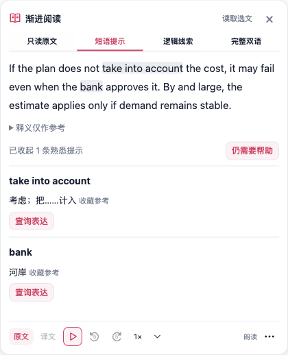
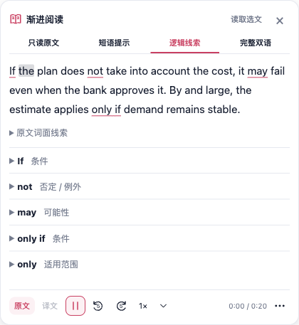

# 渐进阅读：把提示标回原文

本版在当前学习面板的原文中标出对应表达，减少在正文和下方解释之间查找的位置成本。短语用浅灰底，逻辑词用细粉色下划线；颜色沿用 FluentRead 的中性灰与粉色品牌，亮暗主题都对应调整。标记没有增加内边距、边框、字重或行高，原文的行数、宽高保持不变。

短语标记跟随当前可见提示：明确掌握且同语境收起的表达不标记，点击「仍需要帮助」同步恢复标记与列表。逻辑词的条件、否定、可能性与范围线索引用真实原文坐标；`only if` 与 `only` 的重叠平铺呈现并保留两项说明关系，不嵌套或重复原文。悬停标记可查看原有参考/线索说明，`aria-describedby` 关联下方同一提示。

切回只读原文或完整双语撤掉辅助标记。原文仍可以选择、复制；原网页 DOM 和学习记录不变。朗读当前词用更深灰色，与浅底或下划线共存；切模式不重新创建音频、不暂停或再次合成。分段只按正文、模式和提示变化计算，媒体进度沿用已缓存分词，没有新增轮询、网络、配置或权限。

本轮以提交 `bac642392a1d7605745341cd11f895c4f131f08b` 为修改前版本，生产源码、runner、构建与证据 SHA 保存于 [verification.json](./progressive-reading-source-marks-20261011/verification.json)。未使用或修改参考仓库。

验证结果：

- 实际 Vue 组件 41/41（保留原 33 项，新增 8 项）：原文保真、掌握提示隐藏/恢复、重叠描述、模式往返、朗读绝对偏移与缓存、换源、恶意坐标/HTML 和重复范围。
- 新纯展示模块 25/25，V8 statements/branches/functions/lines 都是 100%。只接受坐标与词面均对应的范围，最多读 64 项并平铺为 129 段，原文不归一化或截断；已纳入正式 coverage 和 unit 归类。
- 当前 Chrome MV3 生产包隔离 Edge 29/29（朗读 8 组），13 次标记 DOM 采样；验证原文坐标/关联、无嵌套、无排版位移、390px 亮暗主题及朗读连续性。控制台异常 0，331 次焦点检查通过，后台第二屏窗口完整可见、自有浏览器关闭并清理 profile。证据见 [browser-report.json](./progressive-reading-source-marks-20261011/browser-report.json)。
- 类型检查、Chrome/Firefox 构建、manifest verifier、文档构建通过。版本、权限、依赖不变；Firefox 仅构建证据。用户脚本文案投影 3 项通过，本轮未重新构建用户脚本。
- 源头注释 957、所有权 16、模块边界 13 项通过；审计 683 文件、11,503 静态 cases。执行范围有重叠，不相加为全仓测试总数。第一次检查命令里的三个不存在的测试名被 Vitest 忽略，未计作通过；随后以核实的路径执行边界、i18n 和语言投影。
- i18n 57/58；唯一全量扫描失败仍为 195 条主分支已有缺译，两个所属 Vue 与整合的 main `1e414ea8c2db6074343fb438bf7633af10a142a2` 字节一致。渐进阅读和 Popup 无缺项，失败未列为通过。

这些检查证明本地夹具中的源码行为与呈现，不证明真人学习收益、完整句法/作者意图、整页速度或线上翻译/音质。朗读使用 Microsoft HTTP 边界的静音 WAV，生产路由和原生 Audio 真实执行。原有跟读当前词的子元素 title 会优先显示跟读精度，其他标记的 title 显示参考/解释。可访问关系关联真实提示行，折叠的完整逻辑详情仍通过 summary 展开；本轮未实测屏幕阅读器或声称默认读出隐藏详情。
