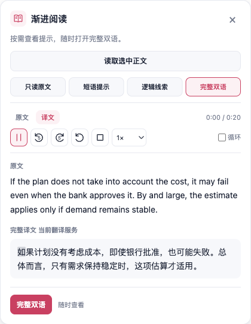

<!--
 * @file docs/reports/progressive-reading-speech-20261011.md
 * 文件职责：记录渐进阅读朗读控制的使用行为、验证范围与证据边界。
 * 主要内容：说明静默选择、显式播放、实际媒体控制、当前音频缓存与清理，以及主分支整合后的限定测试、估算跟读和生产浏览器验收。
 * 模块边界：不代替最终机器记录，不宣称在线音质、精确词级时间、Firefox 实机表现或整体性能提升；旧报告保留历史结果。
 -->

# 渐进阅读朗读：2026-10-11

本次为学习面板增加原文和译文朗读，保持主动选文、按需查看帮助的流程。「学习」继续放在 Popup「局部」右侧，默认无快捷键，可以在设置中录入。生产构建、隔离浏览器结果及截图由[验证摘要](./progressive-reading-speech-20261011/verification.json)归档。[此前的渐进阅读报告](./progressive-reading-20261011.md)保留其历史证据。

## 播放与阅读行为

打开面板、读取正文、切换帮助档位，以及选择「原文」或「译文」都不会自动生成或播放语音。原文可在读取正文后选择；没有完整译文时，「译文」按钮禁用并提示先查看完整双语。切换朗读对象会停止并清理旧音频，随后需要再次明确点击播放。

朗读沿用划词朗读的语言、在线/本地策略及音色设置。后台沿用现有合成能力，通过 `selectionTts` 的 `playback: 'page'` 返回音频，由当前页面的原生 `Audio` 播放。面板控制媒体当前位置、语速和循环，不另建轮询时钟。

| 操作 | 当前行为 |
| --- | --- |
| 播放 | 明确点击后才生成或读取缓存音频；准备中可再次点击取消 |
| 暂停 / 继续 | 暂停实际 Audio，保留当前位置；继续从该位置播放 |
| 后退 / 前进 5 秒 | 按实际媒体 `currentTime` 跳转，限定在 0 到总时长之间；仅播放或暂停时可用 |
| 从头重听 | 当前音频归零后开始播放 |
| 停止 | 暂停并归零、清除跟读高亮，保留当前音频供再次显式播放 |
| 语速 | 提供 0.75×、1×、1.25×、1.5×，作用于当前 Audio |
| 循环 | 原生音频播放到末尾后回到开头；取消循环后允许自然结束 |

总时长尚未知时，时间区显示「朗读」，前后 5 秒和从头重听禁用。这表示媒体元数据尚未就绪，不作为播放错误；有效时长到达后恢复这些控件。出错后可点击同一个播放按钮重试。

循环对象是面板当前显示的原文上下文或完整译文。网页中划出的一个词或短句可用于表达查询，但面板可能读取所在段落的上下文；朗读范围以面板展示的文本为准，不能把循环理解为只循环那段短选区。本次提供前后 5 秒和整段重听，没有上一句、下一句或独立句子循环。

四档帮助在同一排呈现，可自由切换。正在播放原文时切换「只读原文」「短语提示」「逻辑线索」「完整双语」保留同一个原文音频。工具栏使用紧凑图标、可访问名称和悬停说明，窄屏允许控件换行；沿用 FluentRead 划词卡片的粉色品牌、浅色表面、灰色分隔和亮暗主题，不向宿主网页应用界面皮肤。最终布局与键盘可达性以生产截图及浏览器记录为准。

## 缓存、失效与文字高亮

每个面板只持有一份当前文本与语言对应的音频。成功合成后，暂停续播、跳转、调速、循环、从头重听，以及停止后再次播放同一文本都复用当前音频，不重复合成。此缓存随当前面板生命周期存在；切换原文/译文对象会清缓存，切回后再次播放可以重新合成，不建立跨对象或持久音频库。

换文、关闭、页面路由变化、禁用或卸载会取消待处理请求，暂停音频、移除音源、释放 Blob URL，并清空播放进度。源语言、目标语言、语音策略、本地音色或在线音色顺序变化也清理当前音频。译文正在作为朗读对象时，译文变化先清理音频；译文失效为空后退回原文选择，恢复新译文仍需重新选择并点击播放。 generation 所有权检查拒绝迟到的合成结果与旧媒体回调。

准备或合成失败会显示可重试错误，已损坏的解码音频释放后重试获取新音频。跳转异常会暂停实际媒体并显示错误，避免界面已报错时继续播放。朗读和控件操作不写掌握状态、学习记录或网页正文。

时间显示来自真实媒体当前位置和时长。当前词高亮按可用句段时长估算；没有句段信息时，按整段时长估算。中文等文字按字推进，其他文字尽量保持完整词，标点和空白保留。此高亮不是精确的词级语音对齐，不能用来评判发音、实际词边界或理解程度。分词按文本复用，媒体事件更新位置与高亮，宿主正文仍保持原样。

界面覆盖简体中文、英语、日语、韩语、法语、俄语和西班牙语。固定面板、朗读、帮助及快捷键文案使用稳定资源；数量和查询词以参数传入。原文、译文、用户词条、收藏参考与表达回答受到 `data-i18n-ignore` 保护，不交给界面文案扫描重写。

## 已有验证证据

本次已整合主分支 `1e414ea8c2db6074343fb438bf7633af10a142a2`，保留渐进阅读与可配置学习快捷键，并合入默认关闭的个人校订。下表来自已完成的限定测试日志，不相加为互不重叠的总测试数。四维覆盖率指语句、分支、函数和行，范围仅限所列模块，不代表全部 Vue 或全仓覆盖。

| 专项 | 已记录结果 | 证据边界 |
| --- | --- | --- |
| 朗读控制器 | 41 tests；`speech.ts` 四维均 100% | 缓存、注入的 Audio 端口调用、取消与迟到结果、错误重试及资源清理 |
| TTS 后台与所有权 | 5 文件、137 tests；`ttsHandler.ts` 四维均 100% | page 协议返回音频、既有 offscreen 路由与 sender/请求所有权回归 |
| 时间、分词和跟读纯函数 | 8 tests；`speechProgress.ts` 四维均 100% | 安全时间范围、词面进度及可复用分词 |
| 客户端组件 | 27/27 tests；13 文件整合日志中再次通过 | 编译并挂载实际 Vue 模板与公开入口，注入 runtime、Audio 和 URL 端口；属于 linkedom 组件证据 |
| 七语言 i18n | 整合前 58/58；最终 57/58 | 固定资源与插值契约通过；唯一失败项为主分支个人校订 UI 的 rawVue 文案扫描，详见下文；未扩大同形词白名单 |
| Popup 直接回归 | 3 文件、90/90 tests；13 文件整合日志中再次通过 | 三按钮、设置与入口的实际模板回归 |
| 用户脚本契约 | 3 文件、42/42 tests | 排除不可达的新学习/Popup 文案，已发布语言资源投影保持稳定 |
| 学习能力装配 | 43/43 tests；`learningFeatures.ts` 四维均 100% | 同时保留渐进阅读与默认关闭的个人校订，验证能力门禁及用户脚本构建隔离 |
| 学习快捷键与设置 | 62/62 tests；`core/config/progressiveReading.ts` 四维均 100% | 默认无快捷键、配置解析、实际设置生命周期及跨入口冲突；仅明确开启的个人校订占用其固定 Alt+Shift+E |
| 架构 | 3 文件、985 assertions（16 + 13 + 956） | 验证归属、模块边界与文件职责 |
| 测试审计 | 682 文件、11,477 静态 cases | 静态测试目录审计，不是执行全仓测试 |

最终 i18n 扫描的缺项来自主分支新增的个人校订面板及其设置说明；这两处 UI 文件与上述主分支提交字节相同。渐进阅读与 Popup 源文件没有出现在缺项中。此失败项仍保留，不计作全过，也没有扩大扫描白名单。

此前记录的 11 个覆盖模块中，9 个源码 SHA 保持不变；此次整合改动的 `learningFeatures.ts` 和学习快捷键 helper 已重新执行上述限定测试并取得四维 100%，沿用覆盖率只适用于源码未变的 9 个模块。

额外消费者组合保留两个既存的 `VocabularyBook` 夹具失败：显式客户端模块映射缺少 `./VocabularySource.vue`，在进入 TTS 行为断言前就失败。保存的基线快照确认该 UI 和测试与检查时的 HEAD 字节相同；这两项不计作通过，也没有为本次朗读改动修补范围外夹具。具体基线与限定日志由验证摘要分别记录。

本地纯函数样本使用 4096 字符合成段落、1532 个 token，每轮计算 120 次进度，共 9 轮。不复用分词时中位数约 18.281 ms，复用分词时约 0.968 ms。它只说明这组输入下重复分词的计算成本；没有测量浏览器布局、页面总响应、设备功耗、在线供应商延迟或整体性能提升。

## 生产浏览器验收与限制

`scripts/run-progressive-reading-test.cjs --speech` 在一个自有临时 Edge 实例与 profile 中，先执行已有阅读专项再追加朗读验收。最终生产包通过 **27/27**，其中朗读 **6 组**；控制台异常为 0。`launchMode=macos-background-cdp`、`focusPolicy=launchservices-no-foreground`，正常窗口完整放在第二屏，`browserFrontmost=false`；自有实例及 profile 已清理。[原始浏览器记录](./progressive-reading-speech-20261011/browser-report.json)保留焦点、媒体采样、控件操作和截图路径。执行过程中修正了 runner 对 Popup 水合/关闭异步完成的等待，并将 macOS 原生语速下拉的验收限定为实际 DOM/Vue 绑定，生产 UI 没有为测试改成模拟控件。

类型检查、Chrome MV3、Firefox MV2、用户脚本构建及清单/verifier 均通过；版本与权限保持原值。最终整合用户脚本为 2,064,882 bytes，低于原有 2,066,000 bytes 上限，没有放宽预算。它继续没有学习入口，新面板及 Popup 专用文案没有进入其固定语言资源。

朗读 transport 夹具在 Microsoft token/合成 HTTP 边界返回确定性的静音零 PCM WAV，可控制生成计数、延迟和失败。生产消息路由、当前页面原生解码、实际媒体时钟及控件保持真实执行；通过 content isolated world 的 CDP `Runtime.queryObjects` 读取原生 Audio 状态，避免只看按钮文字推断播放成功。

验收按六组组织：

1. 默认静默、显式播放、解码和媒体时钟推进，估算高亮仅在面板内展示，宿主正文保持原样。
2. 暂停冻结实际时钟，继续从原位置播放，同文本不重合成。
3. 真实 ±5 秒首尾限界、四档语速、从头重听和停止后播放复用音频。
4. 循环实际跨越音频末尾回到开头，取消循环后自然结束。
5. 原文/译文选择静默、失败重试、准备中取消、换文/关闭/路由/禁用/语言变化清理，延迟响应不恢复播放。
6. 390px 布局无横向裁切、可信 Tab/Enter 可播放和暂停，最终清理与学习记录保持不变。

四档语速通过实际 select 选项与 Vue `change` 绑定设定，再读取原生 Audio `playbackRate` 验证；这与可信鼠标/按键的播放、暂停、跳转、循环验收分别记录，没有验证需前台的系统下拉菜单或语速选择快捷键。390px 面板内朗读工具栏宽 336px，无横向溢出。

音频输出在专项中静音。这些证据可以验证解码、媒体控制和生命周期，不证明听到了真人语音，不验证线上 TTS 音质、发音或音色可用性，也不证明精确词级同步。Firefox 与用户脚本的构建记录应单列；本次不宣称 Firefox 实机、真实移动设备、真人理解收益或总体性能已获验证。
