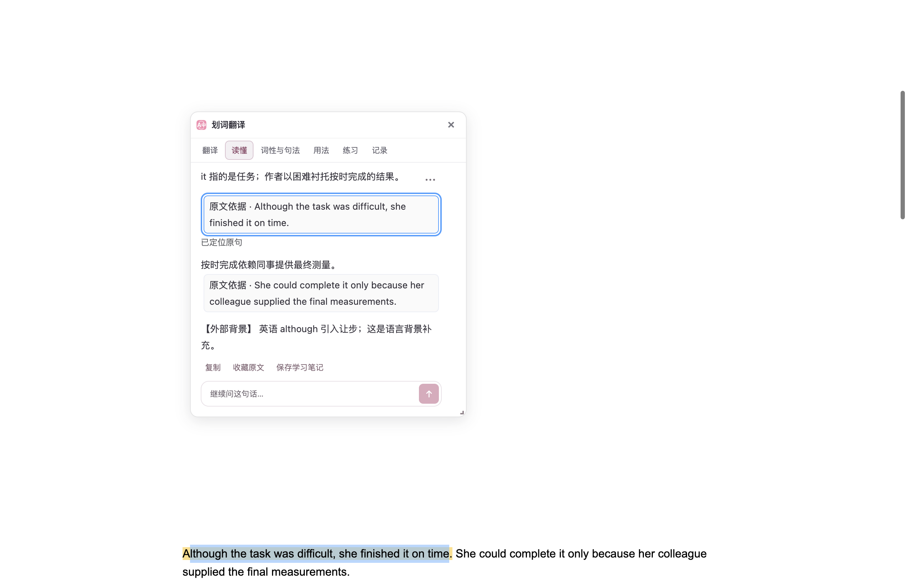

# AI 阅读解释的原文依据（2026-10-11）

阅读卡现在可以把指代、条件和作者理由的解释与实际提供给模型的原句放在一起。读者点击“原文依据”，或聚焦后按 Enter / Space，会回到原选区所属正文块并短暂点亮支持句。多个来源分别核对；未知身份、改写或不完整引用保留为无法核对的文字。

本轮只增加阅读解释的来源协议和定位端口，沿用现有模型服务、Harness 循环、流式消息、学习笔记权限和本机历史。没有新增模型调用、跨标签页读取或整页检索；未读取或复制参考项目代码。

## 实现与边界

- `core/harness/evidence.ts` 从真正允许提供的选区与有限上下文生成稳定身份，保留句段种类和规范化偏移，每种最多 16 段。后台和显示端都核对身份及连续原文。上下文捕获器的边界省略号不作为原句。
- Harness 指令要求每项材料判断附近引用原句，多句支持分别引用，歧义与不足明确说明。通用知识、例句和外部背景使用独立标记；学习记忆及前轮回答不成为当前页面依据。
- `evidenceAnchor.ts` 只在原选区所属的最小正文块定位，排除译文、控件、代码和扩展 UI。局部映射最多 2,000 个节点与 64,000 个原始字符；不保留未许可余文，只保留许可快照、原选区偏移及本地 SHA-256 摘要。校验时不建立逐字符节点映射，定位时才临时构建。
- 重复文字由原选区位置与来源偏移消歧；不搜索整页或追随模型生成的 URL、选择器、页码。无法唯一绑定就显示无法定位。
- 等价文字节点和有限原位块重建可恢复。隐藏原文时保留快照且不绘制；重新显示可以核对。正文改写、导航及页面离开永久撤销旧定位。
- 每次流式进度及最终结果写入前同步检查归属；停止、关闭、更换选区及卸载释放观察器、监听、计时器、高亮和临时滚动保留窗口，拒绝迟到结果。历史记录只展示保存的引用，不获得当前 DOM 权限。
- UI 用紧凑的“原文依据”按钮和既有卡片配色，完整引文放在悬停提示及无障碍名称中；成功定位不额外占行，失效状态使用短说明，把空间留给解释。
- 有引文的句法表保留安全表格，以显示每格引用；无引文的结构分析保持既有顶部交互布局。不会执行模型 HTML 或生成可点击外链。

引用映射只证明引文对应实际提供的文字，不能证明它支持模型的推断。模型仍可能忽略引用指令，或为不合理解释附上真实句子；本轮没有把这些情况宣称为事实验证。

## 验证

工作分支为 `codex/reading-evidence-20261011`，起点 `c8a06bb5f`；独立工作树位于 `/Users/thinkstu/Desktop/copy/FluentRead-reading-evidence-20261011`。主目录与其他任务的工作树未修改。

| 验证范围 | 实际结果 |
| --- | --- |
| 引用协议、Harness 后台、答案格式 | 3 文件，79 项通过；3 模块 statements / branches / functions / lines 均 100% |
| DOM 锚点 | 34 项通过；模块四维均 100% |
| 阅读卡、流式布局、划词生命周期及引用 UI | 19 / 14 / 118 / 2 项通过 |
| 模块边界、源码头、验证归属 | 13 / 915 / 16 项通过 |
| 七种界面语言 | 57 项通过 |
| 油猴构建配置与语言资源 | 35 项通过；固定提交含准确资源内容 |
| 测试矩阵审计 | 通过；新增测试已归入矩阵与严格覆盖边界 |
| `pnpm compile` | 通过 |
| Chrome 与 Firefox 生产构建、清单验证 | 通过 |
| 油猴构建与产物验证 | 通过；2,039,178 字节，包含五种远程语言的固定提交验证 |
| 文档生产构建、`git diff --check` | 通过 |
| 隔离 Edge 生产扩展验收 | 23/23 项通过，包含 4 项初始化契约与 19 项依据流程；控制台与 HTTP 错误均为 0 |

严格覆盖率使用仓库原有配置和 100% 阈值，只收窄目标模块；没有降低阈值或新增排除。复制和学习笔记导出保留可读引文与本地化状态，不泄露内部来源 ID 或协议。命令见 [测试文档](../testing.md#ai-阅读解释的原文依据)，摘要见 [coverage-summary.json](./reading-evidence-20261011/coverage-summary.json)。普通测试失败后的修正局限于真实新增依赖的夹具与带 scope 属性的 HTML 断言，相关项重跑通过。

浏览器专项只操作临时 Edge profile，在第二屏后台可见窗口运行真实鼠标和键盘输入。模型与普通翻译均为本机确定性 HTTP 夹具，使用虚构凭据。实际双语翻译与恢复使用扩展全文翻译链路；手工插入译文节点的排除规则另行记录。报告绑定源码/产物摘要，并保留源 DOM、闭合 Shadow DOM 与截图。

最终运行报告为 [browser-report.json](./reading-evidence-20261011/browser-report.json)。`launchMode=macos-background-cdp`、`focusPolicy=launchservices-no-foreground`、`browserFrontmost=false`；结束后清理临时 profile。点击第一处依据实际滚动 535px，CSS Highlight 中的真实 Range 属于 `#target` 的英文原句，没有跳到远处重复段落。Enter 定位第二句，Space 定位第一句；真实全文翻译产生中文双语节点后，高亮仍属于英文原文。

源码摘要为 `edfefb8d83d43e323316ef0cecaff635a0bb8be6528267050dec80ae12ea9aab`，Chrome 产物摘要为 `2ba91c36af44f686698a5bc368e45d14d962e81c7230a1496e4d14333d1f42bd`。运行时分支尚未提交，因此报告的 HEAD 为基线；摘要绑定当时真实工作区和产物内容。完整逐文件摘要保留在本机 `/private/tmp/fluentread-reading-evidence-20261011-final2/build-provenance.json`。

原文 DOM 与卡片 DOM 分别保存为 [reading-evidence-source.html](./reading-evidence-20261011/reading-evidence-source.html) 和 [reading-evidence-closed-shadow.json](./reading-evidence-20261011/reading-evidence-closed-shadow.json)。这些内容均来自本地虚构夹具。

验收复现并修复了内部 `scrollIntoView` 触发“滚动自动收起”的问题：定位滚动保留卡片两帧，随后恢复原设置的手动滚动行为。另修复 fallback 固定坐标高亮在父布局变化后遗留的问题，相关 DOM 变化立即清理绘制，锚点仍可重新核对。

## 油猴体积对照

使用同一依赖目录，在 `c8a06bb5f` 的干净 `git archive` 快照独立生成语言资源、prepare、构建和校验。基线为 2,024,873 字节，原 2,025,000 字节预算仅余 127 字节。最终完整功能为 2,039,178 字节，增加 14,305 字节（0.7065%）。按仓库既有 1 KB 步长最小调整为 2,040,000 字节，余 822 字节，所有协议与运行断言保留并通过。

对照与散列见 [userscript-size.json](./reading-evidence-20261011/userscript-size.json)。精简后的五种远程语言资源生成后先提交，再将构建固定到 `d0ce95dc6e998431ae2914dd3ad76da859e91754`；定向测试逐文件核对该提交内容与构建资源一致。

## 限制与后续

本轮没有验证真实在线模型质量、Firefox 实机、油猴管理器实机、移动端、所有站点或长时间运行。实际 PDF 来源适配尚未接入这次 DOM 定位；后续可通过公开来源类型及受限定位回调接入。隐藏且无法从公共来源恢复的仅译文页面、超出局部映射上限的正文、跨块选区和无法消歧的重复句会保留快照并显示无法定位。

本轮交付 PR，不合并、不发布；工作树保留供审阅。
