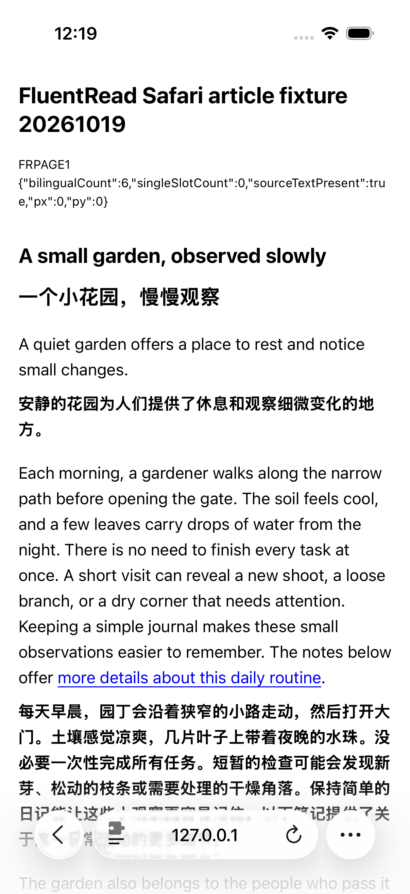
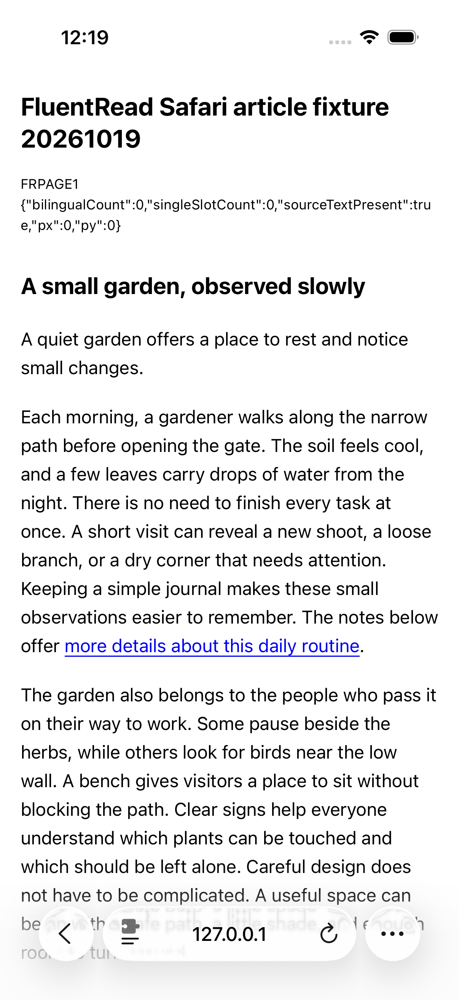

# Safari 已安装扩展的网页翻译与恢复

84a214351的新未签名包已安装至本任务专用iPhone 16 Pro／iOS26.2模拟器。通过本地英文文章的正常Safari扩展Popup，实际点击一次翻译，仅对edge.microsoft.com选择一次“允许1天”，随后重新打开Popup并点击一次还原；两次均以原生“完成”返回文章。没有填写密钥、切换服务或直接由驱动请求翻译商。

| 阶段 | 实际结果 |
| --- | --- |
| 初始文章 | 双语节点0，原文保留，滚动0/0 |
| 翻译并关闭Popup | 双语节点6，原文保留，滚动0/0；首屏标题和段落显示中文译文 |
| 再次打开Popup | 实际“恢复当前网页”Switch与可见“还原”按钮均已核对 |
| 还原并关闭Popup | 双语节点回到0，原文保留，滚动0/0；首屏中文消失、英文正文可见 |

Root与独立审查逐张查看了全部4张原始截图，包括微软单域权限提示、译文、还原入口和还原后的文章。下面两张为未修改原图。

正式XCTest为0PASS／1SKIP／0FAIL，运行36.778秒；测试在完整阶段与原图收集结束后主动SKIP，原始结果未改写为PASS。DOM读回与两人看图支持“这篇本地文章可见区域的翻译—恢复流程”，不证明全篇屏外内容、像素级还原、供应商具体响应／缓存未命中或权限持久化。

21条命令均退出0并完成进程组清理；前后App490文件、Web472文件全图一致，其他14台完整设备记录未变，15台最终关机，本地只读服务已关闭。配置保留、创建标签数仍UNKNOWN；URL通过固定openurl作测试setup，没有键入地址。此次没有操作划词卡、原生长按选词、物理设备，也不能替代反向滚动／关闭或全部移动端验收。摘要及完整证据pins见[verification.json](./verification.json)。未借鉴或修改参考项目。
