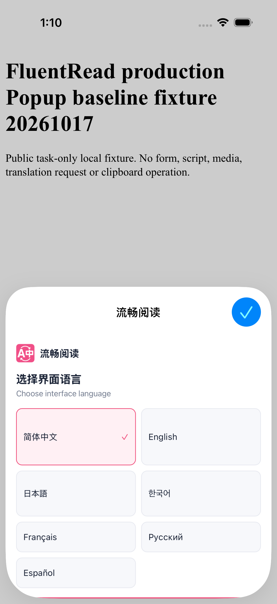
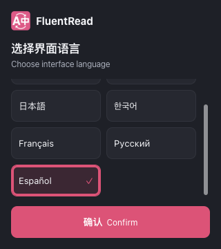

# Safari 首次语言选择页高度修复（2026-10-19）

专用 iOS Simulator 的真实 Safari Popup 复现了首次语言选择页裁切：语言列表占据首屏，确认按钮仅露出边缘。该次初始化正式结果为 0 通过、1 跳过、0 失败，未点击语言确认；配置实际持久化与保留仍未验证。截图证明首屏裁切，不能证明确认按钮永久不可达，也不能解释所有无障碍节点分类问题。

本次补修基于 `7867fbf6e1752156fc8be40f885ab8ef3e6ef297`。Safari 独立触摸 Popup 的高度随可见视口收缩，常规矮屏由语言列表滚动，确认按钮保留在列表外。高度不超过 280px 时整张卡片滚动，保留标题、七种语言和确认按钮的可达性。列表为覆盖式滚动条预留空间，焦点轮廓收进按钮；方向键和 Home/End 只滚动所属列表或 Popup，不滚动宿主页面。桌面自然高度和 embedded Popup 的平台边界保持原样，保存、失败重试及生命周期流程未改。

## 受控生产包验证

三份直接相关测试共 144 项通过、0 跳过，类型检查通过。Chrome、Firefox、Safari Web 生产构建及 Safari 资源校验通过。显式使用 Node 22 直接运行 Vite 后，userscript 为 2,100,290 字节，与此前基线产物摘要完全相同；原 2,101,100 字节上限及完整运行校验均保留。此前经 pnpm 的构建没有固定实际 Vite 运行时，产生多 1,000 字节的产物并失败，记录保留，没有为此调整预算或许可证。

隔离 Edge 在第二屏正常窗口运行，未抢前台焦点。使用实际 Chrome 生产包、实际 Vue DOM 和 CSS，仅控制 Safari root marker、触摸媒体条件及视口。七种尺寸全部通过：402×430、402×360、320×300、320×360 深色、844×280、390×180，以及桌面自然高度对照。全部 14 张原图已审阅。

常规矮屏中，确认按钮保持完整 46px、五点命中且位置稳定；七个语言选项均可通过键盘到达，宿主文档不滚动。极矮场景通过实际滚轮访问全部选项与确认按钮，焦点显露由所属 Popup 承担。桌面对照保留自然内容高度。两轮较早候选因覆盖式滚动条遮住右列按钮边缘而失败，保留在验证摘要中；最终增加边距后通过。

本轮没有点击确认或调用翻译服务，配置保存尝试为零；实际持久化仍未验证。显式源码和完整构建目录前后摘要一致，控制台无错误；所属浏览器关闭、临时 profile 删除，焦点观察器无违规并已停止。[机器可读摘要](./verification.json) 保留源码、构建、日志、原图摘要及失败边界。

## 后续原生验收

本轮七种尺寸属于受控 Chromium 证据。随后 a672e87 包已完成本地三平台编译、同包更新及文件核对；配置保留仍未知。真实 Safari 首次初始化正式 1 PASS，但资源包装因收尾监测错误退出 1，整轮不记为通过；服务抽屉键盘／旋转补验正式 1 PASS，相关进程和导出退出 0。横屏键盘极限下采用整卡滚动分别显露工具栏与结果行，二者不同时常驻。

另有独立页面恢复问题及后续真实 Safari 点击边界，见[Popup 页面恢复修复](../safari-popup-pageshow-recovery-20261019/acceptance.md)。此前版本的原生结果按版本保留；未开发者签名、发布或操作真机。未借鉴或修改参考仓库。
