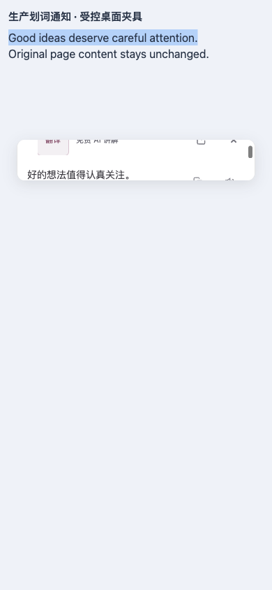
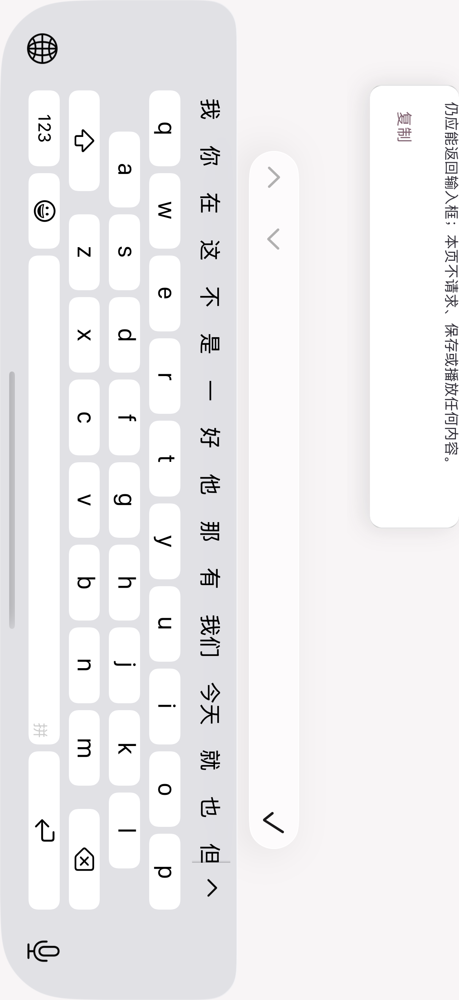
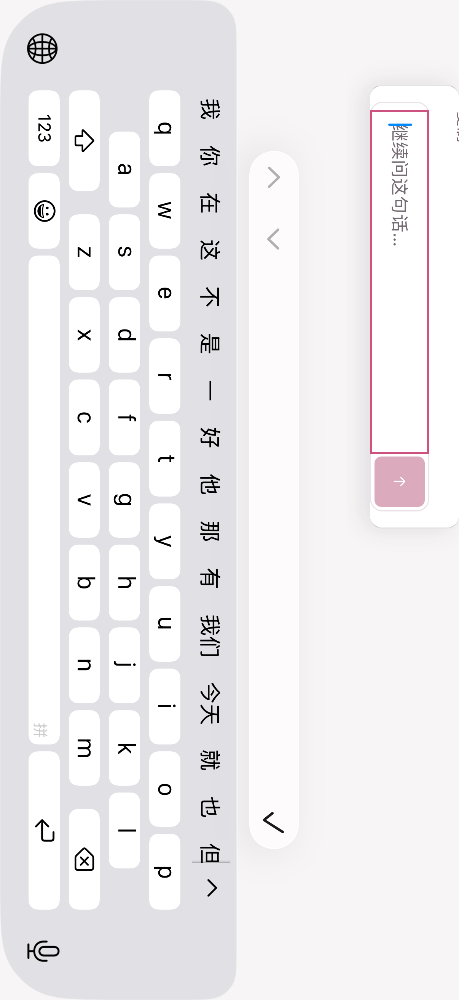
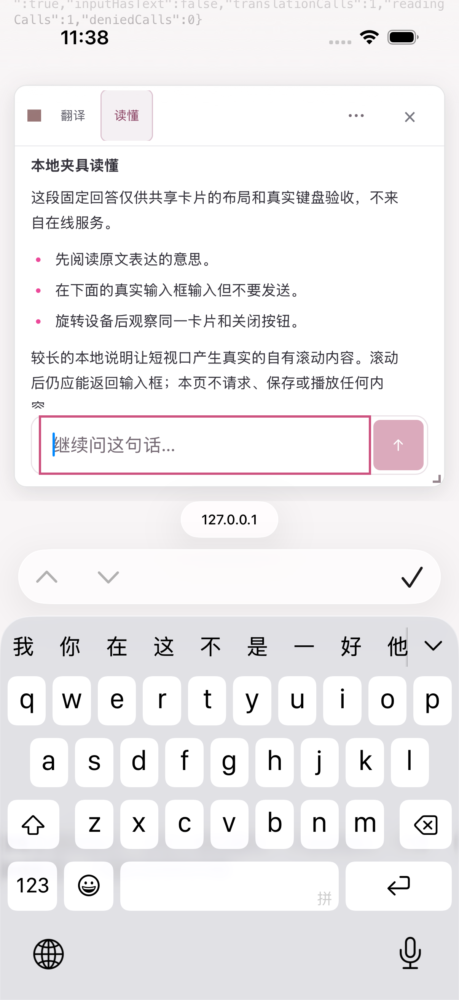
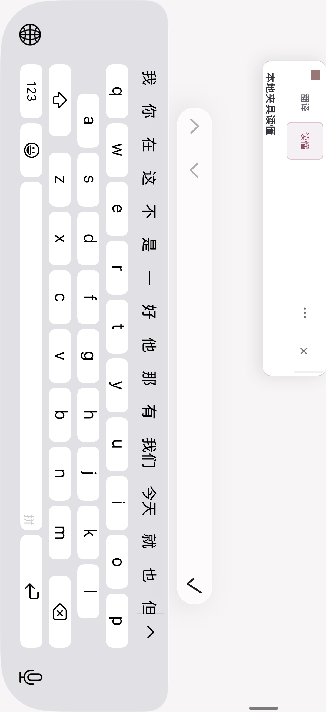

# 划词卡片在极矮可见视口下的滚动修复

旧卡片在 58px 的安全可见区域中仍保留上下各 12px 间距，实际外框仅 34px，44px 关闭按钮下缘被裁切；该位置的点击落到了宿主页面。专项单测与旧生产包均复现了问题。

修复后，空间不足时同一卡片使用整卡滚动并收紧顶栏间距。触摸滑动不再被标题拖动捕获；内容、输入、请求和语音归属保持，视口恢复后沿用原有手动位置与尺寸。普通桌面继续使用原有紧凑卡片。

## 实际生产包证据

隔离的 Edge 正常窗口位于第二屏，使用临时 profile、受控 Microsoft 响应和 DOM Range 选区。VisualViewport 数值是受控夹具，触摸滚动使用浏览器实际 CDP 输入；这些结果不代表原生软键盘、Safari、Firefox 或真实翻译服务验收。

| 场景 | 关闭按钮与滚动结果 |
| --- | --- |
| 390px 宽，58/44px 可见高度 | 44×44 关闭目标完整可见、五点命中；触摸滚到译文片段，再反向回到关闭入口 |
| 320px 宽，116px 高，深色 | 同上；整卡滚动与深色布局正常 |
| 320px 宽，32px 高，深色 | 保留 44px 目标和整卡滚动；32px 无法容纳完整关闭按钮，恢复正常视口后才实际点击关闭 |
| 390px 宽，280px 高 | 常规卡片与关闭命中正常 |
| 1280px 宽，精细指针 | 原有 26px 桌面关闭按钮与紧凑布局保持 |

六行均保持同一张卡片；四组矮视口恢复后几何与原卡一致。每行仅一次受控翻译请求，宿主正文及滚动保持，控制台错误、意外请求、自有浏览器激活和清理错误均为 0。Root 与独立审阅者均查看了全部 10 张原始截图。

旧包 58px 场景：

新包 58px 场景，以及实际触摸滚到正文后：

## 验证与边界

- 3 个测试文件实际执行 432 项，全部通过，无跳过；包括新增 8 项参数化或独立用例，覆盖同卡关闭、32/44/58px 与缩放、手动尺寸恢复、语音锁和阅读输入焦点。
- TypeScript/Vue 类型检查、Chrome／Firefox／Safari Web 构建、Safari 包装校验通过。
- 油猴产物 2,101,091B，通过未调整的 2,101,100B 上限；采用同一组件内的几何与样式等价去重，没有放宽预算。
- 真实浏览器 6 行通过，原始截图 10 张，资源清理完成。对应源码、产物和执行记录见 [verification.json](./verification.json)。

上述Edge证据本身不含原生Safari/软键盘或物理设备验收。早期微软单域权限流程使用的是旧703f4767a包；不能把它的原生证据计入这次新划词卡。后续新包与共享组件的补验分别记录如下。移动端与Safari长期目标仍未完成，PR不自动合并。本次未借鉴或修改参考项目。

## 同步主分支后的补验

本地提交 97e30a48c 保存本修复后，普通合并最新主线得到 2990c32e3；划词组件逐字节不变，主线的 PDF 入口、语言与共享翻译修改完整保留。8 个相关文件实际 791 项通过，类型及三个 Web 构建通过。新版生产 Chrome 包在隔离 Edge 重新执行同样 6 行，10 张原图均由 Root 和独立审查查看，焦点与资源清理闭合；证据仍限定于受控 VV 和响应，不代表新增 PDF 消费者或原生键盘。

同一 Safari Web 包完成了本地未签名 macOS／iOS Simulator／iPhoneOS 编译，10 个命令均退出0，472个 Web 文件在4处副本逐项匹配。该编译步骤没有启动、安装或进行原生 UI 验收。随后已仅更新专用 FD81 模拟器：12命令全部退出0，新App490文件与Web472文件在运行中和关机后均与编译源完整匹配，另外14台完整记录未变，15台最终Shutdown。未打开App或Safari、未操作UI、申请权限或再次点击翻译；配置保留仍UNKNOWN。最新标准与独立油猴包的构建差异、固定压缩器及未放宽的大小验证，见[构建记录](../userscript-build-portability-20261020/acceptance.md)。不同轮次的重复测试不累加为独立覆盖数。

## 阅读追问与 Safari 软键盘补验

阅读追问输入与工具栏现在稳定放在回答滚动区之外，回答较长或软键盘压缩空间时不再随回答区域被裁切；输入沿用同一个节点，保留正在编辑的内容、IME 和请求归属。

Safari 已明确切换方向、但 VisualViewport 宽度尚未更新时，卡片使用固定800ms旋转过渡窗口，避免把浏览器伴随的页面平移误当作用户主动滚动而关闭。可见视口变化后，仅在同一输入仍聚焦、卡片和原文仍匹配且短卡确有溢出时，一次滚动卡片自身显露输入；不重新聚焦、不滚动宿主页面，用户输入或手势会取消这次显露。卡片内部可信触摸另仅保留固定400ms、累计不超过2 CSS px的宿主尾移保护，普通页面滚动、外部操作和过期状态仍会关闭，不能据此宣称所有触摸手势都已通过。

本轮专项实际执行567项，全部通过，无跳过；类型检查、Chrome／Firefox／Safari Web构建、标准与独立油猴构建及各自校验共9步均退出0并完成清理。标准油猴产物为2,100,236B，仍通过未调整的2,101,100B上限。源码和产物的精确摘要见本次 [verification.json](./verification.json)；不同轮次的测试数不累加为独立覆盖。

| 实际场景 | 已证明的行为与限制 |
| --- | --- |
| Safari真实软键盘竖屏／横屏 | 共享源码夹具中输入44px完整可见；旋转后卡片与输入焦点保留 |
| 横屏短卡正向触摸 | 卡片scrollTop 304→314，宿主scrollY保持557，输入仍聚焦 |
| case17反向手势与关闭 | 未证明反向滚动进展；原图全黑且键盘／输入实时映射丢失，Close未执行；正式0 PASS／1 SKIP／0 FAIL |
| 两次页面setup失败 | 固定本地URL的openurl退出60，原生UI未执行；失败与清理记录保留 |
| 后续重复补验 | 正式0 PASS／1 SKIP／0 FAIL；正向再次304→314，宿主557、焦点保留；反向后映射仍不可用，无有效后读回，Close仍未执行 |
| case20完整操作路径 | 正式1 PASS／0 SKIP／0 FAIL；正向304→314、反向314→0，宿主保持557、输入焦点保持；原图确认关闭入口重新出现，实际Close一次后DOM卡片数为0 |

case17的原图已由Root查看，反向阶段黑图不证明完整绘制。case19再次确认横屏输入与正向卡片滚动，但一次反向手势后仍因键盘／输入实时映射不可用而停止；没有反向后的有效FRSEL1读回，不能判定产品主动关卡，原因仍UNKNOWN。case16和18没有进入UI。以上旧记录均保持原结果，不把资源退出0或正式SKIP当作功能PASS。

case20独立新轮次完成了反向回到关闭入口并关闭，Root与独立审阅者均实际查看4张原始PNG。78px整卡滚动模式中，输入和顶栏通过滚动分别到达；反向后的图显示完整导航与44px关闭目标，输入随卡片滚动离开可见区，不表示两者同时常驻。关闭结果由原生操作和严格DOM读回证明，没有关闭后的截图。

该轮功能用例通过，整个资源守卫仍退出1：末端前台样本从ChatGPT变为Google Chrome，触发POINT_FOCUS_CHANGED，随后原定PS检查未执行，变化原因UNKNOWN。20条已执行命令与服务进程均闭合，安装包完整映射未变，其他14台设备记录未变、15台最终关机。之后单独的只读PS补查退出0，确认当时无列出的SDK进程、原记录进程组均已消失；它不补写原轮次的PS样本，也不改变原退出1，不能称整轮焦点安全验收通过。

上述键盘原生运行使用本地共享生产组件源码夹具、程序化Range选区和受控本地翻译／阅读响应；case17和19运行时修复尚未安装进当时的2990扩展，case20已核对新安装84a包及共享源码一致，但实际操作仍发生在共享组件夹具。它不等同于生产扩展划词路径、原生长按选词、真实服务、物理设备或全部移动端验收。普通桌面和既有受控Edge证据保留各自范围。本次未借鉴或修改参考项目。

同一共享源码夹具的横屏输入对比（真实 Safari 软键盘，受控本地响应）：

## 新包编译、安装与网页翻译补验

新提交84a214351完成本地未签名macOS／iOS Simulator／iPhoneOS编译，10条命令均退出0，472个Web文件在四处副本逐项匹配。随后仅更新专用FD81一次，12条命令全部闭合；App490文件和Web472文件在启动与关机后均与新包完整匹配，其他14台完整设备记录未变，15台最终关机。配置保留仍UNKNOWN。

新安装扩展随后实际完成一次翻译、微软单域“允许1天”和恢复；DOM双语节点0→6→0，原始截图确认首屏中文译文出现并在还原后消失。详情及正式SKIP边界见[网页翻译与恢复记录](../safari-article-translation-restoration-20261020/acceptance.md)。这项补验没有验证划词卡的反向滚动或关闭。

随后同一84a安装包完成原生长按选词、图标开卡、实际关闭，以及Safari BFCache和30秒后台返回；Android Firefox也完成30秒后台往返、服务抽屉开关和返回阅读页。原始截图与各项范围见[安装版触摸和后台返回补验](../mobile-native-followthrough-20261021/acceptance.md)。安装版阅读追问键盘仍待验收，不能用新增开关卡证据替代。
