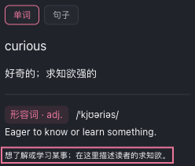
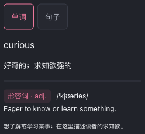
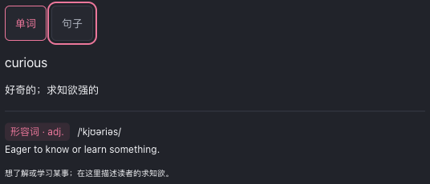

# 划词设置预览：触屏尺寸与静态描边验收

2026-10-21。修复划词设置中非交互说明文字始终出现焦点框的问题，并将“单词／句子”预览按钮的触屏目标从 44×25px 增至 52×44px，字号从 11px 增至 13px。鼠标模式保留 44×25px、11px 的紧凑布局。

## 实际生产页面

使用真实 Chrome MV3 production 包，在独立临时 Edge profile 内从正常中文首次引导进入清单声明的 Options 划词设置页。覆盖粗指针 320×700、844×500，各含浅色与深色；没有注入平台标记或直接写入配置。正常第二屏窗口在后台可见，持续焦点观察记录 0 次测试浏览器激活，测试后浏览器、观察器和临时 profile 均已关闭或清理。

| 检查 | 修复前 | 修复后 |
| --- | --- | --- |
| 未聚焦说明文字 | 四组均有 2px 实线描边 | 四组均为 none／0px |
| 触屏预览按钮 | 44×25px，11px 字号 | 四组均为 52×44px，13px 字号 |
| 键盘 Tab 到“句子” | 有焦点框 | 保留 2px 实线、3px 偏移 |
| 关闭触摸模拟后的细指针 | 原有紧凑样式 | 只读实测仍为 44×25px、11px |

一轮程序聚焦“单词”，再发送一次可信 Tab 到“句子”。两步分别记录；没有激活预览按钮，单词预览保持选中。没有输入、切换服务或请求翻译。四组固定预览均无横向溢出，说明文字全部位于预览内部。生产页面无未处理异常。

修复前和最终修复后各保存并查看全部 6 张原始预览截图；这里附其中 3 张，未编辑图片。完整计算样式、几何、生产包指纹与动作摘要见 [evidence.json](./evidence.json)。

修复前的窄屏深色预览：

修复后的窄屏深色预览：

修复后可信 Tab 聚焦“句子”：

## 真实组件行为回归

`selectionSettingsConsumer.test.ts` 实际编译、挂载本组件及 `FeatureEnableCard` 等布局子组件，通过 DOM 点击验证单词／句子预览往返、ARIA 状态、预览不改配置，以及关闭后重新开启时恢复原显示模式并同步兼容字段。4 个交互用例与 21 项验证归属检查通过；该组件已从冻结历史例外迁入真实行为验证。

这里的 DOM 事件由 linkedom 模拟，回答展示与学习设置子组件按公共 props 端口隔离。它补充组件事件和配置草稿的验证，不替代上面的生产浏览器尺寸、可信 Tab 或配置持久化验收。

## 验收边界

本页证明受控 Chromium 生产 Options 的这一处样式与焦点行为。它不替代 Safari／iOS／Android 真机、原生软键盘、实际供应商、安装更新保留或返回路径验收。源码只调整该组件 CSS；模板、事件和配置写入逻辑未变，未借鉴参考仓库。
