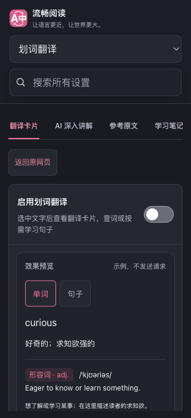
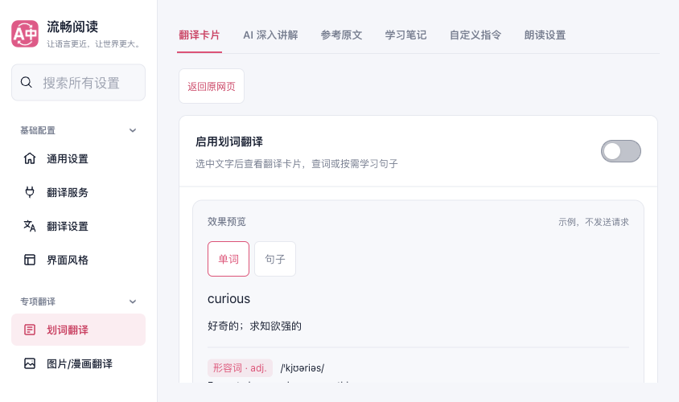
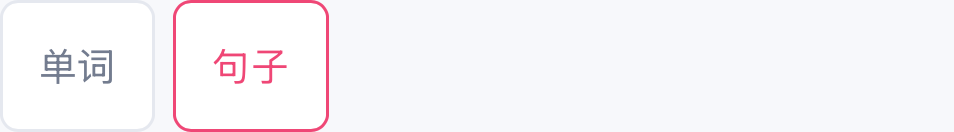

# 划词设置返回原网页验收（2026-10-21）

从 Popup 的“划词翻译 → 更多设置”进入独立设置页后，原先没有携带来源标签，也没有明确的返回入口。本轮复用既有来源返回组件，在划词设置顶部放置“返回原网页”，避免手机用户编辑设置后寻找浏览器标签。

## 行为与边界

- Popup 只把已绑定的来源数字 ID 交给划词设置，不传正文或来源 URL；其他普通分区导航保持原路径。
- 普通划词入口只展示返回按钮，不占用空间重复展示修复说明。触摸或不宽于 640px 时按钮至少 44px 高，宽屏细指针保留 32px。
- 明确点击后重新读取该标签并检查 ID 与网页协议，再激活其当前页面；不关闭设置页，不重建文章、不自动翻译。来源关闭、受限或暂不可读时显示本地提示。
- 组件捕获自己的 document/window，页面隐藏、pagehide、所属分区或配置身份切换、缓存停用及卸载使旧查询失效。重新显示允许新操作，旧结果不能释放新操作的忙碌状态。已提交的浏览器标签激活无法撤回。
- 默认服务修复调用保留原说明和错误文案；返回提示只属于当前可见上下文，不保证成功提示在以后重访时仍显示。

## 定向验证

使用 resource-safe 的 40%／单 worker／单并发通道串行运行，没有执行全量回归。

| 检查 | 实际结果 |
| --- | --- |
| 三个生命周期测试文件 | 首轮 247 项中 245 通过；两项新断言误将原有离页草稿交接视为新增写入。修正断言后 SettingsSections 整文件 65/65 通过；其他两文件首轮 182/182 通过。未把首轮改写为全通过。 |
| 类型、测试归属 | 最终类型检查通过；21/21 归属测试通过。测试审计通过，库存计数不等于执行用例数。 |
| 生产构建 | Chrome、Firefox、Safari Web、userscript 构建通过；userscript verifier 通过，产物 2,100,236 字节。 |
| 生产界面 | 隔离后台 Chromium，实际 manifest Popup 正常语言确认、划词抽屉、更多设置、新建 Options、返回原页。六组几何／媒体检查通过，六张原图经 Root 与独立审查查看。 |
| Safari 本地交付 | 新工程打包及 macOS、iOS Simulator、iPhoneOS arm64 三个 Release 未签名编译通过；8 命令／16 流关闭、回收且所属进程组消失。四份 Web 副本逐文件匹配全部 472 资源，源码完整映射前后一致。该步骤只验收编译。 |
| 专用模拟器安装与返回 | c54 冻结源码包单次更新后，完整 App 490 文件／Web 472 文件与构建一致。安装后的 case48 从 Popup 划词入口进入更多设置，再明确返回来源；官方 1PASS／0SKIP／0FAIL，8 AX／6 UI／0 PNG。来源同次原生 owner、固定正文、原文／滚动及无新增浮层回读通过；Root 与独立审查核验。 |
| 后续 CI 测试夹具修正 | c54 首轮 CI 发现两份旧测试夹具不兼容：首子节点断言及 timer-only Window。05fba 仅修测试；两个整文件 317 项及类型检查通过，05fba 的质量与文档 CI 均成功。未据此宣称原生包来自干净的 05fba 构建。 |

测试覆盖：来源固定与缺失、设置打开失败、迟到回调、返回忙碌及错误重试、无效协议、七语提示、配置／分区变化、初始隐藏、同一事件轮次隐藏与显示、pagehide/pageshow、缓存失活及监听清理。根组件原有的离页草稿补丁保持完整，返回动作不改配置。

## 生产 UI 与操作审查

六组为 320×700 与 844×500 触摸模式浅深色、844×500 细指针浅色只读、320×700 细指针深色。触摸模式返回与预览按钮均为 44px 高；宽屏细指针返回为 32px、预览为 25px。采样界面未观察到返回按钮重叠或横向溢出。原图底部仅显示当前视口内正文，未计入整页滚动验收。

一次可信返回点击激活了精确来源 ID／窗口／HTTP 地址。来源 HTML、文字、滚动位置、视口和文档 timeOrigin 全部保持；设置页原文档和标签集合保持。焦点观察为零激活，临时浏览器、profile、监听器和本地服务均已清理。

先前三次脚本停止记录保留：第一轮在更多设置前的联合几何门停止（具体条件未知，之后发现细指针错误套用了 44px 门槛）；第二轮误要求标签 API 必须给出可选 URL；第三轮六组几何及实际返回已通过，但误要求自动化中的设置页必须显示为 hidden。最终只修正脚本假设，没有因此修改产品或增加权限。

本地 Playwright 默认发送焦点仿真；[Chromium 的处理实现](https://chromium.googlesource.com/chromium/src.git/+/refs/heads/main/content/browser/devtools/protocol/emulation_handler.cc)会创建 stay_hidden=false 的捕获句柄。这与实际 visible 读数一致，但本轮没有独立测量其因果关系。因此保留原始 visible 读数，明确**不验收真实隐藏／恢复、BFCache 或原生生命周期**，没有伪造隐藏事件或更改焦点仿真。

以下是未经裁切或编辑的已知设置区原图，完整机器摘要见 [verification.json](./verification.json)。

## 未完成项

安装后的受控划词设置返回路径已由 case48 接受；它没有独立证明标签集合、文档 timeOrigin／无重载、配置／权限保留、长后台及驱逐。旧包 case45 的 0PASS／1SKIP／0FAIL 保留，不用它证明新包。

当前共享组件的真实键盘、横屏、卡片内部滚动和关闭另见[阅读追问键盘验收](../current-shared-reading-keyboard-20261021/acceptance.md)。该夹具使用程序化 Range 和固定本地回答，不等于安装扩展的正常长按选词链，也没有实际输入法组词或发送验收。

安装包 case53 已完成局部“单词→句子”检查：从正常 Popup 上滑一次，依次进入划词、更多设置并点击句子；官方 1PASS／0SKIP／0FAIL，9 AX／7 UI／1 张原始控制组截图。原生可访问性树中的固定原句与译文完整可见，单词解释已消失；两个切换按钮分别为 52×44pt、53×44pt。逻辑预览高 516pt，底部超出当前视口 48pt，长内容允许自然增高；本轮没有验收整张预览、语法表滚动或返回操作。截图只覆盖已知控制组，确认“句子”选中样式和按钮无重叠，不能据此证明原句与译文的实际像素。Root 与独立审查均逐项核对保存证据并查看原始截图；独立审查在上述限定范围内未发现阻断问题。

此前 case51 的入口准备停止与 case52 的组合预览检查停止均完整保留为 0PASS／1SKIP／0FAIL，没有改写为通过，也没有原样重试。case53 仅在点击句子后的局部检查中允许预览底部延伸，关键文本和控制组的完整可见性、44pt、owner 与时限要求仍保留；它不能反推 case52 的具体失败子条件。物理设备、YouTube 登录／机器人限制下的播放及 AVKit 系统全屏字幕仍另列缺口。

代码、实际 UI 和操作逻辑分别经过审查；未借鉴或修改参考项目。原始完整证据保留在本任务工作区的 settings-selection-source-return-followup-1 目录。Goal4 与 Issue #992 持续进行，PR 不自动合并。
