# 首次使用与自助诊断验收记录

基础提交：`fa431a845`。本次接入 popup、全文状态和服务设置修复路径，并将已有语言确认收敛为单屏；没有重做供应商选择算法或平台适配，也没有借用参考项目代码。生产逻辑与测试均在独立任务 worktree 中完成，未修改主检出。

## 当前界面：局部按钮下方的小状态入口

默认只在翻译区底栏右侧显示 **24×24px 状态图标**，与网站规则同行，不单独占一行。原因、服务检查、重试和报告入口只有用户打开浮层后才出现；浮层覆盖展示，不增加翻译主区高度。网页范围模块隐藏或独立排序时，状态入口仍唯一属于翻译区，不改变用户模块顺序。

键盘 Enter/Space 打开后进入可用的主要恢复操作；Escape/右上角关闭收起并归还入口焦点，外部点击和焦点离开收起且不抢焦点。“忽略提示”才移除诊断并回到翻译按钮。报告仍需再次明确预览，再明确导出。浮层限制在 Popup 与视口的可见交集，标题和关闭按钮在内部滚动时固定；外部滚动重新定位，入口真正离开可见区后收起。

本轮 **5 文件、233 项通过**，诊断模块 statements/branches/functions/lines 均 **100%**；TypeScript/Vue、Chrome/Firefox/userscript 生产构建、manifest/userscript 验证和登记审计通过。独立生产验收完成 **9 个核心场景、20 个七语原生宽度/深浅色布局样本、7 种语言的打开状态**；默认入口均 24×24px。实际 429 冷却、超时重试、明确报告下载、外部关闭、Tab 离开、键盘聚焦与忽略均通过。打开时主区 213.898px、外壳 429.898px 均不增长；报告滚到 123px 后关闭按钮仍可见。

短视口滚动另有独立通过记录：260px 受控视口、真实 windowY=300 与 shellY=11.5、外壳 560px/scrollHeight=637；内部滚动保持浮层与固定关闭入口。外部第一个滚轮事件仅将 shell 滚到顶部，入口仍可见，继续显示正确；第二次滚轮使 windowY=0、入口移到 518.55px，浮层收起且不抢焦点。原规则、布局和偏好恢复，两个临时 profile 与冻结包均确认清理。

合入最新 main 前的独立专项包摘要为 `e4d90cdb129b2f3626255dadb9807347c382406efe346185802cc6937570bb06`，474 文件。此前完整主流程基线为 `a22d8b17…72fea`、22 场景/19 图/3 次同 URL 刷新；e4 包相对它只增加固定标题 CSS 与展开后焦点时序修复（sync→post），由独立专项补验，不把两包表述为同一产物。首个焦点失败、中间包及单次滚轮夹具超时的原始报告都保留；核心报告 `coreOk=true/ok=false` 的最后失败仅为滚轮预设未达前置条件，后续独立滚动报告 `ok=true`，未篡改旧报告或算成一次全程通过。

| 默认的小状态入口 | 用户打开后才显示原因与恢复 | 明确预览/导出且关闭入口固定 |
| --- | --- | --- |
| 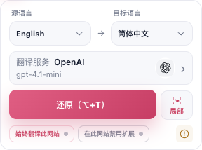 | 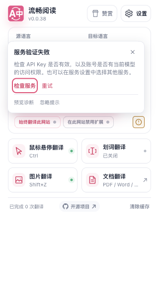 | 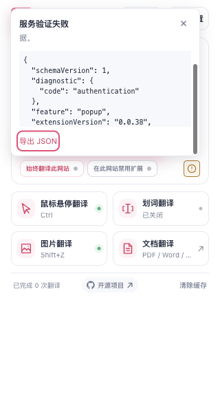 |

## 并行工程合入后的集成复验

任务分支合入 main `d3fb95d65`，保留其他工程的网页稳定性、翻译质量和专业文档实现。实际冲突仅涉及全文 runtime 的职责注释和测试登记尾部，双方内容均保留；Popup 和诊断浮层源文件没有被覆盖。

合入后集中专项 **30 文件、1,465 项通过**，本项 11 个业务模块逐文件四维覆盖率均 **100%**。随后补充动态网页集成组合，全文调度单文件 **400 项通过**（含 5 项新增）：失败 ShadowRoot 移除时清诊断且保留排队的活正文/保护变化；分片发现期间根移除或替换不续扫、不误报无正文；换路由后旧 401/429 迟到不复活故障，新候选成功后清空态。两组有重叠，不相加为独立总数。新增测试经独立只读审查，使用真实 runtime 与候选算法，受控观察器/供应商端口不冒充原生浏览器投递时序。

新生产包摘要 `a3d32ce60163f29e506fd34ade1686f784138b6249794a920ca84b409b9a92dc`，474 文件；**22 个主流程场景、19 张截图、七语和 3 次同 URL 刷新**重新通过。覆盖实际首译成功、401/404/429、离线/超时手动恢复、HTTP 取消、无正文、重复打开、设置修复与返回、明确预览/导出。默认仍是 24×24px 单一入口，无长说明和默认恢复按钮。Chrome/Firefox/userscript 生产构建、类型检查、manifest/userscript 验证通过；远端 CI 以 PR 当前精确 head 为准。

本轮使用隔离临时 profile、第二屏后台可见正常窗口，没有接触用户日常页面。冻结包运行前后摘要相同，profile 与副本均清理。详细本地证据在 `research/self-help-diagnostics-20261015/main-integration-verification/` 和 `ui-main-integration/`；e4 的键盘及短视口独立专项继续保留自己的包指纹，不声称在 a3 上重复执行。

| 新包默认状态 | 新包深色状态 |
| --- | --- |
| 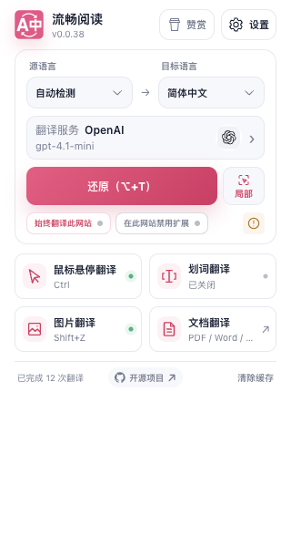 | 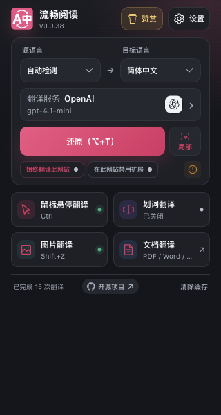 |

### 材料工程合入后的最终产物

随后合入 main `633baacd3`（材料学习工程）。本次仅组件归属与覆盖率登记冲突，保留双方登记；Popup、诊断、全文源码没有变化。针对新增 composition 接入重新验证 **7 文件、231 项**，后台消息、页面启停/BFCache、首启资源、设置导航及架构/归属均通过；前述 11 个本项模块源码未变，覆盖率证据保留原范围，不把其他工程的模块算作本项新增。

最终 **476 文件**包摘要 `a828650dacab446b967745b5c72f3036c69f7863a204545f657f6f39b3982a2f`：类型检查、Chrome/Firefox/userscript 构建、产物验证、登记审计通过；完整主流程再次 **22/22、19 图、七语、3 轮刷新通过**，19 张原图逐张审查，默认均为 24×24px，无控制台错误。主区效果见[最终包默认截图](./status-material-default.png)，深色图像与上表原图字节相同。

首次浏览器启动在创建测试页时检测到独占测试 Edge 短暂成为前台，焦点守卫中止，**0 测试场景、0 HTTP**；该次原始报告和空白截图保留，不能称全程没有焦点异常。清理确认后，只按原规则重试一次，未放宽守卫或手动抢焦点。成功轮前后前台均保持原应用，冻结包摘要不变，profile 与副本均清理。证据在 `material-integration-verification/`、`ui-material-integration/` 及其 `attempt-focus-guard-first-open/`；a3 和 e4 各自的证据继续保留，不混为同包重复验证。

## 此前的紧凑提示行（4fe8a42e4，保留历史）

错误默认采用无背景卡片、无边框的短提示行：简短原因、一个主要恢复入口、详情省略号与关闭按钮。长解释、其余恢复动作、诊断预览和导出只有用户明确展开后才出现。找不到正文时主入口为“检查范围”；凭据、模型与限流问题指向“检查服务”；网络和超时等可直接重试。收起或 Escape 会清除报告预览，Escape 将焦点还给详情按钮。

本轮集中专项 **3 文件、164 项通过**，诊断模块每文件四维覆盖率均 **100%**；TypeScript/Vue、Chrome/Firefox/userscript 构建、userscript 与 manifest 验证和测试登记审计通过。更新后的主生产 UI 专项保留 **22 场景、19 图、七语言与 3 次同 URL 刷新**，14 个默认错误采样均为 **24px** 高，未挂载长解释、次要操作与报告。明确预览/键盘导出、Escape 焦点、离线和超时重试、实际 HTTP 取消、设置检查与返回均通过。原生宽度按现有产品设定为中日韩 320px、英法俄西 380px，没有注入样式改变页面宽度。

独立紧凑界面专项另有 **9 场景、20 个原生宽度/浅深色布局样本、69 次真实按键、32 张截图**；全部默认提示仍为 24px，零页面/控制台错误。实际 429 冷却中收起再展开不重置等待，到期无自动请求，明确重试成功；超时后原 HTTP 关闭并可重试，未识别正文时不请求供应商。初始宽度夹具和预期 Popup 关闭的脚本错误保留失败证据，按精确 profile/PID 守护清理后重跑通过，未计入通过数。

本轮冻结 production 为 474 文件，摘要 `e15c6296a6091a6a9eb1db781e714b213a95dff2040d9cda9d69b2a554bd9e6c`，算法为排序的 `[相对路径, 原文件 SHA256]` JSON 的 SHA256。证据在 `compact-notice-verification/`、`ui-compact-notice/` 和 `compact-notice-ui/`；以下早期专项及截图继续保留原包与故障注入边界，当前默认错误外观以上方小状态入口为准。

| 此前默认主区（320px） | 此前深色提示 | 此前法语提示 |
| --- | --- | --- |
| 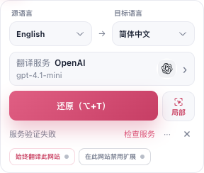 |  |  |

## 最终行为

- 首启直接展示七种原生语言名称和一个确认按钮，无欢迎、下一步、返回或 1.2 秒完成动画。确认前只预览，当前保存确认成功后立即一次交接主菜单。主操作旁只显示当前需要的简短提示；只有真实 `translated` 状态才提示译文就绪。
- 配置暂时读取失败时显示安全错误和“重新打开”，不会把水合默认值当成新用户。等待完成及异步资源准备后均检查既有配置保护状态，原保存记录不被覆盖。
- 内容识别、凭据、模型、限流、超时、离线、页面接入与配置保存确认失败使用统一安全分类。修复入口定位当前服务，返回时复验原标签页；凭据/权限、模型配置和普通配置故障都可一次明确点击“重试”，复用恢复原文后重新翻译的路径，主按钮继续正常还原。
- 报告默认不存在。用户预览时才创建白名单数据，明确导出后才下载；没有自动上传、剪贴板写入或持久化原始异常。
- 同 URL 刷新使用新文档令牌重新握手，拒绝旧文档广播和迟到回执。权威计数同步不会清掉正在查看的错误与报告。
- 设置页停止检测会停止 UI 等待和后续逐 Key 检测、忽略迟到结果；已经发到后台的当前连通性请求仍可自然结束，本次未新增后台中止协议。

## 验证范围与审查

定向依赖计划包含 140 个测试文件，初跑 131 个通过、9 个失败。逐项定位后修复了新增文案漏译、Popup 启动反馈测试夹具和后台安全错误响应断言；5 个涉及回环监听、受控子进程与进程身份检查的文件受沙箱限制，使用相同受控夹具重新执行。没有把这些失败称为基线问题，也没有运行全量 730 文件套件。

| 最终专项 | 结果 |
| --- | --- |
| 最终集中专项与业务模块覆盖率 | 最终 20 文件、823 项通过；11 个模块每文件 statements/branches/functions/lines 均 100%，包含 Options panel 路由测试（各定向专项存在重叠，不相加统计） |
| 受限环境失败文件及后台组装契约 | 6 文件、301 项通过 |
| Popup 实际模板与生命周期 | 本轮 53 项通过，包含诊断 Retry、网站修复 URL 与普通导航隔离；前期另覆盖刷新重新握手、七语首次提示切换 |
| Popup 授权/可见性夹具 | 60 + 31 项通过 |
| i18n 与返回网页实际组件 | 前期 90 + 35 项通过；返回组件 42 项已纳入集中专项，固定七语文案随本地代码发布 |
| 生产启动反馈 | 4 项实际操作通过：延迟加载、加载失败和两次手动恢复；语言、服务、翻译方向与主题均保留 |
| 配置读取与 Popup 挂载 | 37 项通过；`application.ts` 与 `mount.ts` 每文件四维覆盖率均 100%；另有 Popup 入口/嵌入契约 91 项通过 |
| 生产配置读取回执故障 | 5 项通过：真实读取回执延迟 5,048ms 后释放可直接挂载；失败显示安全错误，手动重开后原法语、Google、英译日及深色主题均保留 |
| 已有用户生产包替换后冷启动 | 7 项通过；同 profile、同路径、同扩展 ID，189 项非敏感偏好完全相同；诊断→原服务配置→原页面重试→恢复可用 |
| 限流与权限完整恢复 | 8 项通过；429 冷却中禁用、重开不重置截止时间、到期无自动请求、手动重试成功；Popup 与设置真实 403 均安全分类，内部页面不联系供应商 |
| 等待中退出与来源关闭 | 4 项通过；关闭 Popup 后完成翻译可重开恢复，同 URL 换文档保持新状态，原网页关闭后立即准确解释并可按指引重新开始；12 张图已复核 |
| 来源关闭分类与读取归属 | 179 项通过；`pageActions.ts` 和诊断模块每文件四维覆盖率均 100%，旧缺失/错误/有效读取不覆盖其间的新命令 |
| 服务修复焦点与生命周期 | 250 项关联用例通过（含当前服务目录 113 项）；默认导航直达当前连接按钮，禁用时定位当前标题；普通设置页、用户操作、隐藏、切换和迟到动作不抢焦点，新模块每文件四维覆盖率均 100% |
| 全程键盘与重复打开 | 当前 8cab 包 13 项、79 次真实键盘事件、16 张截图通过；单屏语言确认→翻译→本地报告导出→服务检查/重试→返回原网页→翻译与恢复，3 次关闭重开分别保留 error/translated/idle；普通入口与缺 Key 分支均无自动请求 |
| 直接影响的设置/提示词及架构契约 | 3 文件、100 项通过，无跨层或循环依赖变化 |
| 最终生产单屏首启、主流程与七语界面 | 22 个记录场景、19 张截图通过（包含 5 个附加语言预览场景）；同 URL 连续刷新 3 次，按产品原生 320/380px 宽度检查七语布局；仅本地 HTTP 夹具 |
| 更换服务后的完整恢复与迟到回执 | 7 项、11 张截图通过；A401→仅编辑 B 不改变默认也不请求→显式设 B 为默认并检测成功→旧 A 真实 callback 晚到不覆盖 B→返回同一原文档→一次诊断 Retry 得到 B200；重开保持 B 与译文 |
| 网站范围修复完整闭环 | 8 项、12 张截图通过；0c55 包实际入口定位 adaptation，顶部返回首屏可见，390px 浅深无溢出；真实表单修正 CSS 并保存后 idle/0 请求，6 次 Tab + Enter 返回同 tab/token，明确翻译才发 2 次本地成功请求；译后及还原重开均保留规则/偏好 |
| 单屏首启保存回执与菜单加载故障 | 3 项、7 张截图通过；发送前失败、真实成功 ACK 延迟 2,051ms、保存法语后实际主菜单 import 中断及显式重开；0 外部请求、0 pageerror，保留 1 条注入产生的预期 `ERR_FAILED` |
| 设置保存确认、返回关闭来源、取消及法语冷却 | 9 项、11 张截图通过；成功保存回执被替换/延迟时不检测，迟到成功不启动旧检测，显式重试才发送；关闭来源不转移到备用 tab，同文档取消后可再次翻译；法语 `Réessayer` 冷却中禁用且无额外请求 |
| 首启高度验证工具与生产复验 | 9 项几何检查、11 张截图通过；280–400px 受控宽度与深色完整显示，130px 短视口不锁高，真实保存等待与模块错误重开保留法语。另 5 个脚本只更新共用首启选择器并检查语法，没有运行无关功能套件 |
| userscript 资源发布契约 | 188 项配置测试通过；本地文案没有改变已固定公开提交中的资源文件名或内容 |
| 编译与产物 | 最终 compile、Chrome、Firefox、userscript、verifier、manifest、测试审计日志均 exit 0；本次文档更新后的 docs 构建通过 |

代码审查覆盖消息来源、顶层文档归属、失败 owner、结构化分类、冷却、导出白名单和资源清理。操作审查覆盖加载/失败/重试/取消/恢复/切换/卸载；发现并修复了计数同步清空诊断、迟到回执覆盖真实失败、旧文档状态归属和刷新握手问题。真实刷新追踪进一步暴露了页面 complete 早于内容组件就绪的竞态，最终通过未知文档广播触发只读复验及合并在途通知解决；相关回归防止握手快照覆盖较新的命令和完成状态。实际 UI 审查查看生产截图中的主操作、诊断报告、深色限流、390px 服务设置、启动反馈和键盘焦点，无横向溢出。

单屏首启独立审查确认，选择只改变本地预览，唯一持久化仍由确认动作调用共享 `setLanguage`。保存等待锁定全部控件；`saved` 回调后再次验证归属，防止父回调同步卸载后仍发出 `confirmed`。页面退出、缓存停用、props 变化及排队焦点门禁保留，没有随欢迎步骤一起删除生命周期保护。菜单加载共用 deferred import，缓存恢复只续接已确认且已保存的交接，旧事件不能重新挂载。

首启故障生产专项区分实际写入和回执：发送前拦截时，另一文档读到的权威语言仍为简中、setup=false，English 选择保留，可再次确认；真正保存成功后把原成功 callback 延迟 2,051ms 时，权威已为 en-US、setup=true，8 个按钮全部 disabled，重复点击没有第二个语言 patch。释放同一回执后实测 82ms 进入菜单，无固定 1,200ms 等待。法语保存成功后中断真实主菜单 import，安全反馈提供明确重开；解除故障并重开后直接进入法语主菜单，不重现语言选择。此例的 1 条 `net::ERR_FAILED` 是注入预期，未隐藏；外部和供应商请求均为 0。

设置保存专项同样只替换或延迟真实成功的 full-save 回执，不声称数据库写入失败。界面使用七语“无法确认配置已保存”，不再断言“配置尚未保存”，当前连接检测尚未发出。等待预算约 10 秒到期后，释放迟到成功回执并继续静置也不发检测，只有明确重试才发送。法语真实 HTTP429 后静置 1,221ms，`Réessayer` 仍 disabled，供应商请求总数保持 5；冷却期间没有英文 `Retry shortly` 标签。

最终修复专项为 `verification-repair-loop/final-strict.log`（20 文件、823 项），对应 `verification-repair-loop/coverage/coverage-summary.json` 的 11 个模块逐文件四项均为 100%；编译与产物检查见同目录 `final-checks.json` 及 `final-*` 日志。原 `verification-final/one-screen-strict.log` 的 18 文件、703 项日志与旧 strict 日志原样保留。当前主 UI、键盘及服务切换三组均采用同一份 474 文件冻结产物，按排序的 `[相对路径, 原文件 SHA256]` JSON 计算摘要为 `8cab45541c0aed7a00c1c54162a67aecf2c93b3e772cdffb88f66f9445d17692`；三组分别为 22/13/7 例，全部临时 profile 和冻结副本均清理。网站最终专项使用后续独立 474 文件产物 `0c556fa739d869f8a06b586e9bd1e4fd2a00e4626f39ee9439edc9ddfae01537`，唯一生产增量为 Options panel 白名单路由，不将两包表述为同包。

初始单屏、首启保存故障、设置保存/返回/取消及高度专项仍对应旧 475 文件产物 `aae58851a17a10c205b24ac1ecd3626f0690dc357fe6745244c0b3e4fe4b4efd`；旧主 UI 的 `76c85ab7…692f3` 是另一种路径/NUL 摘要算法，不代表另一包。早期配置读取、升级与来源关闭继续保留各自 package 和注入边界。远端 CI 以 PR 当前精确 head 为准，本地检查不替代最终 CI。

追加的实际配置读取故障注入发现并修复了一个根因：配置权威为保护旧记录，会在读取失败后以安全默认值结束 `configReady`，原 Popup 因而误挂载首次引导。修复从现有 `initialized` / `writesBlocked` 派生只读状态，未改变水合或持久化算法。独立代码审查确认调用点先等待 `configReady`，资源异步窗口结束后复验，退出先返回且清理监听。失败生产截图显示未挂载主应用或引导；解除回执故障后点击真正的“重新打开”按钮，原偏好恢复，0 页面及控制台错误。

等待中关闭来源网页的生产补验又发现空 URL 被当成浏览器内部页。现在确定标签页缺失时立即显示 `source-closed` 的七语指引，且没有刷新已不存在标签页的动作；一般读取错误仍保留准确分类。读取前记录状态版本，避免晚到的缺失、异常或有效标签页覆盖其间的新命令。独立代码审查及修复后生产复验确认新开所需网页再开 Popup 可以继续翻译，备用标签页未被触碰。

429 专项使用已有 `translationMaxRetries=0` 隔离 UI 的冷却逻辑：首次失败到关闭重开后的截止时间完全相同，到期后再等待 1.2 秒仍只有原来 1 次请求；明确重试才产生第 2 次成功请求。之后分别验证 Popup 和连接检测的真实 403，总请求序列为 `429 → 200 → 403 → 403`。这不表示 SDK 默认重试被禁用；默认有界重试的首轮证据单独保留。退出/同 URL 换文档专项中旧 HTTP 连接被浏览器取消，因此不把该场景称作迟到网络响应实际送达；迟到状态与回执归属另有针对性测试。

实际跨服务操作又发现原 A401 会话仍使主按钮显示还原，检查服务后没有直接重试入口，用户须先还原再翻译。现在凭据/权限、模型和普通配置诊断增加手动 Retry，使用既有控制器恢复并翻译。服务切换 7 例中，被动观察真实消息 callback：B 成功在 `1792058849730` 收到，随后 `1792058849987` 释放旧 A，`1792058849991` 才收到 A401；旧结果未覆盖 B。返回与重开均无自动请求，一次诊断 Retry 才把供应商请求由 3 次增加到 4 次，同一原文档显示 B 的合成译文。

网站修复的契约为 `#settings-sites` + `target=adaptation` + 数字 `returnTabId`，不携带来源 URL；普通设置导航不加来源。网站适配面板顶部紧凑返回条受当前视图、分区及配置/范围变化保护。生产观察发现 Options 原来只接受具体搜索目标而忽略 panel ID；白名单修复后的 `site-scope-ui/final-production` 已完成 8 例：桌面返回按钮位于首屏 y=96.68–128.68px，390px 浅/深色同样完整可见；真实 UI 保存 `article h1`/`article p` 后会话 idle 且无请求，6 次 Tab + Enter 返回同一原文档，明确翻译才发出 2 次本地成功请求，翻译后与还原后重开均保留规则和偏好。0 页面/控制台错误，守护关闭和 profile 清理确认；旧缺口及 8cab 定位失败证据仍保留。

全程键盘审查发现修复链接原本需要经过 74 次 Tab 才能抵达连接检查。现在有效修复链接首次进入时由产品聚焦当前服务检查按钮，额外 Tab 为 0；用户仍须明确按 Enter 才检测。实际 Chromium 还揭示了标题临时 `tabindex` 被移除会导致失焦，因此最终为当前服务标题及配置区域保留稳定的 `tabindex="-1"`，不加入普通 Tab 顺序。最终缺少必填 Key 的生产场景中，禁用检查按钮、标题焦点及后续 4 次 Tab 到空 Key 输入均正确，无自动请求；普通可见设置页也不触发修复聚焦。脚本没有调用 DOM `focus()`、点击或用 `locator.press()` 隐式聚焦来替代这条用户路径；设置初始焦点由生产代码产生。

生产 Edge 使用临时 profile、`macos-background-cdp`（`launchservices-no-foreground`）、后台可见第二屏正常窗口；启动时 `browserFrontmost: false`。本地 HTTP 夹具验证真实 401/404/429、断网、10 秒超时、重试成功及服务器确认取消请求关闭；另一次对公开合成文本的默认免费池在线烟测实际达到 `translated`。二者分开记录，未使用真实 API Key 或用户页面。

本轮主脚本实际参数为 `--extension`、`--artifacts`、`--locales true`、`--refresh-rounds 3`，没有启用 `--live-default`；此前默认免费池在线烟测单独保留。最终脚本对异步浏览器状态采用 Node 侧有界轮询，每轮先等待实际响应再判断。没有使用会提前结束等待的异步 `waitForFunction` predicate。结构化结果见 [evidence.json](./evidence.json)。

首轮远端 CI 在 8068 项中发现 1 项 userscript 资源 pin 回归：扩展专用文案进入全局词库后，新的语言文件名不属于已固定的公开提交。最终将这些文案归入本地诊断词库并撤回新增的未发布资源；保留原 pin 与契约测试，没有以更新期望值掩盖资源不存在的问题。

| 最终单屏首启（浅色） | 同一首屏（深色，原生 320px） |
| --- | --- |
| 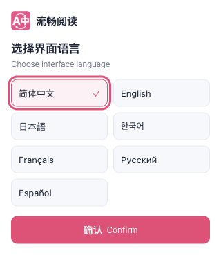 | 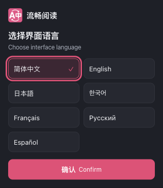 |

| 首启保存无法确认 | 语言保存后菜单资源失败 |
| --- | --- |
| 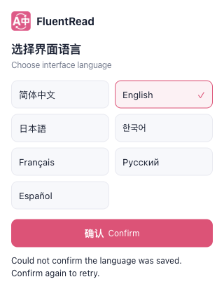 |  |

| 设置保存回执无法确认 | 法语冷却保持本地化重试标签 |
| --- | --- |
| 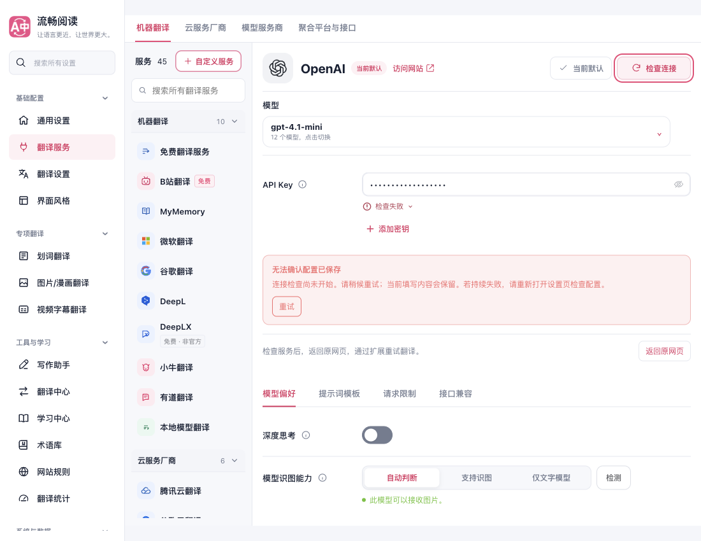 | 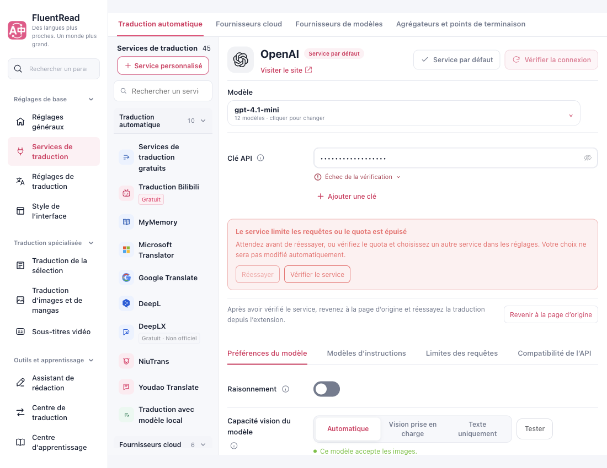 |

| 首次完成与本地报告 | 窄屏服务修复与深色错误 |
| --- | --- |
| 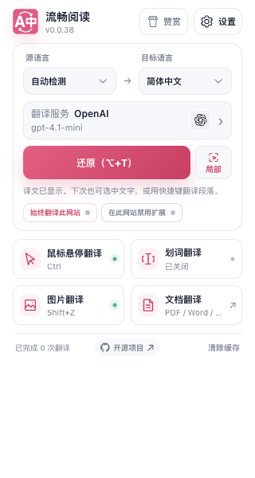 | 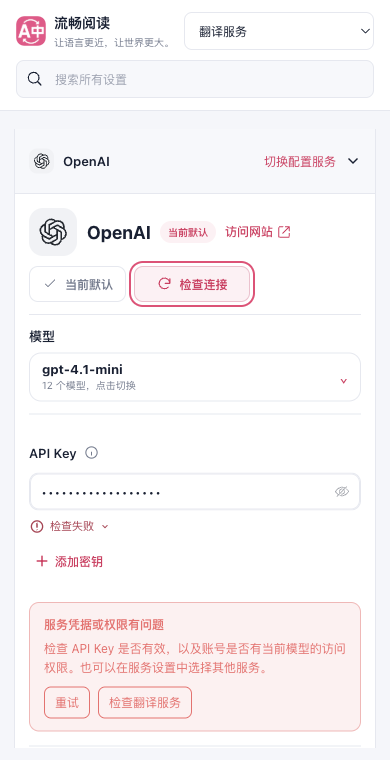 |
| 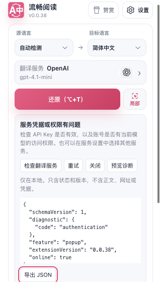 | 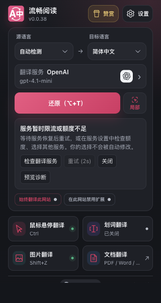 |
| 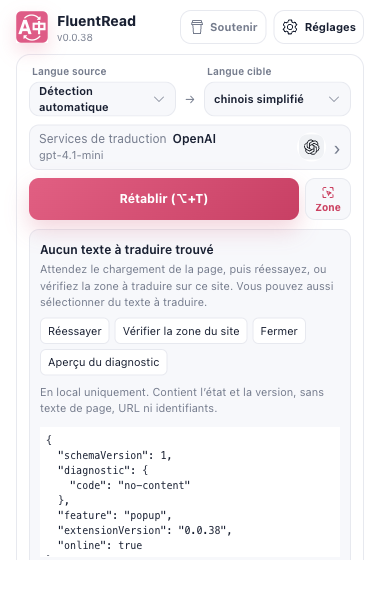 | 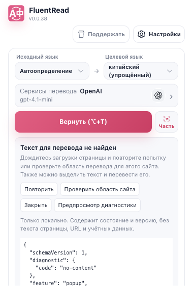 |

| 凭据故障可直接明确重试 | 旧 A 回执不覆盖当前 B |
| --- | --- |
| 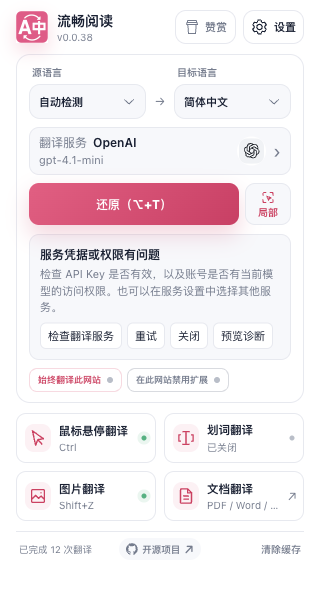 | 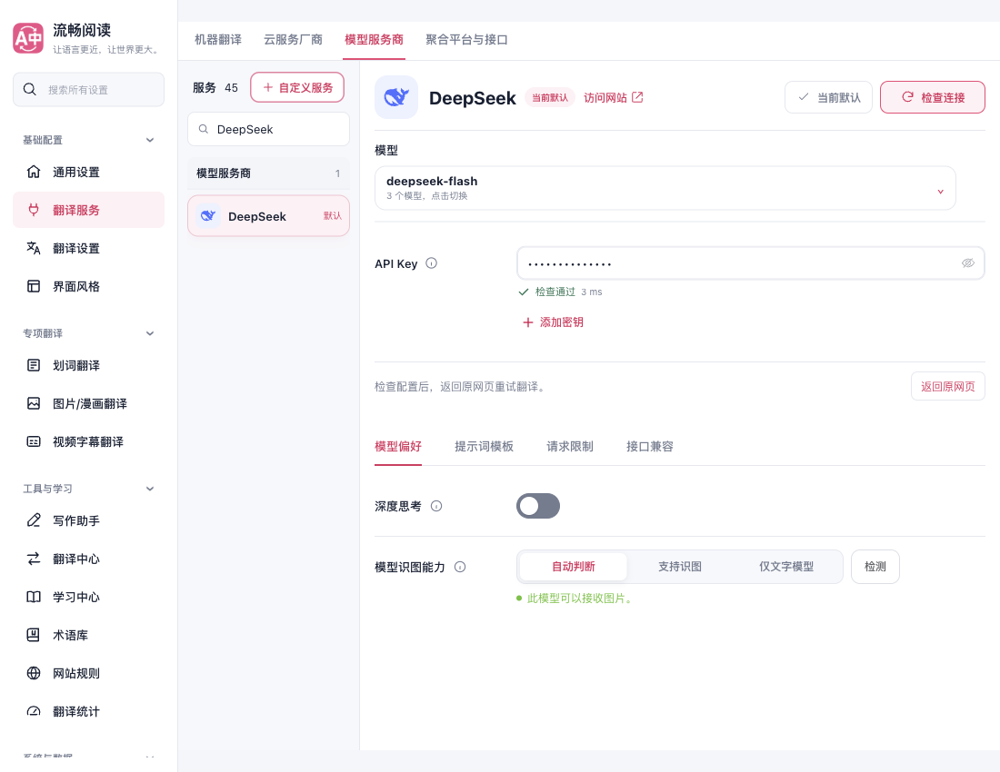 |

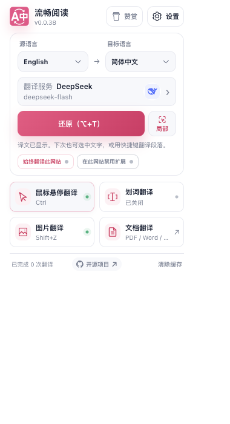

| 网站规则修复的窄屏返回入口 | 修正规则后明确翻译成功 |
| --- | --- |
| 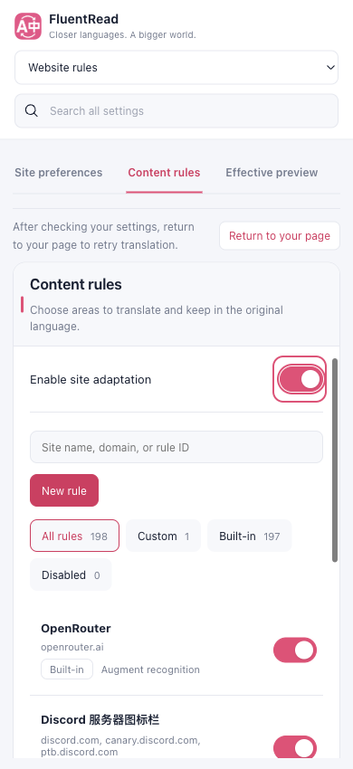 | 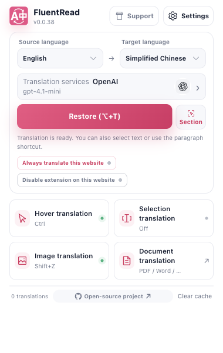 |

| 真实配置读取回执失败 | 显式重开后原偏好恢复 |
| --- | --- |
|  | 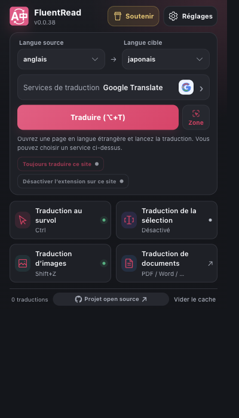 |

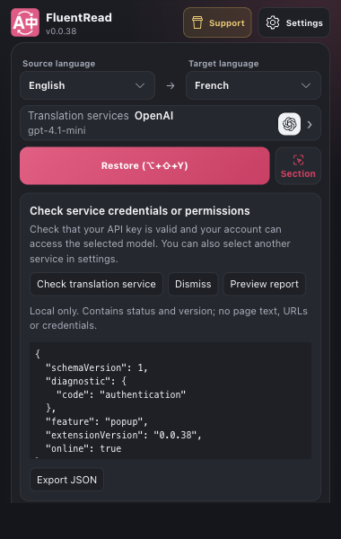

| 限流后重开继续原倒计时 | 原网页关闭后的准确下一步 |
| --- | --- |
| 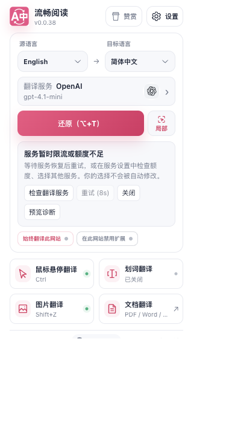 | 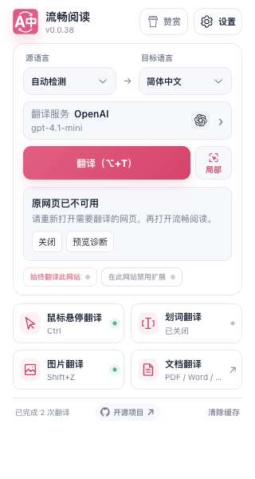 |

| 键盘直接检查当前服务 | 缺少必填凭据时的稳定焦点 |
| --- | --- |
| 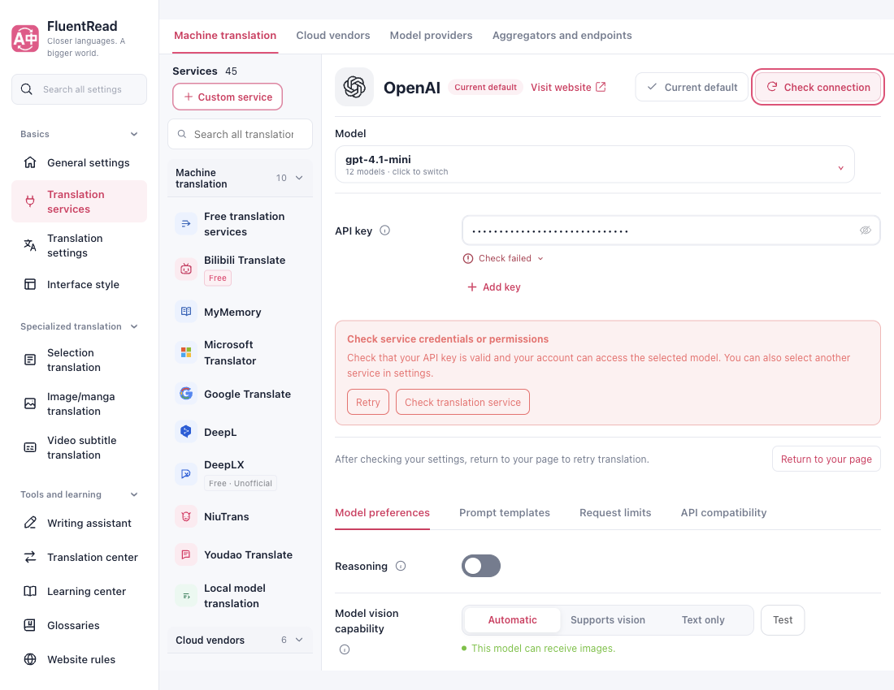 | 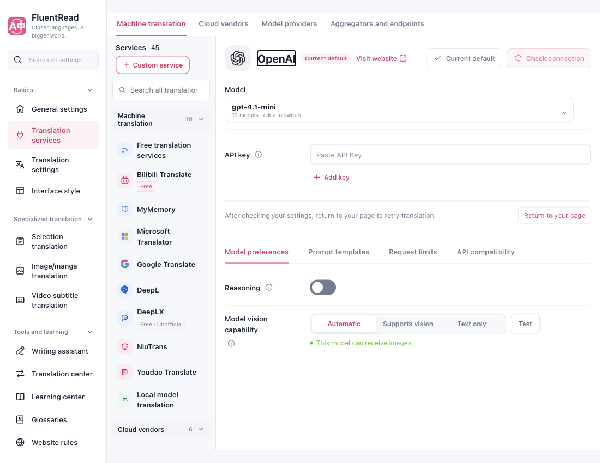 |

以上精选图只含产品 UI 和本地合成夹具，API Key 为掩码或空值；报告预览仅含允许的分类、版本与在线状态，没有真实凭据、用户正文、私有网址、请求头或异常原文。最新主 UI 与键盘图已替换对应旧图；早期配置读取、升级、启动与冷却证据保留原包摘要及各自故障边界。

完整本机证据位于工作区的 `research/self-help-diagnostics-20261015/` 目录。早期失败日志和受控清理记录一并保留；早期 UI 脚本下载/导航等待处理曾留下任务 profile，已按精确 profile 与进程身份核验关闭，随后修复等待和 finally 清理，后续成功轮次均确认关闭并删除自身 profile。

## 精确限制与集成边界

本次没有实际 Firefox/Safari 运行时、移动真机、物理触控板、屏幕阅读器或供应商跨地域/长期稳定性验收。首启保存、设置保存和配置读取专项分别注入 patch 发送前失败、成功回执延迟/替换与读取回执故障，不能相互替代，也不证明磁盘损坏恢复。模块加载与读取回执的迟缓/失败均已通过生产 UI 操作验证；读取专项只替换临时 Popup 的真实 `configStorageRead(local:config)` 回执，不破坏数据库。读取不可用时无法取得用户保存的界面语言，启动反馈使用浏览器/文档语言，恢复后继续使用原设置。

键盘专项在隔离浏览器扩展标签页中加载真实 `popup.html` 并固定来源标签页，覆盖应用内真实键盘事件；未覆盖浏览器工具栏打开快捷键或操作系统层 Tab 行为。

已有用户专项先在 `fa431a845` 生产包保存偏好，受控关闭自身浏览器，替换同路径生产包后用同 profile 和扩展 ID 冷启动，再逐字段比较及继续实际翻译。两包 manifest 版本均为 `0.0.38`，这验证代码替换后的持久化兼容，不代表商店分发或版本递增事件迁移。所有供应商异常与重试均为真实本地 HTTP 夹具，单独的默认免费池烟测除外。共享诊断、报告操作、首次提示、启动反馈和服务返回路径均支持现有七语言，未知语言回退英文。不能将当前证据表述为全平台或全部在线供应商验收。

共享冲突面为 `UiLanguageOnboarding.vue`、`PopupOnboarding.vue` 与相关首启测试脚本、`PopupApp.vue`、`pageActions.ts`、`mount.ts`、配置 `application.ts`/`store.ts` 的只读状态出口、全文 `runtime.ts`/`stateNotification.ts`、内容查询/菜单回执、`OptionsApp.vue` 的 panel 白名单路由、`SettingsSections.vue` 的网站面板及上下文、`ServiceConfiguration.vue`/`ServiceRepairReturn.vue`、`ServiceCatalog.vue` 的标题可聚焦属性、后台 `connectionTest.ts` 及测试归属清单。新增 `diagnostic` 与 `documentToken` 是既有消息的附加字段；使用既有配置保存与消息边界。诊断模块不读取配置、浏览器或正文，其他 feature 可通过相同白名单契约接入。
