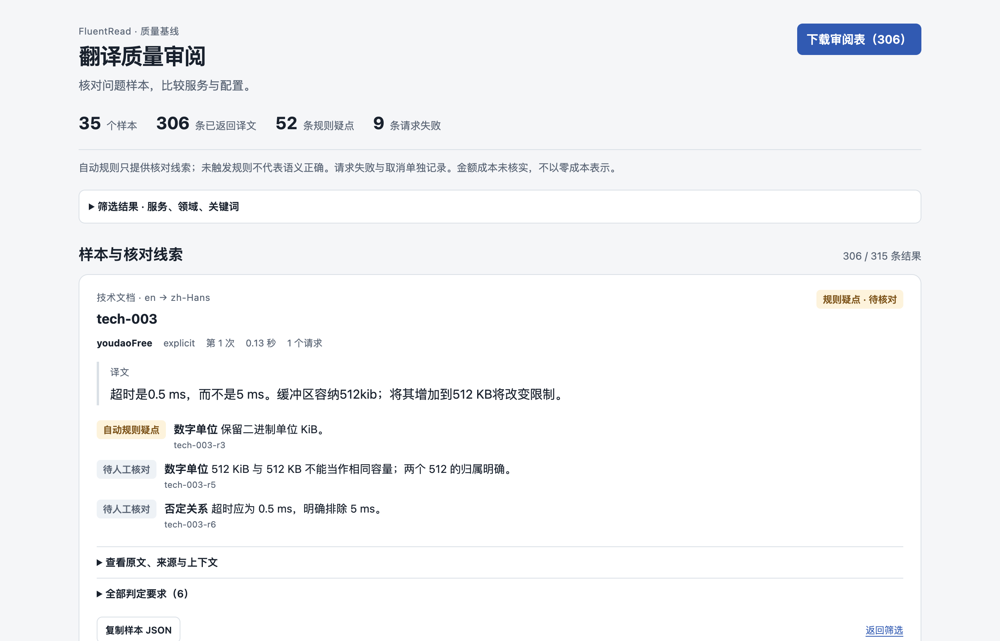
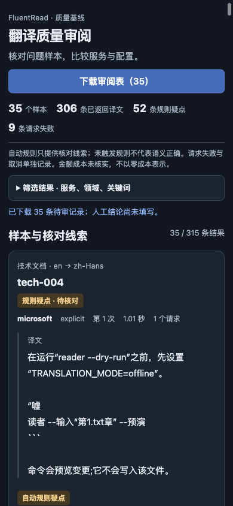

# 翻译质量基线与策略修复（2026-10-15）

本轮在 `fa431a845`（包含 PR #993）上建立可审计语料、在线 runner 和可离线打开的审阅报告，并修复两个由证据支持的生产问题。没有复制参考仓库代码，没有修改网页 DOM 或扩大产品界面。

## 样本、运行与证据

35 条合成基线样本覆盖技术文档、新闻、口语、论文和混合语言，含 138 条要求（40 条局部自动信号、98 条人工语义要求）。另有 3 条长文本压力样本和 7 条确定性分段探针。所有语料及译文的人工核对状态都是 pending；没有人工金标准，也没有把代理观察登记为人工判定。

| 运行 | 评测记录 | 实际 HTTP 请求 | 证据 |
| --- | ---: | ---: | --- |
| 修改前：35 样本 × 9 服务 | 315 | 443 | [原始基线](./translation-quality-20261015/baseline/report.json) |
| 修改后：相同样本和服务 | 315 | 435 | [原始记录](./translation-quality-20261015/candidate/report.json)、[审计订正视图](./translation-quality-20261015/candidate/audited-report.json) |
| 自动识别：12 个混合/歧义样本 × 9 服务 | 108 | 136 | [自动识别配置](./translation-quality-20261015/auto/report.json) |
| 长文本边界，修改前 / 后 | 9 / 9 | 18 / 18 | [修改前](./translation-quality-20261015/boundary-baseline/report.json)、[修改后](./translation-quality-20261015/boundary-candidate/report.json) |

另外保留 [10 服务、50 条探索记录](./translation-quality-20261015/live-baseline-smoke/report.json)。豆包匿名入口在该轮返回 403，此后暂缓剩余请求；未把它放进后续重复评测。MyMemory 的匿名额度较小，本轮没有使用。其他已登记但未选中的服务未作质量结论。

在线评测调用真实 production provider 源码，在 Node 中运行；浏览器后台、缓存、术语保护及 DOM 是另一层验收。代码块与路径的原始 adapter 信号不能直接当作浏览器 DOM 中受保护代码被破坏的证明。所有输入均来自本任务合成语料，不读取账号、日常浏览器或私有网页。

## 生产修复

1. **句子、词语及局部上下文边界。** 多个免费 adapter 原先默认按字符上限硬切。现在共享 wrapper 优先完整句界和词界，保留常见称谓/姓名首字母、数字单位和闭引号；必要时退回较早词界，无法装下的超长词仍保证有界推进。码点/UTF-16、FRTERM、换行、空白、取消和失败契约保留。`Dr. | Smith`、`3.5 | kg`、长词尾字母被切开的请求差异见 [确定性证据](./translation-quality-20261015/chunk-boundaries.json)。这改善同一请求内的局部上下文连续性，不等于新增跨段指代消解。
2. **依据已确认错误换线。** 有道在 `mixed-001` 等中英混合样本中忽略明确的 `en → zh-CHS`，返回 `fanyi.type=zh-CHS2en` 和英语。尝试额外指定 type 仍反向，因此修复为拒绝明确相反的已知方向，以 `freeFailure=request` 进入现有备用服务；这不冷却该服务的其他正常文本。缺失/未知 type 保持兼容，仍交给公共结果校验。见 [脱敏的真实响应与回退验证](./translation-quality-20261015/youdao-direction-evidence.json)。

真实长文本对照中，词霸的 `boundary-unit` 基线遗漏 `3.5 kg`，修改后返回“最大允许重量为 3.5 kg”；腾讯 `boundary-word` 中的半截 `hy` 消失，词霸恢复脑电图术语。每个样本前后均为 2 次请求。火山仍保留英文术语，腾讯重复校准句仍有压缩现象，均保留原文、输出及待审要求。短预算确定性压力用例中有两例增加 1 次请求，未隐去这一代价。以上是本轮观察，不能推出一般语义准确率或线上永久效果。

## 服务对照的解释

| 服务 | 修改前返回 / 35 | 修改后返回 / 35 | 前 / 后规则疑点 | 修改后中位耗时（成功返回） |
| --- | ---: | ---: | ---: | ---: |
| Microsoft | 35 | 35 | 7 / 7 | 497 ms |
| Google | 35 | 32 | 5 / 5 | 755 ms |
| 腾讯交互翻译 | 35 | 35 | 5 / 5 | 265 ms |
| 火山 | 34 | 33 | 8 / 7 | 244 ms |
| B站 | 35 | 35 | 1 / 1 | 375 ms |
| 有道 | 30 | 27 | 8 / 6 | 114 ms |
| 词霸 | 33 | 33 | 2 / 2 | 233 ms |
| 阿里 | 34 | 34 | 7 / 7 | 498 ms |
| ModernMT | 35 | 35 | 9 / 9 | 1466 ms |

有道新增的 3 次拒绝对应 `mixed-001/002/006` 的明确反向响应；生产免费池会继续备用服务。不能把“更少错误输出被接受”误读为总质量下降，也不能因疑点数量减少宣称所有语义改善。其他服务的可用性和文本变化可能来自在线漂移。没有据此更改全体默认服务权重。

Google 的 3 条失败没有收到 HTTP 头；早期观察器没有区分 adapter 自己的局部取消，误归为 response。原始记录完整保留，另生成带原始 SHA256 和逐条理由的审计订正视图，保守归为 unavailable，**不倒推未记录的确切超时原因**。当前工具已记录局部取消/评测截止/消费者取消，并有对应流式测试。初次探索和修改前报告早于工具快照归档；正式修改后与自动识别运行保存工具快照、源码/锁文件/adapter bundle 哈希。

自动识别配置没有稳定消除混合语言问题。部分中英入口会在本地判成同方向并拒绝请求；明确语言设置也不能保证所有服务理解混合文本。五条 `sourceContext` 在本轮匿名 adapter 中不被消费，故不宣称这次验证了跨段消歧收益。当前报告将它们作为可检查背景保留。

## UI、操作与验证

报告默认把疑点放在前面，筛选折叠以优先展示原文/译文核对内容；可切换服务、领域、配置和状态，搜索、展开来源与全部要求、复制样本，下载所有人工结论留空的审阅表。初版手机筛选占据过多空间，实际截图审查后改为紧凑布局。

生产 Chrome 产物在临时 Edge 131 profile、第二屏正常后台窗口中验证；`browserFrontmost=false`，未操作日常窗口。实际通过：长段落分块、已知有道反向响应 → 腾讯备用、翻译—恢复—再次翻译 `[1,0,1]`、相邻段落保持原状、错误重试、加载、在途取消、刷新和卸载；报告的空态、键盘、筛选切换、刷新恢复、导出和窄屏/深色亦通过。此层使用受控 HTTP，不能当作在线供应商质量。详见 [验收记录和产物哈希](./translation-quality-20261015/verification.json)。

定向验证包括：分段相关 7 文件 272 项、追加有道与关联 provider 的 3 文件 109 项，两个修改的生产模块四维覆盖率 100%；架构/文件头/免费池 4 文件 1215 项（其中 1026 项为文件头检查）；工具专项另记录于验收文件。各专项可能重叠，不相加为独立测试总数。Chrome、Firefox、油猴生产构建、清单、油猴 verifier、类型、测试登记和文档构建通过；没有运行无筛选全仓回归。

CLI 在 15 条成功记录后中断并恢复，前 15 条保持逐字相同，最终恰好 315 条唯一记录；在途取消另外由真实流测试和 production 浏览器验证。报告需要再生时使用 [维护者指南](../maintainers/translation-quality.md) 的离线 render 命令。

## 剩余验收与后续样本

- 语义、指代、否定作用域和术语合理性仍待实际人工核对。自动信号通过不能替代这一步。
- Firefox runtime、Safari、移动真机和屏幕阅读器未验收；本轮仅完成相应构建或明确标注的平台范围。
- 跨段上下文、付费/自定义配置、地区差异和服务长期漂移未完成在线验收。现有上下文、词库和个人修正没有重新包装为新交付。
- 路径/代码字面量、KiB 大小写、日英混合引用及未翻译的专业术语仍有风险信号。优先用报告导出逐条核对，再决定保护规则或服务策略；不以一种模型评分或一次服务排名直接改变默认行为。

共享集成点为 `freeTextChunks.ts`、`free-chinese-web.ts` 和 `tests/test-matrix.json`；公开 provider 签名保持兼容。PR #993 已在基线中，Issue #969 的 DOM 稳定性工作没有重做或覆盖。
