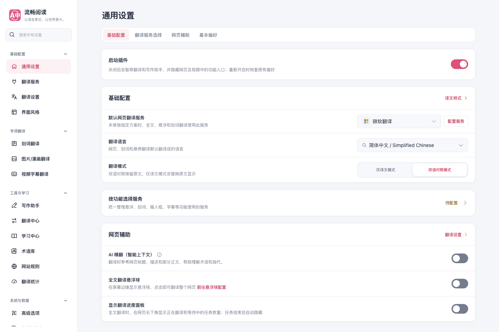
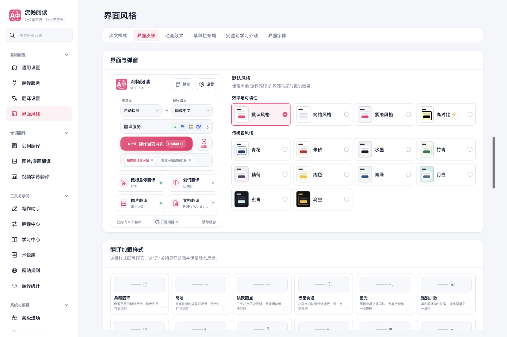
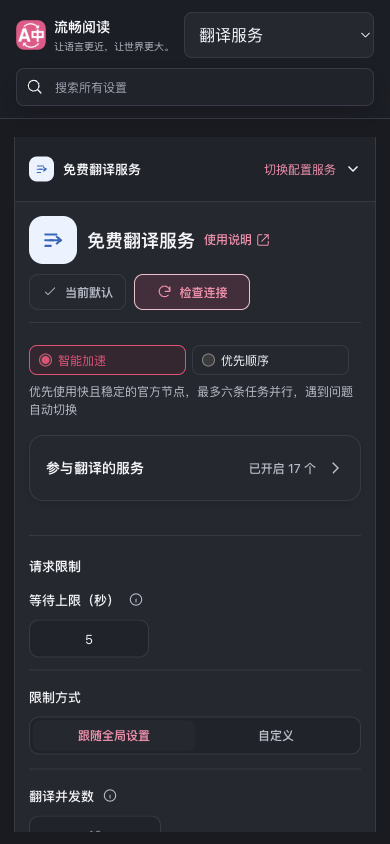
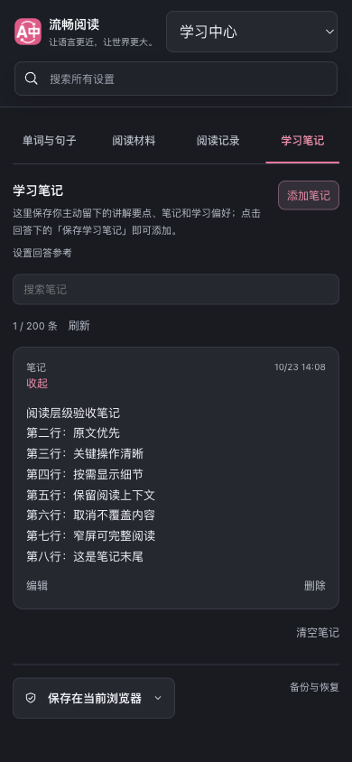
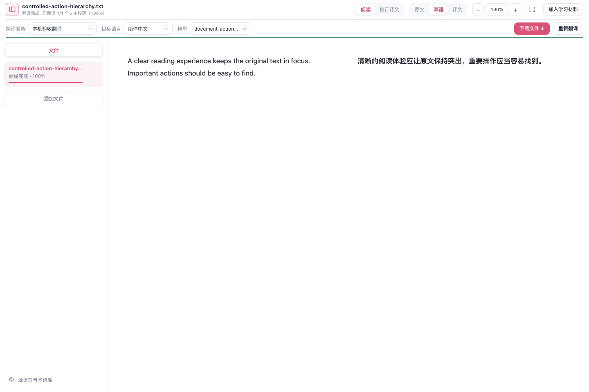
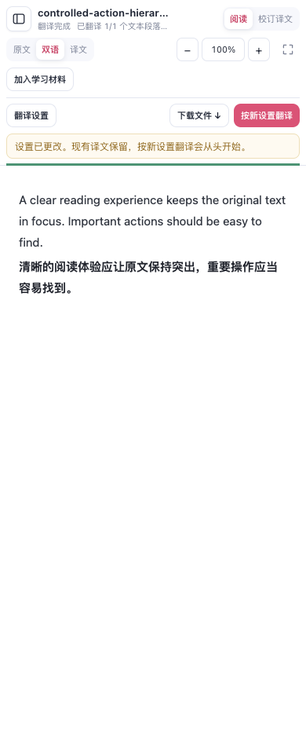
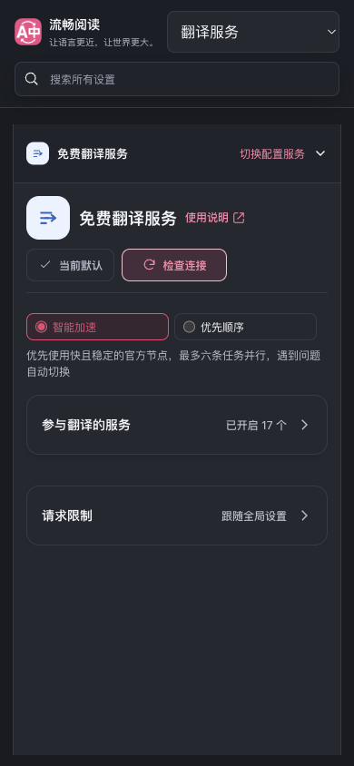
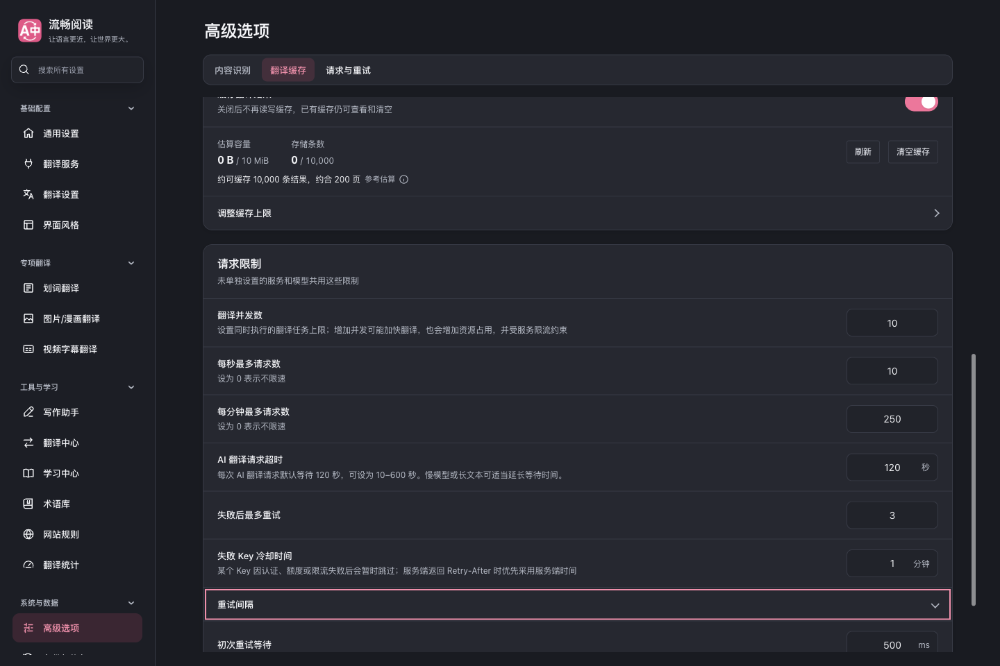
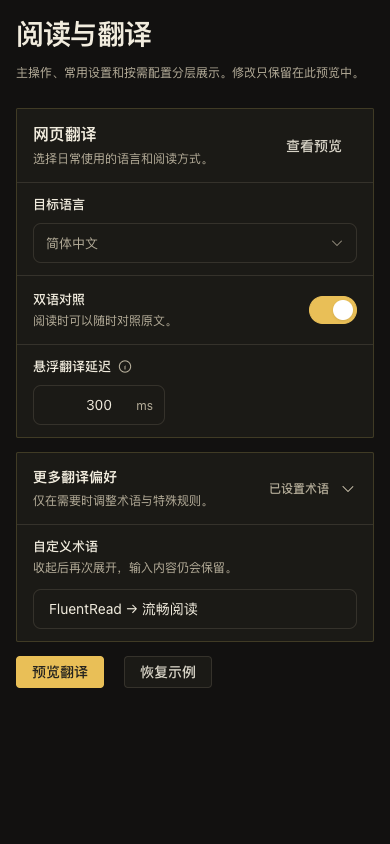

# UI 信息层级改版验收（2026-10-23）

保留流畅阅读的粉色品牌、原有皮肤和 Vue/WXT 架构，把主要操作、当前内容和必要状态放在优先位置。共享设置卡片统一边界、留白与标题，次要配置默认收起；设置搜索和锚点仍能展开并定位目标。

## 设计取舍与复用

- 设置页恢复清晰的桌面标题，统一卡片与页内导航。窄屏使用顶部分类选择器，避免重复标题占用正文高度。
- 通用设置保留默认服务、目标语言和显示方式；功能独立服务收进折叠卡片，缺凭据或已启用功能不可用时仍在摘要提醒。
- Popup 把悬浮、划词开关放在抽屉标题旁；移除重复快捷键和含义不明的服务数量。常用服务直接可见，更多服务按需展开，搜索仍覆盖完整目录。
- 皮肤以名称和配色缩略图供比较，只展示当前选择的说明。保留完整可访问名称、悬停说明及方向键、Home/End 操作。
- 免费服务先显示路由策略和启用数量，17 个节点的状态、权重及配置按需展开。收起后不读取权重、不保留轮询，展开才读取；关闭会取消请求并忽略晚到结果。
- 空材料库不显示无效筛选，管理与恢复入口仍可访问。长笔记原位展开全文，阅读与编辑分开；取消编辑保留原文和搜索条件。
- 文档翻译完成后以下载为主操作，保留重新翻译；更改翻译设置后重新突出翻译。确认框返回或 Esc 不提交请求，原结果仍可下载。

复用入口为 `SettingsGroup`、`SettingsItem`、新增的 `SettingsDisclosure` 和 `src/ui/styles/tokens.css`。折叠组件使用原生 details/summary，无额外观察器或轮询，内容始终挂载以保留草稿。规则与真实组件示例见[设计系统与组件预览](../../guide/design-system.md)。本轮没有复制或修改参考仓库代码。

移除了 3 条已无 UI 使用的旧翻译校正；已发布 userscript 远程语言包通过独立投影保留原字节和固定引用，避免破坏已有资源校验。

## 第一轮验收

| 专项 | 结果 | 已验证内容 |
| --- | --- | --- |
| 主 UI | 85 项，96 张截图 | 16 个设置分类的 1440/390px 浅深主题；皮肤另覆盖 820px、中英文及键盘选择；服务搜索、折叠揭示、Popup 快关与重开保存 |
| 服务与学习 | 7 组流程，23 张截图 | 17 个节点开关持久化、浏览服务不改默认、空材料恢复文件入口、八行笔记展开及取消编辑；1440/390px 浅深主题 |
| 文档 | 12 项，9 张截图 | 1440/900px 主次操作切换、两种取消重译方式、改变目标语言、实际双语 TXT 下载；只产生 1 次本机翻译请求 |

三项专项均使用生产扩展、临时 Edge profile 和第二块屏幕上的后台可见窗口，记录 `macos-background-cdp`、`launchservices-no-foreground`、`background-visible-no-focus`，前台 PID 未被测试浏览器占用。未发现页面错误或横向溢出，自有浏览器和 profile 均已清理。桌面各分类、窄屏深色及所有改动交互的代表截图已实际逐组查看。

组件与生命周期定向测试覆盖 Popup、设置搜索/锚点、皮肤键盘交互、服务目录、权重轮询取消、材料/笔记和文档动作；i18n 与 userscript 资源契约共 360 项通过。类型检查、Chrome/Firefox 构建、userscript 构建与校验、Storybook 类型/产物检查、文档构建与测试归类审计一并执行。

证据边界：这是本机 Edge 的生产扩展验收和确定性 TXT 夹具，不代表真实翻译供应商、全格式文档、Firefox/Safari 实机或物理移动设备已经验证；本轮未运行全量回归。

## 第二轮细节与交互验收

继续检查真实界面后，补齐了以下问题：

- 卡片外描边与圆角统一由 token 控制，保留乌金的 2px 棱角与金边、compact 的紧凑留白；折叠卡展开悬停时，摘要也保持相同顶角。
- 警告和错误改用主题语义色，玄青、乌金在浅色主题选择下仍使用适合其深背景的颜色。默认深色功能警告的实测对比度从 3.48:1 提高到 8.65:1；清理重复的功能名与 AI 限制文案。
- 仅有请求限制页签的服务默认收起低频表单，摘要显示跟随全局或自定义；展开、修改、收起、重开保留结果。AI 服务原有多页签继续使用原布局。
- 缓存上限和重试间隔的键盘焦点改为内收，不再被卡片裁剪。Storybook 与产品使用同一份设置控件样式，开关保留 44px 命中高度、48×28px 轨道，并补齐数值输入和帮助提示示例。
- 文档提示进入正常布局，持续状态不再覆盖正文首行。同一任务的告警按处理优先级显示；导入进度与取消、独立恢复反馈保留自己的位置。
- 窄屏首次打开文档时收起文件侧栏，展开后文件与添加入口正常可达，保留内部滚动与 200px 高度上限；工具栏保留翻译设置入口，侧栏不重复展示。窗口缩放不会重置用户选择，多文件或导入失败仍自动展开。
- 校订器首次打开才挂载，阅读时不构建隐藏编辑内容；同一文档往返保留搜索，换文件释放并重置。已有人工修订、保留修订和下载行为继续受生命周期用例保护。

| 专项 | 结果 | 已验证内容 |
| --- | --- | --- |
| 皮肤一致性 | 76 项，16 张截图 | 14 种皮肤 × 明暗 × 1440/390px；184 个实际警告/错误样本最低对比度 5.08:1；外描边、圆角、compact 对齐、Tab/Space 焦点 |
| 服务与学习 | 8 组流程，28 张截图 | 请求限制默认收起、自定义并发保存与重开、恢复全局；免费节点、材料、笔记既有交互；展开悬停顶角 |
| 文档 | 18 项，15 张截图 | 390px 首次导入及侧栏开合；1440/900/390px 提示和正文首行几何；按需校订及搜索保留；取消重译、实际双语下载；仅 1 次本机请求 |
| Storybook | 24 组交互，4 张截图 | Controls 和 Settings 两个实际示例，默认/compact/乌金 × 明暗 × 1440/390px；鼠标、Tab/Enter、数值输入、帮助、Esc、折叠草稿 |

第二轮共 126 项浏览器场景、63 张截图。各专项均使用稳定生产包；没有页面错误或前台焦点占用，独立浏览器和 profile 已清理。代表截图由主任务与独立复核者实际查看，像素疑点经计算样式和再次操作确认后修复。

定向测试分组：共享设置、皮肤、功能服务和本地化 330 项；服务配置/编辑/请求限制 127 项；三个实际文档应用宿主 185 项，共 642 项。另通过变更共享组件的严格覆盖率、类型检查、Chrome/Firefox 构建与 manifest、userscript 构建和校验、文档/Storybook 构建及测试归类审计。首次 CI 暴露的旧标题断言、共享组件插槽覆盖和 Vue 验证归属已同步修正；校订按需挂载后的旧测试也改为先经过真实校订入口。

后续 CI 暴露的 24 项失败已逐项修正并定向验证：原 `run-ui-consistency-test.cjs` 公共命令恢复原字节，本轮专项独立命名；提示词/原生合批测试渲染真实折叠组件；冻结的网站名单组件恢复原字节，错误色由共享设置样式覆盖。修正后 76 项皮肤与网站名单专项用新生产包重跑，184 个实际颜色样本通过；其余界面的组件与行为实现未变，保留上一次生产包的服务、学习、文档和 Storybook 证据。完整产物标识见同目录 `verification.json`。

性能结论仅限已验证的工作量变化：阅读时校订器 DOM 为 0，免费节点折叠时停止轮询，不新增窗口 resize 监听。没有以构建通过代替真实性能计时，也不宣称供应商、全格式文档或物理设备已验证。

## 复现

先运行 `pnpm build`。将下列 `PLAYWRIGHT_ROOT` 指向安装了 Playwright 的 node_modules，`ARTIFACTS` 指向仓库外的新证据目录。每次只运行一个浏览器专项。

```sh
node scripts/testing/run-ui-hierarchy-polish.cjs --extension-dir .output/chrome-mv3 --playwright-root "$PLAYWRIGHT_ROOT" --artifacts-dir "$ARTIFACTS/main" --audit-sections true
node scripts/testing/run-service-learning-hierarchy-test.cjs --extension-dir .output/chrome-mv3 --playwright-root "$PLAYWRIGHT_ROOT" --artifacts-dir "$ARTIFACTS/learning" --display secondary
node scripts/testing/run-document-action-hierarchy-test.cjs --extension-dir .output/chrome-mv3 --playwright-root "$PLAYWRIGHT_ROOT" --artifacts-dir "$ARTIFACTS/document" --display secondary --widths 1440,900,390
node scripts/testing/run-settings-skin-consistency-test.cjs --extension-dir .output/chrome-mv3 --playwright-root "$PLAYWRIGHT_ROOT" --artifacts-dir "$ARTIFACTS/consistency" --display secondary
# pnpm docs:build:site 后运行真实组件示例
node scripts/testing/run-storybook-controls-test.cjs --storybook-dir docs/.vitepress/dist/storybook --extension-dir .output/chrome-mv3 --playwright-root "$PLAYWRIGHT_ROOT" --artifacts-dir "$ARTIFACTS/storybook" --display secondary
```

脚本使用独立配置；文档专项启动本机 HTTP 翻译夹具，其他专项禁止外部服务请求。截图及结构化报告写入指定目录。

## 代表截图

通用设置先呈现默认选择与常用操作：



皮肤网格保留品牌差异，减少重复说明：



划词抽屉的开关与功能名称同行：


窄屏深色下，次要服务配置保持紧凑：



笔记展开后原位阅读，编辑仍是独立入口：



文档完成后突出下载，保留重新翻译：



第二轮的窄屏文档默认保留正文空间，提示位于正文上方：



低频服务配置按需展开，摘要仍可判断当前状态：



卡片内的键盘焦点完整可见：



组件预览复用生产样式，并保留乌金的卡片造型：


