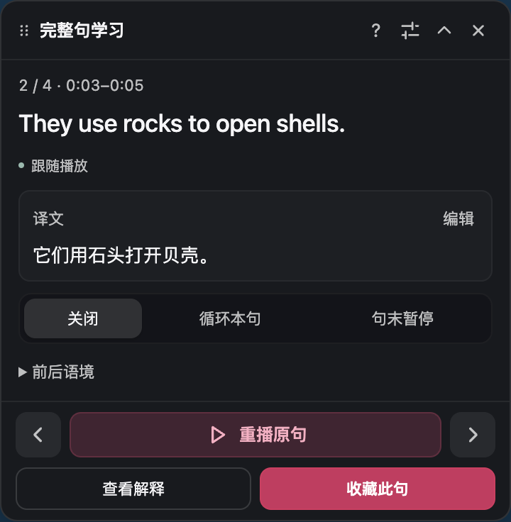
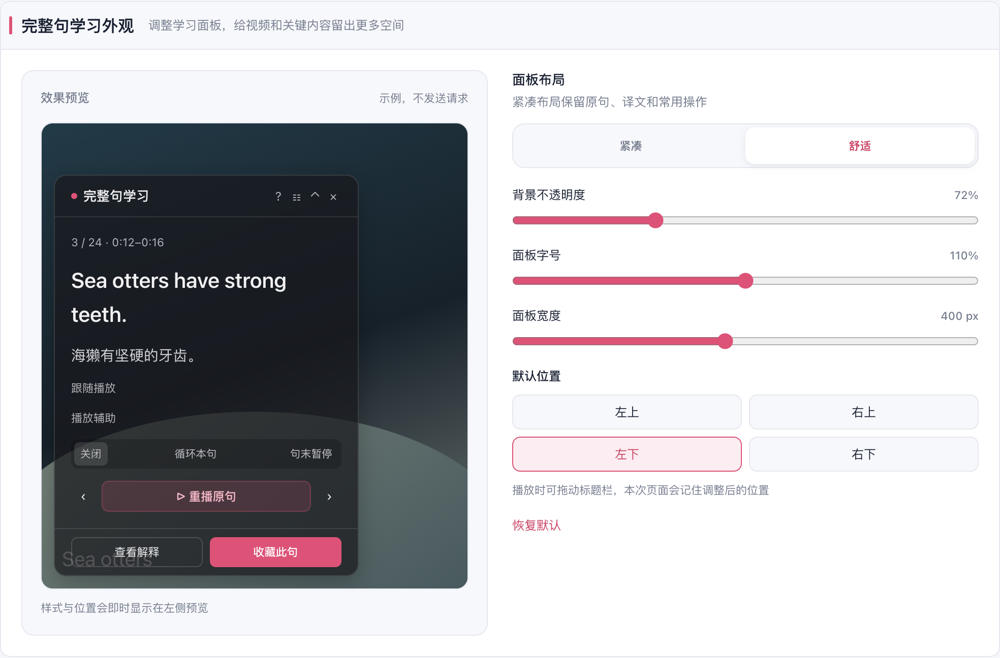

# 完整句学习可靠性与界面优化

本轮修复接续已合并的 #953。围绕用户报告的全屏丢失、快捷键冲突、播放辅助跳转和界面遮挡完成修改；底栏按最新反馈仅保留「查看解释」与「收藏此句」。

## 使用流程

字幕菜单提供带图标、强调色与箭头的「开始完整句学习」按钮。面板优先显示完整原句和译文，默认采用紧凑布局；上一句、重播原句、下一句固定放在正文下方、解释收藏上方，紧凑与舒适布局都能直接操作。顶部保留拖动、帮助、外观、收起和关闭，帮助说明在面板内展开。收藏成功后，正文中的保存提示才提供学习中心入口。

打开学习后，点击当前播放器仍可使用左右方向键换句、R 切换循环、Q 切换句末暂停。输入框、组合输入、修饰键及播放器外的页面操作保留原有行为。普通状态 Esc 关闭学习；菜单打开时优先关闭菜单；当前视频全屏时 Esc 调用浏览器退出全屏接口，同时保留原生默认行为，学习内容继续保留。

标题栏拖动手柄可以调整本页会话的位置。播放器尺寸变化或同一视频进入、退出全屏时，面板重定位并保留句子、草稿和播放辅助。界面中心新增独立的完整句学习分类，采用左侧预览、右侧调节布局，支持紧凑/舒适、透明度、字号、宽度和默认四角位置；面板标题栏可以直接跳到该分类。

## 修复依据与边界

- 字幕入口点击原来无条件关闭学习面板，造成打开显示菜单时丢失学习状态；移除这条关闭路径。
- 同一媒体的宿主变化原来可能销毁视图。现在由独立 session 和 placement 管理视图加载、宿主迁移、拖动、尺寸及销毁边界，拒绝迟到加载与脱离页面的目标。
- 学习快捷键在当前播放器范围内从 window capture 处理，避免继续传到站点 document 快捷键处理器；编辑文本及无关页面不拦截。该机制针对可复现的事件冲突，不声称已经确定用户真实 YouTube 加速的唯一根因。
- 播放辅助保留已有异步 seek 的归属，句尾只处理一次；已过期的固定句启用辅助不会自动跳回旧句。辅助不写 playbackRate，拖动原生进度解除辅助。
- 播放器监听过滤当前字幕、控件图标的内容更新，避免反复扫描和重绑；媒体 source/track、播放器结构、样式、可见性和自有控件移除仍会触发必要检查。普通已加载字幕不再依赖逐视频帧循环。
- 外观配置单独订阅，不因无关配置或样式变动取消译文请求、播放辅助或草稿。拖动位置只属于当前页面会话，默认位置才持久化。320×180 的实测发现旧留白会裁掉解释/收藏，紧凑布局改用随可用高度收缩的纵向留白，保留按钮尺寸，并优先露出原句；其余内容在正文内滚动查看。390×260 及更大尺寸保持原留白。

没有修改参考仓库，也没有引入跨仓库依赖。测试与性能页面使用确定性字幕和 HTTP 传输，不能代表真实翻译服务质量或完整 YouTube/X 网站的全部行为。

## 验证

| 范围 | 结果与证据 |
| --- | --- |
| 完整句学习专项 | 9 文件、82 用例通过；8 个登记模块语句/分支/函数/行覆盖率均为 100% |
| 播放器 locator/binding | 77 用例通过；两个模块四维覆盖率均为 100%，包含 source/track 与原生字幕/图标更新边界 |
| 菜单、组件与模块边界 | 58 用例通过，包含菜单 Esc 优先级和入口保留面板 |
| 配置和迁移 | config、configTransfer、组件相关 180 用例通过；设置、导航、配置 diff、运行时及源码头相关 1143 用例通过（与其他组有重叠，不累加） |
| 最新主分支集成 | 同步 `58ef643e85b5` 后，配置、迁移、学习键/菜单、后台导航、免费服务默认与 userscript 相关 11 文件、526 用例通过 |
| userscript 压缩与 adapter | 55 相关用例通过；新增 inlineCssPlugin 四维覆盖率均为 100% |
| 最终生产构建 | Chrome、Firefox、vue-tsc、扩展 manifest verifier、标准 userscript build + verifier 通过 |
| 最后修改复验 | 全屏 Esc 退出接口、重复事件和接口拒绝的 20 个组件用例通过；最后 CSS 只调整紧凑信息行上限，两套浏览器构建均包含该修改。产物及输入 SHA 见 [构建记录](./evidence/build-verification.json) |
| 标准 userscript 体积 | 最终 2,061,358 字节，现有预算 2,078,000；不可变最新主分支 `58ef643e85b5` 同锁基线 2,076,951 字节，减少 15,593 字节。只压缩 userscript 内联 CSS，复用既有同步解压；最终产物中四份 CSS 的精确还原验证见 [证据](./evidence/userscript-css-equivalence.json) |
| 浏览器与性能 | 同产物受控自然媒体性能、原有语义回归和新可靠性操作，见 [复验协议与结果](./performance-protocol.md) 及 evidence JSON |

补充检查保留已确认的基线问题：i18n 检查在不可变最新主分支 58ef 与候选中均为 57 通过、1 失败，失败列表是同一组 195 条既有校订文案，见 [逐项对照](./evidence/i18n-baseline-comparison.json)。docs:check 在 e96 与候选两侧均缺少 Storybook colors 页面链接；文档 build 通过。独立 userscript 的原 e96 基线还缺少已有 adapter 常量导出；只补同一行兼容导出后，基线 4,211,060 字节、候选 4,204,164 字节，均超过原有 3,600,000 预算。没有提升预算，也没有删除功能。独立版数值来自压缩子任务时点，不代替最终标准版验证。

最终 Chrome content-script SHA 为 `d1166be072fa5682add0e7d4c468f0f0b0a0e4258931ccc0f7481a3d5b696943`。同一产物的原有语义回归 80 项、新可靠性链 31 项、两种小播放器尺寸探针全部通过，页面异常和浏览器前台激活均为零，专属配置已清理。可靠性链包含可信按键触发真正退出全屏、菜单导航、宿主迁移、草稿和拖动位置保留、原生快捷键冲突、播放连续性与设置持久化。原生默认 Esc 的隔离环境限制与修复前失败另行保留，最终退出由产品按键处理调用浏览器接口完成。

下面是默认首次打开的真实面板截图：原句、译文在正文，上一句／重播／下一句固定在其下方，解释和收藏各占最底部一半。外观设置沿用左侧预览、右侧调节。截图来自确定性页面；Chrome/Edge 受控验证不等于 Firefox 运行时、真实网站账号、全部设备或商店发布验证。

